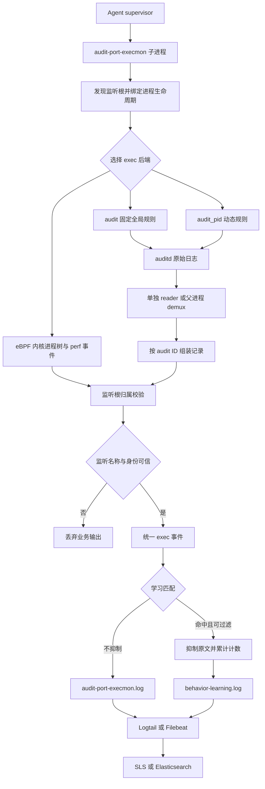
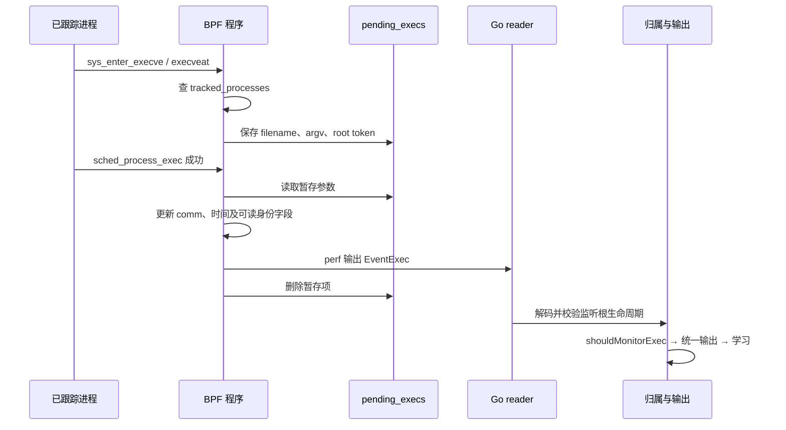
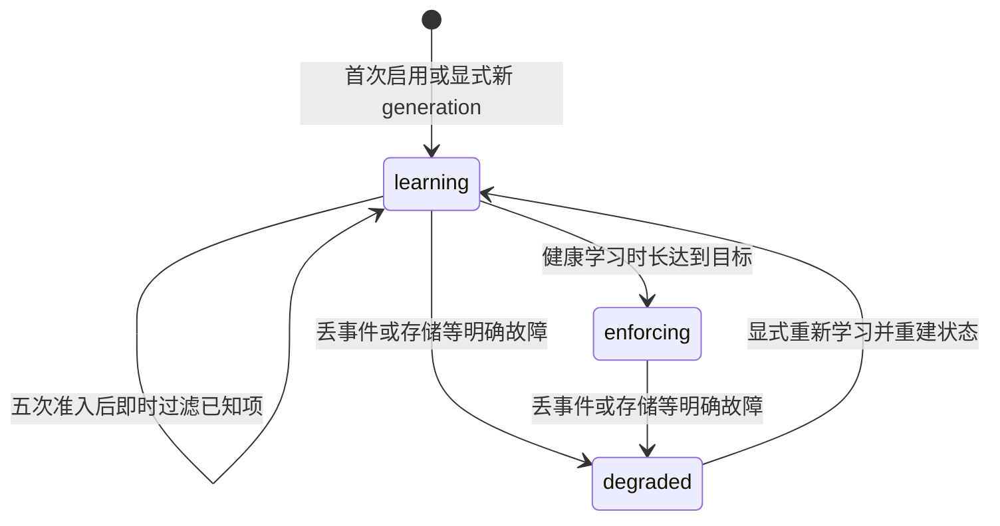

# SecWeaver Agent exec 事件全链路处理分析

分析日期：2026-10-12。分析对象：SecWeaver Community 当前工作区中的 Agent **0.3.95**。

本报告解释 exec 如何产生、被采集、关联到监听服务、经过学习过滤，最后落盘并交给日志采集器上传。重点是此前讨论的 Linux `listener_process` 场景；Windows 的差异在第 13 节说明。

这是源码分析与本地隔离验证报告。基线 HEAD 为 `428557704fbcd58ed20dc71e0310e25d58b900e0`，工作区包含未提交的 0.3.95 修改，因此 **HEAD 本身不能完整重现本报告基线**。此次没有修改 Agent 实现、配置或版本，没有部署，也没有读取生产主机和 SLS 的新数据。报告中的“已复现”指使用真实 Go 函数、合成进程身份与内存输入输出完成的本地验证，不代表已在生产 Linux 内核复现。

## 阅读导航

- 第 1—3 节：整体架构、启动过程、监听根的发现。
- 第 4—7 节：三种后端、内核事件、audit 组装及进程归属。
- 第 8—10 节：学习过滤、事件字段、落盘与上传。
- 第 11—13 节：并发与资源边界、故障处理、Windows 差异。
- 第 14—16 节：具体问题、排查流程与验证记录。

## 1. 总体结论与职责边界

当前 Linux exec 设计是**以对外 TCP 监听进程为根的进程执行采集器，加上基于历史重复行为的输出过滤器**。它本身不判定某条命令是否恶意，也不是系统中所有进程的完整执行审计。

核心结论：

1. **`listener_process` 表示被监控的服务根。** `pid_name` / `exe` / `command` 表示本次执行进程及其命令；不能把两者混成“监听服务执行了同名程序”。
2. **默认先尝试 eBPF，启动不可用时回退固定规则 audit。** `audit_pid` 是显式兼容路径，开销、覆盖和失败事件语义都与其他后端不同。
3. **归属必须先成立，才允许输出。** 无监听名称、名称为 `unknown`，或归属状态不确定的 Linux 事件，不能进入业务日志和学习队列。这不等于删除内核或 auditd 的原始记录。
4. **当前 Linux exec 学习使用四字段文本匹配。** 一小时内五次独立事件即可入名单，第五次开始过滤；它不是“学习 24 小时以后才过滤”，也不是风险判定白名单。
5. **本地输出和上传是两个系统边界。** Agent 写 JSONL；SaaS 常见路径由 Logtail/LoongCollector 上传，ES 示例由 Filebeat 上传。Agent 的学习正常不证明 SLS 已入库。
6. **仍有可确认的问题。** 包括 audit 的 exec 端口过滤遗漏、关闭后代跟踪时的行为不一致、eBPF 参数截断/空白处理、命令指纹歧义，以及部分输出失败没有传递到监督重启链路。见第 14 节。

### 1.1 名词与数据对象

| 对象 | 作用 | 不能据此推断的内容 |
| --- | --- | --- |
| listener | 发现的监听 PID、名称、地址、端口，内部绑定根启动时间 | 某条 exec 一定由该端口的一次远程请求触发 |
| tracked process | 在监听根或其后代范围内的进程 | 仅凭同容器、同可执行文件就属于同服务 |
| fork/clone | 延伸进程归属关系的控制事件 | 每个 fork 都会成为一条对外 exec 日志 |
| exec | 执行映像/命令的事件；audit 还可能包含失败尝试 | 必然创建新 PID，或必然执行成功 |
| attribution | 把事件归到具体监听根的证据判断 | 只要命中了 audit key 就证明归属可靠 |
| behavior baseline | 重复四字段行为的本机名单 | 命令安全、经过人工审批或二进制可信 |
| event output | 学习未抑制的 JSONL 原文 | 等同于所有内核事件数量 |
| behavior summary | 已知行为的观测/抑制计数与学习状态 | 可以恢复每次被过滤事件的完整命令、PID 和时间 |

### 1.2 代码职责图



阅读入口：[模块入口 main.go](../../src/tools/secweaver-agent/pkg/auditportexecmon/main.go)，[监督器 supervisor.go](../../src/tools/secweaver-agent/supervisor.go)，[语义输出 learning.go](../../src/tools/secweaver-agent/pkg/auditportexecmon/learning.go)。

## 2. 启动与生命周期：开始接收事件之前做什么

`auditportexecmon.Main()` 从第 24 行开始组织生命周期，主要顺序如下：

1. 解析参数和配置。`-learning-status` 提前进入只读状态查询，不安装 audit 规则。
2. 检查 Linux、root、auditctl、audit 日志目录及 audit 状态。
3. 打开事件输出，准备 enterprise/host 身份与输出目录。
4. 解析监听端口、exec/connect/file 开关、规则预算、压力策略和后端参数。
5. 发现对外 TCP 监听服务，排除 Agent 自身进程分支。没有可监控监听服务时退出，由外层监督器按策略处理。
6. 选择并启动 eBPF，或选择 audit 后端。`-dry-run` 只探测，不附着 BPF、不安装规则、不读事件。
7. 建立 `processTreeMonitor`，将监听根与 `/proc/<pid>/stat` 的 starttime 绑定。
8. 清理本工具旧 key 的规则，准备共享 audit 输入或捕获独立读取的文件 offset。
9. 安装初始规则、建立监听根及现存后代。初始失败会尝试回滚；并非全系统 audit 规则事务。
10. 启动异步规则/重扫 worker、可选压力监控和学习 worker。
11. eBPF 消费与 audit 消费并行运行。eBPF 模式仍保留 audit 路径，供敏感文件等能力使用。
12. 退出时先结束事件生产者，再排空学习队列、提交状态和关闭输出；规则 worker 退出后清理会话规则，避免清理期间又安装新规则。

需要特别理解的行为：

- **当前 eBPF 模式仍要求 audit 环境。** 检查发生在后端选择之前，因此不能按“eBPF 不需要 auditd”来部署这个模块。
- `auto` 的回退发生在启动阶段。运行中的 eBPF reader 失败，会使模块结束并由监督器按策略重启；不是在同一进程中无缝切到 audit。
- `-from-start` 禁用当前学习包装，避免回放给学习制造重复样本；但归属仍依赖当前可验证的进程关系，所以它不是任意历史 audit 的完整离线重建器。
- 监督器默认重启基础延迟 3 秒、最大 5 分钟；连续失败阈值 8 次，熔断等待 15 分钟，稳定运行 5 分钟后重置连续失败计数。配置可覆盖这些值。不能把“进程由 supervisor 管理”等同于“始终无采集空窗”。

源码：[main.go](../../src/tools/secweaver-agent/pkg/auditportexecmon/main.go)，[precheck.go](../../src/tools/secweaver-agent/pkg/auditportexecmon/precheck.go)，[bootstrap](../../src/tools/secweaver-agent/pkg/auditportexecmon/monitor_bootstrap.go)，[supervisor.go](../../src/tools/secweaver-agent/supervisor.go) 第 292 行。

## 3. `listener_process` 从哪里来

### 3.1 发现监听 socket 与实际进程

主路径是有 5 秒超时、固定 C locale 的 `netstat -tlnp`。以下情况会补充 `/proc` 扫描：命令失败、没有 TCP LISTEN 行、存在无法解析的 LISTEN 行，或者相关监听缺少 PID。

补充扫描读取 `/proc/net/tcp` 与 `/proc/net/tcp6`，再通过进程 FD 指向的 socket inode 找 owner。0.3.95 已改为使用 TCP 表固定第 10 列，即 `fields[9]` 的 inode，避免从行尾反推导致不同内核格式取错字段。

监听名称优先使用发现结果，再尝试 `/proc/<pid>/comm`、可执行文件 basename；最后只能得到 `unknown` 时，统一输出层会拒绝该名称。

筛选条件是：

```text
非 loopback 地址
且匹配可选 -port
且端口不在 whitelist_ports
且不属于 Agent 自身分支
```

**`whitelist_ports` 在这里是排除列表。** `exec.listener_ports` 才是 exec 的端口选择条件。这两个名字和用途容易混淆，而且后者在固定规则 audit 下还有第 14.1 节的问题。

### 3.2 根的身份，而不是名称的身份

发现去重使用 `PID/address/port`，内部生命周期通过 `RootStartTime` 绑定。归属种子只从实际监听 PID 开始，不再把机器上所有相同 exe 的进程都当作这个服务。

`MonitorExe` / `ExeOnly` 主要服务于某些动态 audit 规则优化，不意味着“所有运行同一 java/nginx 二进制的进程属于同一服务”。当前查找路径仍要求进程关系和生命周期证据。

### 3.3 当前覆盖边界

| 场景 | 当前能力与边界 |
| --- | --- |
| 当前网络命名空间内，非 loopback 的 TCP listener | 主要发现目标 |
| 仅 UDP、Unix socket 或 loopback 监听 | 不属于当前自动发现根的范围 |
| 其他容器网络命名空间中的独立 socket | 没有遍历所有 netns 的完整发现机制；需要部署实测确认覆盖 |
| 共享 socket FD 的多个 master/worker | 发现源可能仅提供一个 owner；不是完整 socket 所有者集合 |
| 一个 PID 同时监听多个端口 | 内部 PID 到 listener 是单值映射；事件上的端口不能代表触发执行的请求端口 |
| 新服务或重启后的新 PID | 依赖重扫修复；默认 300 秒，关闭后代跟踪时还有额外限制 |
| 独立进程树的 PHP-FPM/Gunicorn 等后端 | 不再仅凭运行时名称挂到某个 Web 网关。若本身不满足发现范围，可能没有覆盖 |

`/proc` FD fallback 单次预算为 32,768 个 FD，按 128 个一批并短暂停顿。它保护扫描成本，也意味着超大 FD 主机可能需要后续重扫补齐，不能宣称一次扫描必然完整。

源码：[listeners.go](../../src/tools/secweaver-agent/pkg/auditportexecmon/listeners.go) 第 45、123、129、414 行，[listener_identity.go](../../src/tools/secweaver-agent/pkg/auditportexecmon/listener_identity.go)，[procfs.go](../../src/tools/secweaver-agent/pkg/auditportexecmon/procfs.go)，[进程归属说明](../../src/tools/secweaver-agent/docs/process-attribution.zh-CN.md)。

## 4. 三种 exec 后端的真实差异

| 维度 | `ebpf` | `audit` | `audit_pid` |
| --- | --- | --- | --- |
| 默认选择 | `auto` 优先尝试 | `auto` 默认回退 | 显式兼容选择 |
| 采集源 | BPF fork/exec/exit + perf | auditd 全局固定 syscall 规则 | auditd PID/PPID/exe 规则 |
| exec 成功/失败 | 当前只输出成功 exec | 可以输出成功与失败尝试 | 可以输出成功与失败尝试 |
| 后代跟踪 | 内核继承 owner，用户态同步 | clone 记录更新用户态关系 | clone + 异步添加 PID 规则 |
| exec 规则成本 | 不需要 exec/clone audit 规则 | 每架构固定分组数量 | 随进程及能力组合增长 |
| 不相关进程成本 | 内核先查 tracked map | auditd 仍记录全机匹配 syscall，用户态再筛 | 内核规则筛选，但规则多时有压力 |
| 短命进程 | 内核生命周期有优势；仍受丢事件和根校验限制 | 依赖已知父节点与短时 fork 证据 | 除归属外还受规则安装时延影响 |
| 参数来源 | syscall enter 暂存，有固定长度限制 | EXECVE / PROCTITLE / comm 等 | 与 audit 相同 |
| 主要故障信号 | perf loss、reader 错误、加载失败 | audit lost、reader/demux 诊断 | 前述信号加规则队列/预算/压力 |

`auto` 默认配置：

```json
{
  "exec": {
    "monitor": true,
    "listener_ports": [],
    "track_descendants": true,
    "java_monitor_mode": "hybrid",
    "process_tree_backend": "auto",
    "fallback_backend": "audit",
    "ebpf": {
      "max_tracked_processes": 131072,
      "perf_buffer_bytes_per_cpu": 262144
    }
  }
}
```

这是包内示例的 exec 子配置，不是可直接替换整份配置的完整文件。`java_monitor_mode` 主要影响动态 audit 路径，不能拿它解释所有后端的归属规则。

源码：[后端选择](../../src/tools/secweaver-agent/pkg/auditportexecmon/ebpf_events.go) 第 18 行，[固定规则安装](../../src/tools/secweaver-agent/pkg/auditportexecmon/audit_bounded.go)，[动态规则](../../src/tools/secweaver-agent/pkg/auditportexecmon/monitor_pid_rules.go)，[完整示例配置](../../src/tools/secweaver-agent/audit-port-execmon.example.json)。

## 5. eBPF：exec 在内核中如何产生和流转

### 5.1 附着、播种及进程关系延伸

Linux amd64/arm64 实现首先探测 BTF 和必要 tracepoint；真正是否可用由 BPF 加载与附着决定。BPF 对象嵌入二进制，目标机器不用现场编译 C。BTF 可见并不保证内核策略、权限和 helper 都允许加载。

核心 map：

| map | 内容 | 默认容量 |
| --- | --- | --- |
| `tracked_processes` | PID → root PID、根 starttime、记录的 parent PID、后代跟踪标记 | 131,072，可配置 |
| `scratch_events` | 每 CPU 的事件暂存区 | 每 CPU 1 项 |
| `pending_execs` | syscall enter 阶段暂存的 exec 数据 | 8,192，当前固定 |
| `process_events` | 向用户态输出 perf 事件 | 用户态按每 CPU 256 KiB 建 reader |

用户态 `Track()` 只接受有效 PID/root PID 和非零根生命周期 token。初始播种包含监听根与当时可见的真实后代。

`sched_process_fork` 检查父 TGID 是否已跟踪、是否允许后代继承。允许时复制 owner 给子 TGID，然后发送 fork 事件。同 TGID 的线程创建不单独扩展进程 owner。

### 5.2 一次成功 exec 的时序



若 syscall 返回负数，`sys_exit_execve/execveat` 删除暂存参数，不产生当前对外 exec 事件。因此 **eBPF 下看不到失败尝试，不能直接等同比较 audit 下的 exec 数量**。

若成功 exec 时找不到暂存项，会使用 `linux_binprm.filename` 等信息构造尽力事件；这可以保留成功执行痕迹，但不能恢复完整 argv。execveat 的 enter/exit 钩子是可选成对附着：缺失时普通 execve 继续工作，通用 `sched_process_exec` 仍可能看到 execveat 成功，但其 argv 可能只能走上述降级路径。

### 5.3 用户态解码与输出

`readEvents()` 从 perf 读取，解码为后端中立 `processtracker.Event`，送入 8,192 项事件 channel。`followProcessTracker()` 将 fork/exit 用于状态更新，只让成功的 exec 且 owner 可用、端口允许的事件进入输出。

JSON 中：

- `audit_id` 使用 `ebpf:<timestamp_ns>:<pid>`。
- `success` 写为 `yes`。
- `time` 是 Go 处理时间，不是直接换算后的内核事件发生时间。
- `/proc` 用于尽力补充 cwd、TTY、父进程名等；短命进程已退出时允许缺失。
- `IdentityValid` 成立时使用内核捕获的 uid/euid/gid/egid、auid、inode/dev 等内部证据；内部 `Fields` 不直接序列化到对外 JSON。
- 当前 Linux 学习并不依赖这些丰富身份字段来构造四字段指纹。

### 5.4 参数保真与容量限制

当前最多保存 16 个 argv，每项缓冲区 96 字节，filename 256 字节，comm 16 字节。字符串缓冲区还要包含 NUL，因此能保存的实际字符串字节更少。

`flags=1` 当前仅在 `argc == 16` 时设置。这会带来两个问题：单个长参数截断未被正确标记；恰好 16 项且没有更多参数时，也被保守标成截断。Go 的 `int8String()` 还会 `TrimSpace`，改变参数首尾空白。第 14.2 节进一步说明。

perf 的 `LostSamples()` 只能反映该通道报告的丢失。`tracked_processes` 满时 fork 插入失败、`pending_execs` 写入失败，没有对应的完整计数闭环；不能以 perf lost 为零断言采集没有缺口。

源码：[BPF 生命周期程序](../../src/tools/secweaver-agent/pkg/processtracker/ebpf/process_lifecycle.c) 第 187、218、270、336、374 行，[Linux tracker](../../src/tools/secweaver-agent/pkg/processtracker/ebpf/tracker_linux.go)，[eBPF 事件组装](../../src/tools/secweaver-agent/pkg/auditportexecmon/ebpf_events.go)。

## 6. audit：syscall 如何变成一条 JSON 事件

### 6.1 固定规则与动态规则

固定 `audit` 后端按能力安装全机 syscall 规则。例如单 `b64`、开启 exec 与后代跟踪时，exec 与 clone 分别占一组；敏感文件 watch 另算。规则没有 `success=yes` 限制，所以会采到失败 exec。

“固定/有界”主要指**规则数量**，不表示 audit.log 的事件量有上限。在 fork/exec 非常频繁的机器上，即使大多数最终被服务归属筛掉，auditd 仍可能产生很多原始记录。

`audit_pid` 按 PID/PPID 或 exe 装规则。新增子进程由有界队列异步扩展，避免每次 audit reader 都同步执行 auditctl。安装前后会核对生命周期，并有规则预算和压力状态；代价是短命孙进程可能在其覆盖规则生效前已经执行结束。

### 6.2 输入传输与 demux

两种传输方式：

- 独立消费：`followAuditLog()` 直接跟随 audit.log，默认从启动捕获 offset 开始；发现 inode 更换后从新文件开头读取。
- 多模块共享：至少两个兼容的 audit 模块使用相同路径和回放策略时，父进程读一次日志，按 key 与 audit ID 路由，通过继承管道送给子模块。子模块使用 `followAuditStream()`。

共享 demux 订阅 channel 是 8,192 行，未投递 backlog 环形队列是 4,096 行，管道刷新周期 250 ms。队列满或 pipe 失败会断开订阅并由监督器重连；未确认交付可能重复，持续故障耗尽 backlog 会覆盖最旧记录并上报诊断。

这里的至少一次语义主要针对父进程内订阅重连，**不是从内核到 SLS 的持久化至少一次保证**。父进程重启、尚未落盘的数据、轮转保留和外部 shipper 都是独立边界。

### 6.3 按 audit ID 聚合

标准处理顺序：

```text
收到一行
  → 检查 audit 标记
  → 固定 audit 对已拒绝主记录的无 key 辅助行快速跳过
  → parseFields
  → observeAuditFields 更新 fork/进程关系
  → 固定 audit 对不相关 SYSCALL 提前筛选
  → clone 仅更新控制状态，不建立用户 exec accumulator
  → 根据 audit ID 聚合 SYSCALL、EXECVE、CWD、PATH、PROCTITLE
  → 判断组装是否足够完整
  → 再次核验 listener
  → 输出或拒绝
```

各记录作用：

| 记录 | 主要贡献 |
| --- | --- |
| SYSCALL | PID/PPID、uid/auid、comm、exe、success、exit、key、源时间 |
| EXECVE | argc、a0…aN，优先用于恢复命令参数 |
| CWD | 工作目录 |
| PATH | 文件路径，内部也尝试提取 inode/dev |
| PROCTITLE | 命令展示回退，并作为可以尝试结束组装的信号 |

只有带 key 的主记录能创建 accumulator。设计依赖 keyed SYSCALL 先于其无 key 辅助记录到达；无主记录的辅助行不会无限等待后来关联。临时对象使用 pool 复用，但 **pool 不等于活跃 accumulator 总量有硬上限**。

普通 exec 在最后记录之后等待 150 ms 的 settle 窗口；看见 PROCTITLE 可以立即完成，定时 flush 默认 100 ms。无有效类型/命令的部分组有 5 秒处理分支，通用 prune 清理超过 10 秒的老 accumulator。退出时专门 flush 的是文件事件，不是所有待定 exec。

### 6.4 命令恢复顺序

1. `EXECVE` 数量与 `argc` 一致、索引连续时，使用完整 argv。
2. 否则尝试 PROCTITLE。
3. 再尝试已经获得、通过基本合理性判断的 argv。
4. 最后回退到 comm 或 exe。

需要注意：某些失败 exec 没有 EXECVE，PROCTITLE 可能描述调用进程当前命令，PATH 才描述尝试执行的目标。因此失败 audit 事件不能一律按“command_line 就是已执行目标命令”解读。现有 `TestLearningCountsFailedExecWithoutEXECVE` 明确验证了这种失败事件仍参与四字段学习。

源 audit 时间被保存在内部 `Fields["learning_source_time"]`，帮助学习事件 ID 去重；对外 `time` 仍是处理时间，普通 `audit_id` 只保留 serial。延迟读取时，SLS 的展示时间可能晚于真正 syscall 时间。

源码：[audit_rules.go](../../src/tools/secweaver-agent/pkg/auditportexecmon/audit_rules.go)，[audit_demux.go](../../src/tools/secweaver-agent/audit_demux.go)，[audit_follow.go](../../src/tools/secweaver-agent/pkg/auditportexecmon/audit_follow.go)，[audit_event.go](../../src/tools/secweaver-agent/pkg/auditportexecmon/audit_event.go)，[audit_identity.go](../../src/tools/secweaver-agent/pkg/auditportexecmon/audit_identity.go)。

## 7. 进程归属：为什么不能把 runc 归到旁边的 mysqld

### 7.1 归属证据的顺序

audit 路径优先验证缓存中事件 PID 的 owner，再验证 PPID 的 owner。校验包含根 PID 的 starttime、已知子进程 starttime、已记录 PPID 与事件 PPID 是否矛盾，以及是否被标记为不确定。

固定 `audit` 避免对每条全机不相关事件进行完整祖先遍历，主要使用已知 PID/PPID 映射。动态 audit 和辅助路径允许有限的真实祖先查找，最多 64 层并检查循环。

如果子进程已经退出，但无法仅靠当前存活父节点建立关系，短时 fork 证据可以补足一部分情况：

- fork/clone 来自已验证监听树，返回合法 child PID。
- 源事件时间不能缺失、来自未来或超过允许窗口。
- fork 证据的源时间与观察时间均受约 5 秒窗口约束。
- 重放或旧 fork 不能续期。
- 独立 fork 证据最多 16,384 项，并与已安装规则的账本分离。

这是一种保守补偿，不能无限保留任意历史关系。直接可验证 PPID 的路径和短时 fork 路径不同，不能把“所有短命事件都必须有 fork 证明”当成当前实现。

### 7.2 eBPF 的根代际 token

0.3.95 把根 starttime token 写入 BPF owner，并随 fork/exec/exit 事件传回 Go。事件必须与原根代际一致；旧根消失或 PID 被新服务复用时，不能用新根名称解释旧事件，也不能让旧 exit 删除另一根代际的状态。

此 token 是 `/proc` starttime 的不透明值，不能当作纳秒时间戳与 `TimestampNS` 直接比较。它强化的是根生命周期隔离，不等同于已对所有子 PID 复用、跨 CPU 排序、线程生命周期组合完成实机验证。

### 7.3 正确与错误的例子

```text
containerd-shim
├── mysqld       ← 监听根
│   └── sh
│       └── helper
└── runc         ← 与 mysqld 是兄弟
```

预期：`sh`、`helper` 在身份与事件覆盖有效时可归到 mysqld；旁边的 runc 不属于 mysqld 后代，不能因为共享 shim、容器或 exe 规则而继承 mysqld 名称。

但如果实际关系是 `mysqld → sh → runc`，runc 是真实后代，应该保留。不能把进程名 `runc` 整体当作噪声过滤规则。

Web companion 同理：名称匹配、命令中出现 `unicorn`、存在同路径 PHP-FPM，都不是充分关联证据。当前 companion 注册要求实际监听根后代关系。独立后端自动关联能力因此受到限制，这是去掉错误猜测后的覆盖取舍。

### 7.4 最终输出门禁

`hasOutputListener()` 要求：

```text
trim(listener_process) 非空
且不等于 unknown（忽略大小写）
且 attribution_status != unknown
```

门禁覆盖学习关闭、初始化失败、队列溢出、直接 writer 等旁路。但这个函数只检查标签条件；真正生命周期校验由之前的归属函数完成。将来新增生产者不能只随便填一个非空 listener 名称就直接调用它。

源码：[attribution.go](../../src/tools/secweaver-agent/pkg/auditportexecmon/attribution.go)，[attribution_fork.go](../../src/tools/secweaver-agent/pkg/auditportexecmon/attribution_fork.go)，[monitor_ebpf.go](../../src/tools/secweaver-agent/pkg/auditportexecmon/monitor_ebpf.go)，[companion.go](../../src/tools/secweaver-agent/pkg/auditportexecmon/companion.go)，[learning.go](../../src/tools/secweaver-agent/pkg/auditportexecmon/learning.go) 第 121 行。

## 8. 自学习：何时入名单，何时不落原文

### 8.1 学习发生在归属确认之后

学习只影响已经通过服务范围检查的业务输出，不负责安装或减少 exec 内核采集规则。开启学习不会消除 auditd 的原始日志开销。

包内新安装示例显式启用学习；老配置若完全省略学习或 enabled，代码默认不启用。状态目录默认 `/opt/secweaver-agent/data/behavior-learning`，摘要默认 `/opt/secweaver-agent/logs/behavior-learning.log`；自定义安装根会影响路径，最终以解析后的配置为准。

设备范围优先使用监督器传入的设备 ID；单独运行时使用本机 machine-id 的散列，不使用会变动的 IP 作为稳定学习身份。

### 8.2 Linux exec 四字段契约

```text
listener_process
pid_name
exe
command_line
```

引擎对收到的这四个字符串进行匹配，不额外做大小写折叠或参数归一化，并使用本地密钥、设备、策略参与 HMAC 指纹计算。要区分：**引擎不归一化，不等于上游采集没有截断、TrimSpace 或 Join。**

以下字段当前不进入该指纹：listener PID/端口、容器 ID、子 PID、父进程、UID/AUID、TTY、成功/失败、二进制内容、inode/dev。

效果与代价：

- PID 每次变化、父子进程退出，仍能识别稳定重复命令，减量直接。
- 同一主机上两个都叫 java 的服务，如果另外三字段一致，会共享行为名单；四字段不是服务实例隔离键。
- 同一命令换用户执行、频率骤增，或者相同路径二进制内容改变，当前简单策略不会仅因这些变化自动恢复原文。
- 已知行为并不代表安全行为。学习期已存在的重复异常，也可能进入名单。

### 8.3 准入、去重与过滤

进入学习前还有有效事件 ID、字段完整性/UTF-8、容量和健康状态等条件。Linux exec 特别允许 argv 不完整或被截断：`command_evidence_reason` 用于诊断，不阻止该四字段训练与匹配。

主要规则：

1. 接收处理时钟下的滚动一小时内，五个不同源事件满足相同四字段。
2. 前四次输出原文。
3. 第五次先将准入写入持久化 admission journal；成功后立即抑制第五次原文。
4. 在 learning 阶段继续吸纳其他符合条件的行为。
5. 默认累计 86,400 秒健康在线学习时间后冻结新增名单；默认总在线 deadline 为 259,200 秒。
6. enforcing 阶段只匹配已有名单，未知行为持续输出，不会自动继续学习。
7. 已准入条目在当前简单策略中不按 idle 自动过期，不再用旧 P95 频率保护重新放开原文。

“一小时”使用接收处理时间，不是直接使用原始 syscall 时间；历史 backlog 很快被消费时，与实时分散到达的节奏不同。`-from-start` 会关掉学习，但普通延迟读取仍要理解这一口径。

事件去重使用 backend、boot ID、audit ID、audit 源时间等组成的源 ID，与行为指纹分开。去重约一小时，最多 65,536 项，同时受更严格的内存/状态预算约束。容量不足时保留原文、不训练，防止 reader 重试制造“五次执行”。

### 8.4 状态机与故障



健康采样每 30 秒一次，健康租约 45 秒。暂时取不到状态会暂停学习和抑制；明确 source loss、队列溢出、持久化失败等让本代退化，重启本身不自动恢复。非正常退出后重启也要求明确恢复/重学。状态文件经过鉴别、受预算限制并由独占锁保护，checkpoint 使用原子替换。

学习适配器有 128 项队列。原始 JSON 大于 64 KiB 或队列满时，标记故障并尝试直接保留原文；它不能在磁盘已经写失败时保证原文最终留存。exec 和 file 学习使用独立引擎，但共享适配器的队列/输出故障可能同时影响两者。

### 8.5 如何解释页面状态

| 现象 | 代码层解释 |
| --- | --- |
| 学习中但 filtering_active=true | 已有准入条目，且非 shadow、源健康；当前设计允许 |
| 学习完成（空名单） | 学习计时结束但条目为零；所有可输出原文继续保留 |
| 基线已建立但 filtering_active=false | 可能是 shadow、源不健康、退化、已停止、状态摘要缺失/陈旧等 |
| filtering_active=true 但原文仍很多 | 可能多数是 baseline miss、独特命令、非 exec 事件，或容量受限 |

`FilteringActive` 表示运行时具备过滤条件，不表示本分钟一定命中了多少条。要结合 `filtering_reason`、`source_event_type`、baseline/candidate 数量及 coverage/summary 计数看。状态摘要默认 300 秒，状态读取还检查摘要代际和新鲜度，因此有采样延迟。

源码：[learning.go](../../src/tools/secweaver-agent/pkg/auditportexecmon/learning.go)，[simple_exec.go](../../src/tools/secweaver-agent/pkg/behaviorlearning/simple_exec.go)，[engine.go](../../src/tools/secweaver-agent/pkg/behaviorlearning/engine.go)，[status.go](../../src/tools/secweaver-agent/pkg/behaviorlearning/status.go)，[store.go](../../src/tools/secweaver-agent/pkg/behaviorlearning/store.go)，[学习说明](../../src/tools/secweaver-agent/docs/behavior-learning.zh-CN.md)。

## 9. 对外 exec 字段与证据含义

| 字段 | 来源/意义 | 分析时的限制 |
| --- | --- | --- |
| `event_type` | Linux exec 固定为 `exec` | 与 fork 控制事件不同 |
| `audit_id` | audit serial，或 eBPF 单调时间与 PID 组合 | 不能单独当作所有机器/启动周期全局唯一 ID |
| `time` | 当前两条 Linux 组装路径均使用处理时间 | 不保证等于源 syscall 时间 |
| `pid` / `pid_name` | 本次执行进程及 comm | PID 会复用，comm 长度有限 |
| `ppid` / `ppid_name` | 事件或尽力查询的父进程信息 | 父名称查询发生在处理时，可能缺失或与历史不完全一致 |
| `exe` | audit exe 或 eBPF 捕获 filename | 两个后端不一定是同一语义的规范绝对路径 |
| `command` | 恢复出的参数数组 | 可能回退、截断；eBPF 当前还会剥离参数空白 |
| `command_line` | 参数数组用空格拼接 | 是展示字符串，不是可逆 shell 引用表达式 |
| `success` / `exit` | audit 原始结果；eBPF success=yes | 失败尝试不能当成功行为分析 |
| `uid` / `auid` | 进程/登录审计身份 | 可缺失，且不参与当前四字段指纹 |
| `cwd` | audit CWD 或 /proc 补充 | 短命进程可能不可读 |
| `has_tty` | 已知有/无 TTY，未知省略 | 省略不是 false；不能据此直接判非交互攻击 |
| `listener_*` | 通过归属验证的监听根 | 不证明请求因果、不提供完整容器/服务实例模型 |
| `command_truncated` | 主要来自 eBPF flags | 当前未覆盖所有截断情况，audit 回退也不靠它完整表述 |
| `command_evidence_reason` | Linux 学习开启时可附加的证据质量说明 | 仅诊断，不阻止 Linux 简单学习 |
| `learning_state/decision_reason` | 学习策略对原文输出的解释 | 不是安全告警等级 |
| `enterprise_id` | 统一输出层从受控环境注入 | 不接受事件自身覆盖当前输出企业 |
| `host_name/host_ip` | 事件已有值，或统一层补齐 | 统一层只补空值，不强制覆盖非空事件值 |

Linux `auditEvent` 没有直接固定写 `asset_type=host_exec`；资产/入库映射不能假定该字段一定由这个序列化结构产生。Windows 证据对象有自己的 asset_type 契约。

仅用于理解字段的示意事件，**不是生产采样**：

```json
{
  "event_type": "exec",
  "audit_id": "12345",
  "time": "2026-10-12T10:00:00+08:00",
  "host_name": "example-host",
  "host_ip": "192.0.2.10",
  "enterprise_id": "EXAMPLE000000000",
  "pid": "2301",
  "pid_name": "helper",
  "ppid": "2300",
  "exe": "/usr/local/bin/helper",
  "command": ["helper", "--check"],
  "command_line": "helper --check",
  "success": "yes",
  "listener_pid": 2000,
  "listener_process": "java",
  "listener_address": "0.0.0.0",
  "listener_port": 8080
}
```

源码：[types.go](../../src/tools/secweaver-agent/pkg/auditportexecmon/types.go)，[audit 组装](../../src/tools/secweaver-agent/pkg/auditportexecmon/audit_event.go)，[eBPF 组装](../../src/tools/secweaver-agent/pkg/auditportexecmon/ebpf_events.go)，[统一输出](../../src/tools/secweaver-agent/pkg/output/output.go)。

## 10. 输出、轮转与上传边界

### 10.1 本地输出

主事件默认进入 `/opt/secweaver-agent/logs/audit-port-execmon.log`，学习聚合进入相邻 `behavior-learning.log`。输出链大致为：

```text
通过 listener 范围检查
→ 学习决定保留或抑制
→ JSON 编码
→ 注入 enterprise_id，补齐 host 字段
→ 64 KiB buffer
→ 默认 5 秒周期 flush
→ 轮转文件
```

默认单文件轮转阈值 100 MiB、5 个备份；启用 supervisor 磁盘预算后可能进一步收紧。默认总输出预算 2,048 MiB、预留 512 MiB，实际按输出数量和优先级分配/检查，不能把单文件默认保留量简单乘成固定主机保留承诺。

日志及备份权限为 `0600`，打开已有文件时也修正权限。磁盘紧张时优先清除自己的数字备份，仍不足则拒绝写入。写入成功可能仅代表进入缓冲区，周期 flush 也不等同于每条 fsync；不能宣称逐事件持久化。

### 10.2 学习摘要不是原文归档

已知行为的摘要统计从入名单开始：前四条已经输出的学习原文不再计入该条目的聚合计数。默认约每 300 秒输出非空行为计数和状态。

计算数据量时，应将原文、`behavior_summary` 与 `behavior_learning_status` 分开，按设备、baseline、source_event_type 和时间窗口汇总。coverage 是运行范围的计数，应按其口径取差值或分段，不能把每份累计快照直接相加。

### 10.3 上传者及 SLS 位置

SaaS bootstrap 负责准备 Logtail/LoongCollector 及机器组身份；Project/Logstore 与采集绑定由部署环境决定，不在 `emitOne()` 或 `emitEBPFExecEvent()` 中硬编码。代码仓库里的摘要 Logtail 文件是字段级示例，不是任何 Logtail 版本都能直接提交的通用 API 请求。

ES 示例 Filebeat 读取当前文件与数字轮转文件，解析 JSON，并按 event_type 路由 exec/connect/file 索引；示例 disk queue 是 1 GB。具体部署的队列、重试、鉴权和送达情况必须单独检查。

因此以下三件事需要分别证据：

1. 本机产生并成功落盘了符合范围的事件。
2. 日志采集器读取了正确路径、轮转文件和所属机器组。
3. SLS/ES 在正确企业、Project/Logstore/索引与时间窗口中可查到。

源码：[输出 writer](../../src/tools/secweaver-agent/pkg/output/output.go)，[磁盘预算](../../src/tools/secweaver-agent/pkg/output/budget.go)，[SaaS bootstrap](../../src/tools/secweaver-agent/packaging/bootstrap-install.sh)，[Filebeat 示例](../../src/tools/secweaver-agent/elasticsearch/filebeat.yml)，[学习摘要采集示例](../../src/tools/secweaver-agent/logtail/behavior-learning.example.json)。

## 11. 并发与资源边界

| 部件 | 所有权/并发原则 | 上限或性能代价 |
| --- | --- | --- |
| 初始 bootstrap | 按 GOMAXPROCS 限制并发执行监听根初始化，汇总后再决定回滚 | 同 exe 规则有预留账本，避免并行重复安装 |
| `processTreeMonitor` | `mu` 保护 owner、生命周期、规则及队列状态 | 一部分有限 procfs 读取仍在锁内，高负载需量测 |
| audit accumulator | 单个 audit 消费循环拥有，结束后放回 pool | 时间回收为主，没有看到独立条数/字节硬上限 |
| 动态规则 worker | 运行期将规则操作从 reader 分离 | 扩展队列 4,096、重扫队列 1；排队/预算不足会降低覆盖 |
| fork 证据 | 短期历史身份，与实际规则账本分开 | 16,384 条，约 5 秒信任窗口 |
| eBPF map/perf | 内核继承、用户态解码、Go owner 复核 | map/暂存/channel/perf 都有容量；不是无损无限队列 |
| learning worker | 单 worker 驱动策略；入队深拷贝，避免引用已归还 pool 的 map/slice | 队列 128；大于 64 KiB 原文退回直出并降级 |
| 学习 store | 生命周期独占 OS lock；checkpoint 原子替换、持久化准入 | 默认内存/状态预算各 64 MiB，条目上限 10,000/候选 20,000，实际预算可能更紧 |
| 输出 writer | JSON 行、缓冲与文件分别加锁 | flush/磁盘慢会反馈到生产端；学习 overflow 直出仍可能等待磁盘 |
| supervisor demux | 路由锁内不写 pipe、不执行诊断回调 | 有界内存重试，长时间故障会有明确覆盖丢失 |

“异步”意味着将较慢工作分离，并不意味着 reader 永远不会等待。特别是学习队列溢出后直接输出原文，仍共享同一个输出 sink；磁盘卡顿不会因绕过学习而消失。

## 12. 故障与降级矩阵

| 触发 | 当前行为 | 数据影响/应观察什么 |
| --- | --- | --- |
| eBPF 启动不可用，backend=auto | 选择配置的 fallback，默认 audit | 后端语义变了；看启动原因 |
| 显式 backend=ebpf 不可用 | 启动失败 | 不会偷偷降级；看监督重启状态 |
| eBPF reader 出错 | 取消模块运行并返回失败 | 监督器按重启/熔断策略处理，有空窗 |
| perf lost 增长 | 告警、请求重扫；学习健康检查使本代降级 | 已丢 exec 不能通过进程重扫重建 |
| audit lost 增长 | 学习判 source loss；动态规则路径还可受压力控制 | 核对 audit backlog/lost 与学习 reason |
| 已知 PID/root 身份不可信 | 拒绝命名归属与业务输出 | 原始 audit 可能仍有；不是学习抑制 |
| 端口发现遗漏/FD 扫描超预算 | 尝试后续重扫 | 到发现之前发生的短命 exec 可能永远缺失 |
| 学习初始化/状态鉴别失败 | 保持普通原文输出，报告原因 | 数据量上升；不是整体采集关闭 |
| 学习队列满或超大事件 | 标记故障并尝试原文直出 | 更保守，但不保证磁盘故障下可保存 |
| 学习已冻结且空名单 | 全量保留符合范围的事件 | 属于可解释状态，不必然是程序错误 |
| audit 事件输出失败 | 当前只通知学习故障并消费 accumulator | 错误不向 audit reader 返回；见 14.4 |
| 带学习的异步事件写失败 | 学习降级并打印错误 | 主生产者已经入队成功，未必触发模块重启 |
| demux backlog 耗尽 | 覆盖旧证据并导出错误诊断 | 不应把 overwrite 数当学习过滤数 |
| shipper/网络/云权限失败 | 依外部日志采集器机制处理 | 本地有日志不等于远端有；保留期有限 |

## 13. Windows 对照：不能套用 Linux listener 结论

Windows exec 来自 Security 4688 和 Sysmon 1，经 `internal/windowsevidence` 转换，默认统一 reader 可把证据写到 `windows-process-execmon.log`。这条链没有 Linux 的 socket-root/BPF/auditctl 发现与归属流程。

当前 Windows 学习适配器可以使用原生有效命令文本，`listener_process` 允许为空，且该空值是平台策略的一部分。Linux 的“无 listener 不输出”不能直接推广成跨平台统一约束。

Windows 保留自己的原始事件时间、Provider/Channel/EventRecordID 等证据；其有效命令学习还有来源、事件时效和字段完整性检查。Linux 本报告的 150 ms audit 组装、5 秒 fork 窗口、失败 exec 语义不适用于 Windows。

本次只核对 Windows 分支边界，没有运行 Windows Event Log/SCM 或双来源真实事件验证。

源码：[Windows 证据分类](../../src/tools/secweaver-agent/internal/windowsevidence/evidence.go)，[Windows 学习上下文](../../src/tools/secweaver-agent/internal/windowsevidence/learning_context.go)，[Agent 平台说明](../../src/tools/secweaver-agent/README.zh-CN.md)。

## 14. 发现的问题及优化优先级

以下是当前基线的分析结论，不是本次已经修复的事项。优先级按对采集契约、证据保真和长期可运行性的影响排序；不表示线上一定已经发生。

### 14.1 优先修复：固定 audit 漏了 exec 端口的最终检查

**证据等级：本地真实解析/归属/输出链已复现。**

触发条件：同时存在多个监听服务，`exec.listener_ports` 只选择其中一部分，backend 为固定 `audit`。

`bootstrapBoundedAuditRules()` 只要发现任一允许的 listener，就安装全局 exec 规则；`bootstrapBoundedAuditListener()` 又为其他发现的根建立 owner。接着 `shouldDropBoundedAuditPrimary()` 和 `emitOne()` 只检查归属，没有再调用 `shouldMonitorExec(listener)`。结果是不在 exec 端口选择中的服务也可以输出 exec。

隔离样例配置 443 可采、3306 不可采，给 3306 根送入合法 exec 记录，输出依然产生；同一 fixture 的 `shouldMonitorExec(root)` 返回 false。

影响：数据量超出配置预期，配置的采集范围不能在不同后端保持一致。这不是 `whitelist_ports` 失效；后者是在发现阶段排除根，属于另一道条件。

建议：在 audit 标准化事件边界按事件类型统一复核能力与 listener 过滤；用多服务、多端口、全局开关和三个后端做契约对照。不要只靠安装规则时的优化承担用户范围约束。

源码：[audit_bounded.go](../../src/tools/secweaver-agent/pkg/auditportexecmon/audit_bounded.go) 第 20 行，[monitor_bootstrap.go](../../src/tools/secweaver-agent/pkg/auditportexecmon/monitor_bootstrap.go) 第 179 行，[monitor_pid.go](../../src/tools/secweaver-agent/pkg/auditportexecmon/monitor_pid.go) 第 272 行，[audit_event.go](../../src/tools/secweaver-agent/pkg/auditportexecmon/audit_event.go) 第 124 行。对照：[eBPF 消费路径](../../src/tools/secweaver-agent/pkg/auditportexecmon/ebpf_events.go) 第 48 行确有 `shouldMonitorExec` 检查。

### 14.2 优先修复：eBPF 参数保真和截断标记不完整

**证据等级：C 与 Go 静态路径确认；未做真实 Linux 长参数执行验证。**

问题有三层：

1. C 的单项 argv 缓冲区只有 96 字节，只判断读取返回值是否大于零，没有把达到缓冲区上限作为“可能截断”标记。
2. 若读取后续参数失败，已有部分 argv 仍可能不带截断标记；filename 截断也没有独立质量标记。
3. Go `int8String()` 对所有字符串 `TrimSpace`，也作用于 argv，改变真实参数内容。例如 `" x "` 与 `"x"` 解码结果相同。

当前 `learning_argv_complete=yes` 依赖“有 args 且未标截断”，因此可能给不完整数据加上完整标记。即便修正标记，现有 Linux 简单学习仍允许不完整文本，需要另行评估策略取舍。

建议：先保留 argv 原始空白，补充单项/项数/读取失败/filename 的质量标记；再确定不完整命令是否允许自动过滤。增加长参数、空参数、首尾空白、恰好 16 项、超过 16 项、读取失败的真实内核测试。

源码：[process_lifecycle.c](../../src/tools/secweaver-agent/pkg/processtracker/ebpf/process_lifecycle.c) 第 218 行，[tracker_linux.go](../../src/tools/secweaver-agent/pkg/processtracker/ebpf/tracker_linux.go) 第 229、258 行，[ebpf_events.go](../../src/tools/secweaver-agent/pkg/auditportexecmon/ebpf_events.go) 第 103 行。

### 14.3 应优先评估的策略风险：不同 argv 可命中同一学习指纹

**证据等级：使用真实学习引擎已复现。**

两条不同参数向量：

```text
["tool", "a b", "c"]
["tool", "a", "b c"]
```

经过 `strings.Join(args, " ")` 都变成 `tool a b c`。在其余三字段相同的情况下，五次第一种行为建立的名单会过滤第六次的第二种行为。参数完整、未截断也会发生。

这不违反目前“匹配四个展示字段”的代码契约，但如果把产品能力理解成“精确命令参数相同才过滤”，该理解不成立。此外同名服务、不同用户、成功/失败不进入指纹，是同类的语义合并风险。

建议：保留 `command_line` 作为展示，同时用可逆结构化 argv 或带明确长度的编码作为未来匹配材料；是否增加稳定服务实例标识、执行结果等，需要结合减量目标选择。改变指纹应使用新策略身份及明确重学流程，不能静默沿用旧名单。

源码：[audit_event.go](../../src/tools/secweaver-agent/pkg/auditportexecmon/audit_event.go) 中 `CommandLine` 赋值，[ebpf_events.go](../../src/tools/secweaver-agent/pkg/auditportexecmon/ebpf_events.go)，[execLearningObservation](../../src/tools/secweaver-agent/pkg/auditportexecmon/learning.go) 第 272 行，[processSimple](../../src/tools/secweaver-agent/pkg/behaviorlearning/simple_exec.go) 第 83 行。

### 14.4 优先修复：输出失败未完整进入恢复链路

**证据等级：audit assembler 的错误吞没已本地复现；长期磁盘故障结果根据完整调用链推导。**

`emitOne()` 收到输出错误后调用 `learningFault()`，随后仍删除 accumulator、归还 pool、增加已处理计数；函数不返回 error。学习未启用时，`learningFault()` 对普通 writer 没有作用，audit reader 无法据此退出或重试。

带学习时，生产者成功入队后，worker 内 `engine.Process()` 的输出错误主要打印并降级，也没有直接向主 reader 返回。与此同时 `PeriodicFlushWriter.Flush()` 会锁存错误，后续写入持续失败；定时 flush 和 close cleanup 又有忽略返回值的路径。

因此“故障时尝试原文输出”不能等同于“写盘故障后自动恢复完整采集”。磁盘恢复后若当前 writer 仍保存旧错误，模块可能仍存活但持续不能输出，需要明确的重开/监督恢复机制。

建议：输出故障进入统一模块健康/致命错误通道；区分序列化失败、临时空间不足和不可恢复 sink 错误；明确重开、有限重试或退出重启策略，并让关闭时最终 flush 失败可见。不要以无限缓存代替持久化设计。

源码：[audit_event.go](../../src/tools/secweaver-agent/pkg/auditportexecmon/audit_event.go) 末端输出分支，[learning.go](../../src/tools/secweaver-agent/pkg/auditportexecmon/learning.go) 的 `process()`，[output.go](../../src/tools/secweaver-agent/pkg/output/output.go) 第 350、373、679 行附近。

### 14.5 中优先级：`track_descendants=false` 的语义不一致

**证据等级：audit 直属子进程仍输出已本地复现；重扫早退由源码确认。**

固定 audit 停止 clone 扩展后，`matchAuditListener()` 仍可按一个已知、有效的 PPID 给直属子进程归属，未在匹配/输出阶段检查后代开关。`audit_pid` 的 exec 安装调用也包含 PPID 规则，而 eBPF 的后代继承受 owner flag 控制。

另一个独立影响：`rescanDescendants()` 在 `!trackDescendants` 时直接返回，位置在 `rescanNewListeners()` 之前。用户关闭后代跟踪也会失去这条路径的新监听根发现，可能在服务重启后长期没有新根。

建议：先明确 false 表示“仅根进程”还是“根与直接子进程但不继续扩展”，再对齐后端；将监听根重发现与后代扩展开关解耦。

源码：[monitor_pid.go](../../src/tools/secweaver-agent/pkg/auditportexecmon/monitor_pid.go) 第 11、77 行，[attribution.go](../../src/tools/secweaver-agent/pkg/auditportexecmon/attribution.go) 第 139 行，[monitor_pid_rules.go](../../src/tools/secweaver-agent/pkg/auditportexecmon/monitor_pid_rules.go) 的 exec 安装分支。

### 14.6 中优先级：独立 audit 文件跟随路径在持续积压时响应不及时

**证据等级：控制流确认；未进行磁盘高吞吐压力复现。**

`followAuditLog()` 一次读取成功就 `continue`，取消信号、listener rescan ticker 和轮转检查主要在 EOF 分支处理。只要持续读不到 EOF，退出/新监听发现可能延迟。`maybeFlushPending()` 虽能在部分已接受记录路径执行，但无关/clone 的提前 return 也会跳过它。

该结论针对模块自己的独立 reader。不能把它直接推广到父进程共享传输，因为两条实现不同。共享 `followAuditStream()` 在循环 select 中检查事件和定时器。

建议：每批有限行主动检查取消、时间任务与轮转；逐步复用已经独立封装的 auditstream 传输，避免两套轮转和取消逻辑分叉。需要积压、持续追加、inode 更换、路径短暂缺失以及部分末行测试。

源码：[audit_follow.go](../../src/tools/secweaver-agent/pkg/auditportexecmon/audit_follow.go) 第 20 行，对照 [auditstream.go](../../src/tools/secweaver-agent/pkg/auditstream/auditstream.go)。

### 14.7 中优先级：范围丢弃和 map 饱和的可观测性不足

当前 parser 指标主要是 processed、accumulator created/completed/expired；没有统一、逐原因统计的“监听缺失”“根代际失效”“端口拒绝”“后端捕获不足”漏斗。`EventsProcessed` 也可能在写失败后增加，不能当作成功落盘量。

BPF 内核 map 更新失败与 perf loss 不等价；学习健康的 eBPF 分支主要看 perf lost，不能覆盖全部丢数来源。audit 的健康租约也不能证明每条输出已经成功落盘或上传。

建议：增加各阶段输入、拒绝、成功输出、输出失败、BPF map 插入失败计数，并使用稳定原因枚举；保留基数上限，避免把 PID/完整命令作为指标标签。页面应展示采集覆盖、学习匹配、输出、上传四组独立状态。

源码：[metrics.go](../../src/tools/secweaver-agent/pkg/auditportexecmon/metrics.go)，[learningHealth](../../src/tools/secweaver-agent/pkg/auditportexecmon/main.go)，[BPF map 更新](../../src/tools/secweaver-agent/pkg/processtracker/ebpf/process_lifecycle.c)。

### 14.8 后续改进：证据时间、硬上限与一致性文档

- 对外增加明确 `event_time` 与 `observed_at`，保留源后端、boot、源 ID；不要让消费者以为 `time` 必然是 syscall 时刻。
- 给活跃 audit accumulator 增加条数/字节预算及容量淘汰计数。现有时间回收和对象池不能限制瞬时故障流量。
- 多端口或多监听根关系需要明确稳定选择或多值模型；不能从进程归属直接推断请求端口因果。
- 严格 listener 门禁会造成部分确定范围内但根已退出的事件丢失。若未来需要保留，应单独设计有限诊断通道，不应悄悄放回业务 exec。
- 新版本的归属修复不会自动清理历史污染的学习名单；是否重学需按既有恢复流程确认，不能期待升级后旧名单自然失效。
- 本次发现少量旧注释与行为不一致：例如 `capture_exec_identity` 注释声称缺字段保持 full-output，但简单 Linux 学习已不以这些字段为准；`AttributionStatus` 注释仍描述输出 unknown，统一门禁实际会拒绝。后续修改应同步修正文档/注释，避免开发者误读。

## 15. 运维如何定位“为什么没有 exec / 为什么还是很多”

### 15.1 从采集入口依次核对

1. 核对 Agent 实际运行版本、启用模块和生效配置，不以源码目录版本代替部署版本。
2. 从启动日志确认实际 process tree backend 及 fallback 原因。
3. 确认目标服务是否在当前网络命名空间以非 loopback TCP 监听，能否识别真实 PID 和名称。
4. 核对 `whitelist_ports`、`-port`、`exec.listener_ports`、后代开关和自排除；注意第 14 节当前已知差异。
5. 检查根是否重启、PID 是否复用、事件是否为真实后代，是否只是同一 shim 下的兄弟。
6. audit 路径检查原始 syscall/clone 的 key、source time、PID/PPID 与原始记录完整性；eBPF 检查 lost/reader 与容量诊断。
7. 检查本地事件文件，而不是立即转向 SLS 查询条件。
8. 再检查学习原文的 decision_reason、独立 exec 状态和摘要计数。
9. 最后核对 shipper、机器组、云端绑定、企业和时间窗口。

示例只读检查命令，需在目标 Linux 主机执行，以下并未在生产环境代用户运行：

```bash
/opt/secweaver-agent/bin/secweaver-agent -version
sudo systemctl status secweaver-agent --no-pager
sudo journalctl -u secweaver-agent --since '30 minutes ago' --no-pager
sudo netstat -tlnp
sudo auditctl -s
sudo auditctl -l
sudo /opt/secweaver-agent/bin/secweaver-agent module audit-port-execmon \
  -config /opt/secweaver-agent/etc/audit-port-execmon.json -learning-status
```

安装根和服务名如有定制，应使用对应实际值。日志包含完整命令时可能带业务敏感参数；此处不提供真实事件或凭证示例。

### 15.2 数据很多时先分量，不要先扩大名单

建议分别统计：

- 按实际 backend、版本、主机、event_type 分组；不同后端失败尝试数量不同。
- 按 listener_process/listener_pid、pid_name、exe、success 和 command_line 分组。
- 将同 listener 名但不同实例区分，排查是否只是展示名相同。
- 将 baseline miss、学习期原文、shadow、source_unhealthy/degraded、重复源 ID 分开。
- 将原文数量与摘要 suppressed_count 对照，不混入状态摘要。
- 对 audit 原始量与 Agent 输出量分别测量；减少 JSONL 不代表减少 auditd 开销。

在 runc 场景，先证明父子关系是否正确。错误归属应修归属，不能让学习名单替错误采集掩盖问题。真实服务后代的重复运行时命令，再评估学习与采集成本。

## 16. 本次验证、复现记录及未覆盖范围

### 16.1 已执行的本地回归

执行位置为 Agent 源码根：

```bash
go test ./pkg/auditportexecmon ./pkg/behaviorlearning \
  ./pkg/processtracker/ebpf ./pkg/output ./pkg/auditstream -count=1
```

结果：五个包全部通过。执行平台为 macOS/arm64，因此 Linux 条件编译的内核附着/解码测试没有作为真实 Linux 运行。跨平台可读取的嵌入 BPF 对象契约测试可以验证部分布局，不能替代内核 verifier/tracepoint 测试。

这些通过的回归覆盖了现有断言，不代表第 14 节的新发现已被现有用例覆盖或修好。

另已执行 `make docs-check`，Markdown 链接及公开文档命令检查均为零问题；`git diff --check` 通过。分析前后核对所记录的 337 个 Agent 文件哈希，没有变化。本次只新增本报告，源码原有未提交修改保持原样。

### 16.2 独立探针的结果

通过 Go `-overlay` 在临时目录增加报告专用测试，不向仓库源码写入测试，不操作真实 auditctl、网络服务或生产进程。

| 探针 | 输入与判断 | 观察结果 |
| --- | --- | --- |
| `TestReportProbeAuditExecScope/excluded_port` | 443 在 exec 选择内，3306 不在；给已验证的 3306 根送 exec | `should_monitor_root=false` 但产生输出 |
| `TestReportProbeAuditExecScope/descendants_disabled` | 关闭后代跟踪，父 PID 是已验证监听根 | 直属子进程仍产生输出 |
| `TestReportProbeCommandLineCollision` | 五次 argv A 准入，再送不同 argv B，但空格 Join 相同 | 第六次仍被抑制，合计只输出前四条 |
| `TestReportProbeAuditOutputFailureConsumesEvent` | 合法 exec，注入必定报错的内存 writer | accumulator 删除、processed 增加，assembler 无错误返回 |

本地证据目录：`/tmp/secweaver-exec-analysis-20261012-114429/`，含开始时 337 个 Agent 源码/配置/文档文件的哈希快照、overlay 测试、探针与回归日志。该目录是本机临时复核材料，不是发布包组成部分；后续清理临时目录不影响本报告中的步骤与观察结果。

### 16.3 仍需实机验证的场景

| 场景 | 需要确认的结果 |
| --- | --- |
| Linux amd64/arm64 的 BPF 加载与真实 execve/execveat | verifier、钩子兼容、参数与身份正确，失败尝试语义明确 |
| 多线程进程、短命多级后代、PID 高频复用与跨 CPU 事件 | 生命周期状态不会错绑或意外漏清理 |
| 同 PID 多端口、共享 socket、容器不同网络命名空间 | 覆盖范围和 listener 选择可解释 |
| 高 fork/exec 速率、map/队列饱和 | 每类丢失可计数，主机 CPU/内存/audit 开销受控 |
| 磁盘满、权限改变、sink flush 失败再恢复 | 故障可见、可恢复，计数不误报成功 |
| 独立 reader 持续积压和日志轮转 | 取消/重扫不饿死，部分行不错误拼接 |
| 学习一期、冻结、空名单、影子模式、非正常退出和显式重学 | 状态、过滤行为和摘要一致 |
| Logtail/Filebeat 到真实 SLS/ES | 原文/摘要路径、轮转读取、企业归属、云端时间与计数正确 |

后续实施建议先处理范围检查、参数保真和输出故障恢复，再讨论学习指纹升级。扩展采集范围或调整学习语义应单独明确契约，避免以增加归属猜测换取表面上的“日志完整”。
