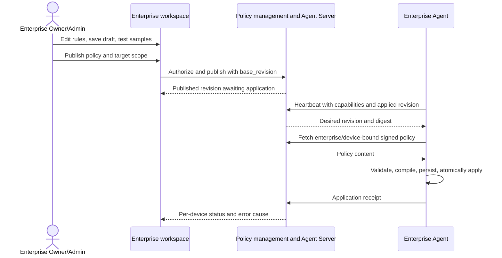
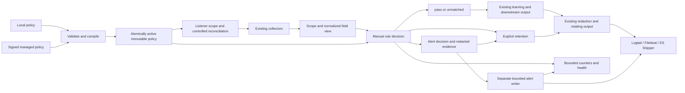
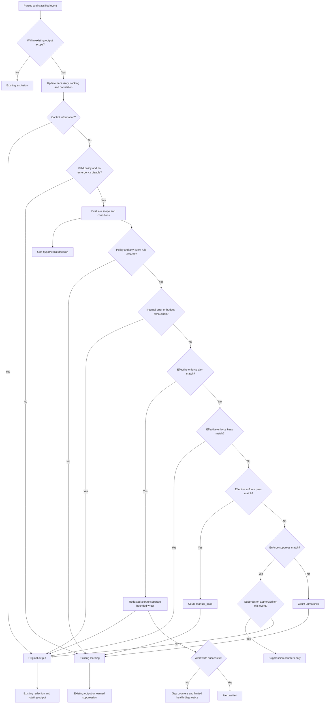

# Enterprise Agent Collection Whitelist Design

**Languages:** English (this page) | [简体中文](custom-whitelist-design.zh-CN.md)

**Status: option A implemented in R1 (Agent 0.3.97 / Agent Server rc.84 / Server rc.135).** This document retains the full design, including later extensions. Use [the R1 implementation guide](custom-collection-rules.md) for supported configuration, commands and limits. Snapshot filtering, offline managed distribution and extended explain commands remain outside R1.

**Requirement revision:** event rules support Alert and record, Do not record, Force recording, and Continue processing. Force recording bypasses learned filtering; pass delegates to downstream learning/output. The four actions and their precedence are implemented in R1.

## 1. Goals and Usage

Users who recognize normal business activity or want alerts on selected behavior can define rules directly without waiting for five repetitions or restarting learning. Rules combine exact fields, path prefixes, command regular expressions, numeric ranges, IP subnets, and retention exceptions. Linux and Windows share the language; ES and SLS deployments share the Agent decision engine.

The enterprise whitelist manages two rule kinds: **event handling** selects alert, suppression, forced recording, or continued processing; **listener collection scope** incorporates whitelist_ports and excludes selected local listening endpoints as Linux process-tree monitoring roots. Neither permits execution, authorizes network access, nor certifies safety. Manual event decisions follow necessary tracking/correlation, source-scope checks, and risk classification, but precede learned filtering; they cannot recover source-excluded/uncollected events. Unmatched events continue existing learning/output rather than forced retention. Originals missed through suppression/exclusion are not archived elsewhere; withdrawal restores future collection/output, not history.

| UI Action | action | Original Module JSONL | Custom Risk Alert File | Behavior Learning |
|---|---|---|---|---|
| Alert and record | alert | Retain the original once | Write one structured alert | Bypass admission and filtering |
| Do not record | suppress | Omit the original | No alert | Bypass admission and filtering; aggregate counters only |
| Force recording | keep | Retain the original once | No alert | Bypass admission and filtering |
| Continue processing | pass | Decided by downstream learning/output | No alert | Admission/filtering under existing configuration |

Original records still use existing redaction and rotation, never plaintext credential/token storage. Do not record omits business events, not audit, health, source failures, or aggregate statistics. pass does not guarantee output: learned entries may still suppress it. Unsupported/disabled learning continues existing output. Observation predicts all four actions without actual alerts or changes to original output.

Recommended workflow: select an event type and action, combine fields, test samples, observe on target devices, review expected alerts/reduction and false matches, then enforce. Existing learned entries remain independent. Manual rules do not change the learning algorithm of five identical events within one hour.

**Enterprise requirement: each enterprise's Owner/Admin must configure and publish its own whitelist in the workspace without platform administrators entering individual rules or logging into customer hosts.** UI configuration and server distribution are the primary hosted workflow. Local files serve offline/local management and diagnostics. Rules, samples, statistics, and device scope are isolated between enterprises.

| Requirement | Description |
|---|---|
| WL-01 | Combine fields with AND/OR/NOT, regex, arrays, and subnets |
| WL-02 | Support alert/suppress/keep/pass; alerts and forced recording override learning, pass delegates downstream |
| WL-03 | Observe/enforce modes, enable/disable, validity periods, and revision rollback |
| WL-04 | Event filtering preserves source scope, tracking, and cursors; listener rules adjust monitoring roots through controlled reconciliation |
| WL-05 | Local configuration for offline ES and workspace management for hosted environments |
| WL-06 | Missing fields, invalid policies, disconnection, or limits must not introduce silent loss |
| WL-07 | Explain matches and misses, measure reduction, and audit changes |
| WL-08 | Bound resources, compile once, switch concurrently, and preserve older Agent compatibility |
| WL-09 | Enterprise Owner/Admin configures, tests, and publishes its policy in the UI and inspects per-device delivery/application |
| WL-10 | Incorporate whitelist_ports as listener-scope rules in the same enterprise policy, management, distribution, audit, and rollback |
| WL-11 | Alerts write separate custom-risk-alert.log and retain originals, with redaction, rotation, permissions, shipping, and observable failures |

## 2. Existing and Proposed Capabilities

Existing [behavior learning](behavior-learning.md) provides exact learned entries for Linux/Windows exec, file_op, Windows active_connect, and ordinary PowerShell script events. Snapshots retain their baseline/delta mechanisms. The new design migrates whitelist_ports into unified enterprise listener-scope rules while preserving discovery-exclusion semantics; it is not equivalent to event listener_port filtering. Severity thresholds and other existing process exclusions retain their responsibilities.

Proposed event-handling coverage follows; integrated event families support all four actions. Only already produced normalized events can match. Alert rules do not install Sysmon, expand existing audit coverage, recover source-excluded events, fill missing fields, or bypass existing source-module severity thresholds. Listener-scope rules separately adjust existing Linux monitoring roots and their resources, section 7.4.

| Event Scope | Module or Asset | Use and Prerequisites |
|---|---|---|
| exec, file_op, active_connect | Linux audit-port-execmon; Windows evidence reader | Combine processes, commands, files, and destinations; Windows network/file evidence requires corresponding Sysmon records |
| Linux system and authentication risk events | syslog-risk-json | Match program, event_type, user, src_ip, message, etc.; high/critical is protected by default |
| Windows system and authentication risk events | windows-eventlog-risk-json | Match provider, channel, event number, user_sid, command, and native fields |
| persistence_change | host-persistence / host_persistence | Explicit exceptions for known persistence paths; change events are protected by default |
| process_snapshot, process_start, process_exit, process_change | host-process-snapshot / host_process | Exclude known business noise while preserving inventory and change semantics |
| Socket, identity, service, task, kernel, and container snapshots/changes | host-state-snapshot / host_socket, host_identity, host_service, host_kernel_context | Reduce snapshots; identity/service/task/kernel changes are protected by default |
| Routine internal diagnostics | Diagnostic output with structured fields | Only integrated ordinary diagnostics; do not parse stderr as rule input |

Authorization/update protocols, minimum operational health, source failures, rule errors, application receipts, and snapshot coverage declarations remain on their control path outside all four event actions. Generated custom_risk_alert records never reenter matching or learning, preventing recursive alerts or self-suppression. Existing host_behavior_summary upload settings remain unchanged; this proposal does not re-enable them.

**Linux listener scope remains unchanged:** listener evidence with missing/blank listener_process or unknown attribution is already excluded before learning/output. A manual keep rule cannot restore it. Windows emptiness follows its adapter; an empty listener_process is not a wildcard. See [process attribution](process-attribution.md).

## 3. Rule Model

A rule defines scope over events or listener candidates, conditions, and an action. No executable scripts, SQL, template variables, or cross-event correlation language are introduced.

| Field | Meaning and Recommended Default |
|---|---|
| id, name, description | Stable ID, display name, and business reason; edits retain ID, copies receive a new ID |
| kind | event_filter (default) means event handling; retain the identifier from the draft; listener_scope means listener collection scope |
| enabled | Defaults to false; only enabled, currently valid rules participate |
| mode | observe or enforce; defaults to observe |
| action | event_filter uses alert/suppress/keep/pass; listener_scope uses exclude_listener/keep_listener; explicitly required, no default action |
| alert | Required only for action=alert; title required (256 bytes maximum), severity low/medium/high/critical (default high), optional description (1024 bytes maximum); static text, no executable templates |
| priority | 0–1000, default 100; event precedence is alert > keep > pass > suppress, with priority attributing same-action matches; listener retention still wins |
| scope.platforms | Nonempty selection of linux/windows |
| scope.modules, scope.event_types | modules is required; event_filter requires event_types; listener_scope rejects event_types; no `*` |
| scope.asset_types | Event rules only; an event without asset_type does not satisfy it |
| when | One condition tree, defined in section 4 |
| valid_from, expires_at | Optional RFC3339 times; interval [start, end); ordinary rules may be permanent |
| allow_protected | Event rules only; defaults to false; protected-event suppression needs explicit authorization, section 6 |

Policy mode=observe restricts every rule to observation. Both policy and rule must be enforce to execute alert/suppress/keep/pass. Observation never writes risk alerts, forces retention, overrides enforcing rules, or suppresses. The feature is disabled by default and initially observes when enabled; an Agent upgrade does not enable it. Reject the whole policy for missing action, invalid alert severity, or an alert object attached to a non-alert action.

Each device has one active manual policy containing multiple business rules. Local, managed, and older revisions must not merge implicitly. Hosted device/group selection is an assignment concern; local policies apply to the current host.

Both kinds share one rules array, enterprise UI, and revision. Existing draft examples without kind mean event_filter; listener rules explicitly specify kind=listener_scope. Listener rules cannot reference command_line/event_type before events exist, and event keep does not restore an excluded monitoring root.

## 4. Conditions and Exact Semantics

### 4.1 Combining Fields

all means AND, any means OR, and not means NOT. Each node is exactly one of these shapes or one field predicate. all/any require nonempty children. The following matches the specified health check under java or mysqld listener attribution when the observed UID is not 0:

```json
{
  "all": [
    {"field": "/listener_process", "op": "in", "value": ["java", "mysqld"]},
    {"field": "/exe", "op": "eq", "value": "/usr/bin/curl"},
    {"field": "/command_line", "op": "eq", "value": "curl -fsS http://127.0.0.1:8080/health"},
    {"not": {"field": "/uid", "op": "eq", "value": "0"}}
  ]
}
```

This requires /uid to exist. NOT does not turn a missing UID into “not 0.” Two complete all branches under any express `(A AND B) OR (C AND D)`. Fields do not correlate implicitly, and “same as the previous event” or implicit joins across object arrays are unsupported.

Fields use [JSON Pointer](https://www.rfc-editor.org/rfc/rfc6901): /exe addresses the top-level field and /fields/Path addresses Path inside fields. Escape `~` and `/` within names as `~0` and `~1`. Paths are case-sensitive; a UI field selector generates them. Version 1 allows only catalogued scalar/string-array paths, rejecting the root object, arbitrary array indices, JSONPath wildcards, and unknown paths.

Catalogs show fields, types, and completeness for the selected module/event rather than a universal field table:

| Event View | Representative Fields and Actual Types |
|---|---|
| Linux audit/eBPF evidence | listener_process, pid_name, exe, command_line, uid, uid_name are strings; listener_port/connect_port are numbers; file_paths is a string array |
| Windows host evidence | exe, command_line, user, windows_event_id, dst_ip, dst_port are strings; file_paths is available after successful correlation |
| Linux risk | program, user, src_ip, severity, message are strings; only catalogued native fields are exposed under fields |
| Windows risk | provider, channel, event_id, user_sid, command, script_sha256 are strings; catalogs declare available native fields keys |
| Persistence | path, category, persistence_type, action are strings; size is numeric |
| host-process | exe, user, command_hash, cgroup are strings; thread_count/rss_bytes are numeric |
| host-state | entity_type, action, entity_key and selected entity fields; sockets expose listen_address/listen_port |

Linux audit uses uid_name/auid_name rather than other modules' user. Its internal Fields are not serialized or exposed as arbitrary configurable input. Cross-module rules require consistent available fields/types in every selected view; otherwise split rules. SLS __source__, Project/Logstore, and ES index names are upload/server metadata, not local matching fields. Use device assignment to restrict hosts.

### 4.2 Operators

| Operator | Input | Meaning |
|---|---|---|
| eq, neq | String, boolean, or number | Full equality/inequality; no implicit numeric-string coercion |
| in, not_in | Nonempty list of one type | Equal/not equal to any list member |
| prefix, suffix, contains | String | Prefix/suffix/substring; value must not be empty |
| regex | String | Search match; use `^...$` for full matching |
| cidr | IP string | Membership in an IPv4/IPv6 subnet; invalid addresses produce unknown |
| gt, gte, lt, lte, between | Number | Numeric comparison; between uses inclusive `[min,max]` |
| exists | Boolean | Whether a field exists; empty strings and null still exist |
| is_empty | Boolean | Whether an existing string/array is empty; null/missing produces unknown |
| array_any, array_all, array_none | String array and item predicate | At least one/all/no items match; the array must be nonempty |
| array_eq | String array | Exact whole-array match, including order and duplicates; `[]` is allowed |

Array item predicates allow string operators without field and cannot nest arrays. array_any/all/none return false for empty arrays. Null, non-string, or oversized elements produce unknown; ignoring invalid members cannot prove “all normal.”

Strings default to case-sensitive comparison without whitespace folding, slash replacement, command parsing, or URL credential decoding. eq/in/prefix/suffix/contains accept explicit case_sensitive=false for strings; field-name case stays unchanged. regex uses inline `(?i)` and rejects case_sensitive. Array items follow the same rules. No wildcard operator is added: `*` in eq is a literal asterisk; use regex for patterns.

### 4.3 Missing Fields, Invalid Types, and Truncation

Use true/false/unknown logic; only a final true matches. NOT unknown is unknown. For AND, false wins, otherwise any unknown yields unknown. For OR, true wins, otherwise any unknown yields unknown. Unknown is not treated as inequality, absence from a list, or a different process.

Missing, null, incompatible, invalidly encoded, or oversized predicate input produces unknown. Unknown configured fields, wrong operand types, and invalid operators reject publication/loading. Occasionally missing event fields retain collection and increment missing_field. exists=false can explicitly match absence, but publication must flag its coverage of missing evidence.

The matching view carries field completeness. An explicitly truncated/incomplete source field produces unknown for content comparisons, while exists can still check presence. Without a completeness marker, matching can only use the collected value, not certify original completeness. Select an explicitly exposed completeness field when needed. This does not change Linux learning's existing acceptance of truncated commands.

Each module catalog declares actual field types and provenance. Version 1 keeps existing JSON port strings as strings; use in with `"443"`. Numeric operators apply only to actual numeric fields. A future numeric port view requires an explicit new field/capability, never a silent /dst_port type change.

### 4.4 Regular Expressions

Reuse Go regexp and its RE2-style syntax rather than adding PCRE. Support anchors, groups, alternatives, character classes, repetition, and `(?i)`/`(?m)`/`(?s)`; reject lookaround and backreferences. Compile during loading and return the rule ID, condition path, and cause on failure. Matching a fixed expression in Go regexp is guaranteed linear in input size, while overall cost also depends on rule count, expression size, and field length. [Go regexp](https://pkg.go.dev/regexp), [RE2 syntax](https://github.com/google/re2/wiki/Syntax).

| Purpose | Expression Text | JSON value |
|---|---|---|
| Full Linux temporary path | `^/var/cache/myapp/[A-Za-z0-9_-]+\.tmp$` | `"^/var/cache/myapp/[A-Za-z0-9_-]+\\.tmp$"` |
| Case-insensitive Windows path | `(?i)^C:\\ProgramData\\MyApp\\Cache\\[^\\]+\.tmp$` | `"(?i)^C:\\\\ProgramData\\\\MyApp\\\\Cache\\\\[^\\\\]+\\.tmp$"` |
| Health-check argument inside a command | `--health-check(\s|$)` | `"--health-check(\\s|$)"` |

Search matching is not full matching: curl matches longer commands containing curl. Use anchors to constrain the whole command. Expressions inspect their named field, not complete JSON or raw XML. Unknown/invalid UTF-8 input never reaches the regex engine.

## 5. Configuration and Examples

### 5.1 Complete Policy

Proposed top-level collection_whitelist includes all four event actions and listener scope independently of behavior_learning:

```json
{
  "collection_whitelist": {
    "enabled": false,
    "source": "local",
    "policy_file": "/opt/secweaver-agent/etc/custom-whitelist.json",
    "apply_to_backfill": false
  }
}
```

schema_version is 1, policy_id is stable, and revision is a monotonically increasing positive integer. mode defaults to observe; rules is a required array, with an empty array meaning no rules. allow_protected_suppression defaults to false. Optional policy valid_from/expires_at constrain the whole policy; rule validity must stay inside that interval. Reject duplicate JSON keys, unknown configuration fields, and duplicate rule IDs.

Complete local policy example:

```json
{
  "schema_version": 1,
  "policy_id": "wl-business-noise",
  "revision": 1,
  "mode": "observe",
  "allow_protected_suppression": false,
  "rules": [
    {
      "id": "java-health-check",
      "name": "Java application health check",
      "description": "Confirmed loopback health check from the application service",
      "enabled": true,
      "mode": "enforce",
      "action": "suppress",
      "priority": 100,
      "scope": {
        "platforms": ["linux"],
        "modules": ["audit-port-execmon"],
        "event_types": ["exec"]
      },
      "when": {
        "all": [
          {"field": "/listener_process", "op": "eq", "value": "java"},
          {"field": "/pid_name", "op": "eq", "value": "curl"},
          {"field": "/exe", "op": "eq", "value": "/usr/bin/curl"},
          {"field": "/command_line", "op": "regex", "value": "^curl -fsS http://127\\.0\\.0\\.1:8080/health$"}
        ]
      }
    },
    {
      "id": "keep-sensitive-commands",
      "name": "Keep shell and credential operations",
      "description": "Retain investigation evidence even if a learned entry matches",
      "enabled": true,
      "mode": "enforce",
      "action": "keep",
      "priority": 100,
      "scope": {
        "platforms": ["linux"],
        "modules": ["audit-port-execmon"],
        "event_types": ["exec"]
      },
      "when": {
        "any": [
          {"field": "/exe", "op": "in", "value": ["/bin/bash", "/usr/bin/sshpass"]},
          {"field": "/command_line", "op": "contains", "value": "/etc/shadow"}
        ]
      }
    }
  ]
}
```

With policy observe, both rules only report expected matches and existing learning is unchanged. With policy enforce, health checks can be suppressed immediately without learning; matching retention exceptions retain originals and bypass learned filtering.

### 5.2 Linux/Windows File Operations

These rule fragments belong in the full policy's rules array. Suppress only the selected application's nonempty cache-path list. array_all prevents an event containing both a cache file and a sensitive file from being suppressed together.

```json
{
  "id": "linux-application-cache",
  "name": "Application cache files",
  "description": "Only the application cache directory",
  "enabled": true,
  "mode": "observe",
  "action": "suppress",
  "scope": {"platforms": ["linux"], "modules": ["audit-port-execmon"], "event_types": ["file_op"]},
  "when": {
    "all": [
      {"field": "/listener_process", "op": "eq", "value": "java"},
      {"field": "/exe", "op": "eq", "value": "/opt/myapp/bin/cache-worker"},
      {"field": "/file_paths", "op": "array_all", "item": {"op": "prefix", "value": "/var/cache/myapp/"}}
    ]
  }
}
```

Windows selects its reader and executable path without requiring Linux listener attribution:

```json
{
  "id": "windows-application-cache",
  "name": "Windows application cache files",
  "description": "Only known application temporary files",
  "enabled": true,
  "mode": "observe",
  "action": "suppress",
  "scope": {"platforms": ["windows"], "modules": ["windows-eventlog-risk-json"], "event_types": ["file_op"]},
  "when": {
    "all": [
      {"field": "/exe", "op": "eq", "value": "C:\\Program Files\\MyApp\\worker.exe", "case_sensitive": false},
      {"field": "/file_paths", "op": "array_all", "item": {"op": "regex", "value": "(?i)^C:\\\\ProgramData\\\\MyApp\\\\Cache\\\\[^\\\\]+\\.tmp$"}}
    ]
  }
}
```

Paths match source text and do not prove the underlying file has no symlink, junction, or mount redirection. The event hot path does not resolve real paths through filesystem access.

### 5.3 Windows Connections: Fields and Subnets

```json
{
  "id": "windows-business-api",
  "name": "Known internal application API",
  "description": "Application HTTPS traffic to the dedicated API subnet",
  "enabled": true,
  "mode": "observe",
  "action": "suppress",
  "scope": {"platforms": ["windows"], "modules": ["windows-eventlog-risk-json"], "event_types": ["active_connect"]},
  "when": {
    "all": [
      {"field": "/exe", "op": "eq", "value": "C:\\Program Files\\MyApp\\worker.exe", "case_sensitive": false},
      {"field": "/protocol", "op": "eq", "value": "tcp", "case_sensitive": false},
      {"field": "/dst_ip", "op": "cidr", "value": "10.20.30.0/24"},
      {"field": "/dst_port", "op": "in", "value": ["443", "8443"]}
    ]
  }
}
```

IPv4/IPv6 membership respects address families and explicitly unmaps IPv4-mapped IPv6. Zoned link-local inputs require an explicitly normalized adapter address or yield unknown. Do not ship defaults suppressing all private-network traffic or all dockerd/java activity.

### 5.4 Windows sys-messages: A Specific Script Command

```json
{
  "id": "windows-approved-inventory-script",
  "name": "Approved inventory script",
  "description": "Exact known script fragment for inventory collection",
  "enabled": true,
  "mode": "observe",
  "action": "suppress",
  "scope": {"platforms": ["windows"], "modules": ["windows-eventlog-risk-json"], "event_types": ["powershell_script_block"]},
  "when": {
    "all": [
      {"field": "/provider", "op": "eq", "value": "Microsoft-Windows-PowerShell"},
      {"field": "/channel", "op": "eq", "value": "Microsoft-Windows-PowerShell/Operational"},
      {"field": "/event_id", "op": "eq", "value": "4104"},
      {"field": "/user_sid", "op": "eq", "value": "S-1-5-18"},
      {"field": "/command", "op": "eq", "value": "Get-CimInstance -ClassName Win32_OperatingSystem"}
    ]
  }
}
```

Risk output event_id is the Windows event-number string; evidence output uses windows_event_id. They are not interchangeable. Existing script_sha256 describes an output fragment, not a whole multipart script. Matching whole-script identity needs a separate complete-script view/capability; version 1 does not implicitly reuse learning internals. Recognized high/critical scripts remain protected under section 6.

### 5.5 host-process: Ordinary Baseline Entries Only

```json
{
  "id": "process-baseline-known-worker",
  "name": "Known worker baseline entries",
  "description": "Reduce routine full inventory; retain starts, exits and changes",
  "enabled": true,
  "mode": "observe",
  "action": "suppress",
  "scope": {"platforms": ["linux"], "modules": ["host-process-snapshot"], "event_types": ["process_snapshot"]},
  "when": {
    "all": [
      {"field": "/exe", "op": "eq", "value": "/opt/myapp/bin/worker"},
      {"field": "/user", "op": "eq", "value": "myapp"},
      {"field": "/thread_count", "op": "between", "value": [1, 32]}
    ]
  }
}
```

If ordinary snapshots omit command_line, command_line rules cannot match; use an available command_hash instead. Baseline suppression requires section 8's coverage declaration so consumers do not infer process exit from omission.

### 5.6 Alert Rules, Files, and Records

For example, a Java listener tree executing a command to read /etc/shadow retains the exec event and produces a custom alert. This rule fragment only predicts alerts in observe; both policy and rule must enforce before writing alerts:

```json
{
  "id": "alert-java-shadow-access",
  "name": "Java service reading password hashes",
  "description": "Retain evidence and raise a custom risk alert",
  "enabled": true,
  "mode": "observe",
  "action": "alert",
  "priority": 200,
  "alert": {
    "title": "Java service reading password hashes",
    "severity": "high",
    "description": "Investigate this command in the service process tree"
  },
  "scope": {"platforms": ["linux"], "modules": ["audit-port-execmon"], "event_types": ["exec"]},
  "when": {
    "all": [
      {"field": "/listener_process", "op": "eq", "value": "java"},
      {"field": "/exe", "op": "eq", "value": "/usr/bin/cat"},
      {"field": "/command_line", "op": "contains", "value": "/etc/shadow"}
    ]
  }
}
```

Use separate JSONL output rather than internal-diagnostic_log or host_behavior_summary:

| Platform | Default File |
|---|---|
| Linux | `/opt/secweaver-agent/logs/custom-risk-alert.log` |
| Windows | `C:\ProgramData\SecWeaver\Agent\logs\custom-risk-alert.log` |

Paths follow logs under the actual installation root. Only local administrators/installation settings may change the output directory; enterprise rules cannot choose arbitrary paths. Agent fixes the filename instead of deriving paths from rules/events. All rules share one file. Proposed local collection_whitelist.alert_output defaults are max_size_mb=100, max_backups=5, queue_capacity=1024, and queue_max_bytes=8388608, outside editable enterprise rules. Active/rotated files share disk protection, Linux 0600 permissions, and Windows administrator/SYSTEM ACLs with existing output.

Example generated record, a proposed contract rather than an existing syslog risk record:

```json
{
  "schema_version": 1,
  "event_type": "custom_risk_alert",
  "asset_type": "custom_risk_alert",
  "event_id": "ca_example_0001",
  "timestamp": "2026-10-13T08:30:00Z",
  "generated_at": "2026-10-13T08:30:01Z",
  "enterprise_id": "ABCDEF1234567890",
  "device_id": "swd_EXAMPLE",
  "host_name": "example-host",
  "host_ip": "192.0.2.10",
  "platform": "linux",
  "origin": "custom_rule",
  "severity": "high",
  "title": "Java service reading password hashes",
  "description": "Investigate this command in the service process tree",
  "policy_id": "wl-business-noise",
  "policy_revision": 2,
  "rule_id": "alert-java-shadow-access",
  "rule_name": "Java service reading password hashes",
  "source_module": "audit-port-execmon",
  "source_event_type": "exec",
  "source_event_id": "audit:example:42",
  "backfill": false,
  "source_event_truncated": false,
  "source_event": {
    "event_type": "exec",
    "listener_process": "java",
    "pid_name": "cat",
    "exe": "/usr/bin/cat",
    "command_line": "cat /etc/shadow"
  }
}
```

timestamp uses source event time; if absent/unparseable, use generation time and source_time_unavailable=true without inventing source time. generated_at is actual creation time; both use RFC3339. Severity defaults to high and takes the higher of configured and recognized source severity, preserving existing critical risks. Missing source severity uses the configured value. Original module JSONL retains its existing type/format instead of becoming custom_risk_alert.

Select one final alert rule per source event, writing one alert and retaining one original. Distinct source records with identical values are separate, with no default aggregation/deduplication. Derive alert event_id from device identity, stable source-record identity, policy revision, and selected rule_id; retries reuse it. Use native source_event_id where available, otherwise adapter-provided stable source positions. Without either, generate a processing ID and declare idempotency_scope=attempt without promising cross-restart deduplication. Content hashes alone cannot identify separate records. Detailed condition trees are for sample explanations, not per-event upload.

source_event contains a consistently redacted evidence copy; cap the entire alert at 32 KiB. On overflow, retain source/process/path evidence by fixed field priority and set source_event_truncated=true plus omitted_fields; never byte-truncate JSON into invalid lines. Redact alert titles, descriptions, and rule names too, including credentials, URL-encoded passwords, sshpass arguments, and tokens across alert, original, and diagnostic output. The unabridged original follows its own existing output limits independently of the alert copy.

One bounded worker owns alert writes, rotation, and closure, reusing output identity injection, redaction, disk protection, and rotation. Bound the queue by both count and total bytes; do not create workers per rule/event. Write alerts directly without waiting for aggregate-summary windows. Count alert_written only after writer success; enqueue counts only alert_queued. Ordinary writes do not promise per-record fsync, so abrupt power loss may lose tail records. Graceful shutdown drains for at most five seconds and records remaining work as incomplete, not persisted.

Original and alert are separate outputs without a cross-file atomic commit or exactly-once guarantee. Queue saturation, disk protection, permissions, or write errors still attempt normal original recording, bypass learning, and report aggregate alert_write_failed/alert_delivery_gap health plus rate-limited diagnostics while keeping the Agent running. Report original-write failure separately too: an enqueued alert is not fully successful processing. No unbounded retries, unlimited temporary spooling, or silent conversion of failure into suppress. Consumers may deduplicate by event_id; expose actual recording and failure counts independently.

**Shipping contract:** ES/SLS share the format. Filebeat/ES Shipper/Logtail independently collect custom-risk-alert.log into dedicated indices/Logstores, with DataAsset schemas/queries and risk-analysis skill integration. File creation alone does not prove cloud delivery, and disabled behavior-summary routes are not reused. Proposed custom-event-alert-v1 declares the alert format and local output capability; report upload-route readiness separately. Hosted publication validates the target installation mode supports the action and required shipping route. Older Agents receive no alert, no silent keep/suppress translation, and no forced upgrade. Offline ES/local mode may save locally before separate shipping integration. Doctor distinguishes matches, enqueue, writes, shipper routes, and verifiable cloud state.

### 5.7 Continue Processing: pass

To let learning decide a health check rather than discard it through a broader business suppress rule, add this fragment:

```json
{
  "id": "pass-health-check-to-learning",
  "name": "Let learning handle this health check",
  "description": "Continue existing learning instead of manual suppression",
  "enabled": true,
  "mode": "enforce",
  "action": "pass",
  "priority": 100,
  "scope": {"platforms": ["linux"], "modules": ["audit-port-execmon"], "event_types": ["exec"]},
  "when": {
    "all": [
      {"field": "/listener_process", "op": "eq", "value": "java"},
      {"field": "/exe", "op": "eq", "value": "/usr/bin/curl"},
      {"field": "/command_line", "op": "eq", "value": "curl -fsS http://127.0.0.1:8080/health"}
    ]
  }
}
```

pass is a final manual-stage decision, not skipping one rule and evaluating the next, and never reenters the same engine. Without alert/keep, it overrides matching suppress and delegates to existing learning/output, so avoid overly broad pass rules. Disabled learning continues existing output; otherwise existing state and protections decide admission, learned entries, and filtering. pass does not enable/reset learning, extend its duration, or revoke learned entries.

Unmatched events enter the same downstream path but count as unmatched, while explicit pass counts as manual_pass with rule attribution. Neither means a log was written; downstream suppression/output has separate counters. Section 9's forced-retention error fallback is not pass and cannot subject failed decisions to learned filtering.

## 6. Event Precedence, Protection, and Learning

The decision order is fixed:

1. Complete existing source scope checks, internal tracking/correlation, and risk classification. Source-excluded events retain existing handling.
2. Always retain control information outside the filterable set.
3. A valid enforce alert match generates one custom alert and retains the original, bypassing manual suppress and learning admission/filtering. Failed alert output still retains the original and reports the gap.
4. Without alert, a valid enforce keep match retains the original and bypasses manual suppress and learning admission/filtering.
5. Without alert/keep, a valid enforce pass match counts manual_pass, ends manual decisions, and delegates to existing learning/output without alerting or forced retention.
6. Without alert/keep/pass, validate suppression predicates and protection authorization. High/critical and persistence/identity/service/task/kernel changes are protected by default; protected suppression attempts retain originals and bypass learned filtering.
7. A valid enforce suppress match increments counters and omits original output without entering learning admission/matching, per-event suppression logs, or alert output.
8. Unmatched events count unmatched and continue existing learning, output, redaction, and rotation. Observation predicts manual decisions without changing processing or generating risk alerts.

Event precedence is **alert > keep > pass > suppress**; unmatched defaults to existing processing. Priority cannot make suppress override any earlier action or pass override alert/keep. Same-action matches attribute to higher priority, then ascending ID byte order. One event is not attributed multiple times or alerted repeatedly. Observation computes one hypothetical enforce decision over all currently valid rules and attributes one predicted action. Actual mixed-mode decisions consider enforce rules only; observed alert/keep/pass cannot block an enforcing suppress.

**Protection exception:** suppressing a protected business event requires both policy allow_protected_suppression=true and rule allow_protected=true, a business reason, and expires_at with a maximum seven-day validity period. Enterprise Owner/Admin can act alone with change auditing; two-person approval is not required. Control information can never be overridden. Protection uses existing classification and explicit event families; it does not claim to detect all attacks in ordinary exec evidence.

**Learning independence:** publishing, disabling, or rolling back a policy does not change learning generation, healthy duration, candidates, or admitted entries. alert/keep matches are not trained, preventing new admissions from immediately filtering them after withdrawal. Preexisting learned entries remain and may resume after withdrawal; they cannot block effective alert/keep. Restore originals by disabling both manual and learned filtering or publishing keep covering the selected events. Use existing learning-reset procedures to relearn.

Only pass/unmatched reach downstream learning, once per event; families without learning continue existing output. Manual-stage and learning counters are separate, so manual_pass followed by learned suppression is not manual suppress. pass cannot override control retention, source classification, or existing learner protection for high-risk events.

All original-output fallbacks remain within source scope. Without a valid manual policy, no alert/suppress/keep/pass executes and learning retains its configuration. Engine faults while evaluating a valid policy force retention of that event under section 9 without subsequent learned suppression. Doctor distinguishes loading/runtime faults and independent learning state.

## 7. Local and Enterprise Management

### 7.1 Local and Offline Configuration

Default Linux path: /opt/secweaver-agent/etc/custom-whitelist.json. Default Windows path: C:\ProgramData\SecWeaver\Agent\etc\custom-whitelist.json. Windows follows actual ProgramData and the Agent root; custom installation roots use their own etc directory. Linux policies are 0600 with root-only writes; Windows uses administrator/SYSTEM ACLs. Local administrators manage local mode without mandatory cloud signatures or connectivity.

Proposed commands, **not present in current versions**:

```text
secweaver-agent whitelist validate --file <policy.json>
secweaver-agent whitelist test --file <policy.json> --events <sample.jsonl> --explain
secweaver-agent whitelist test --file <policy.json> --listeners <listener-sample.jsonl> --explain
secweaver-agent whitelist install --file <policy.json>
secweaver-agent whitelist install --file <policy.json> --migrate-legacy-ports
secweaver-agent whitelist disable
secweaver-agent whitelist status --json
```

test is offline by default and does not register a device, write production output, or modify learning. Report sample count, matched rules, protection blocks, missing fields, and predicted alert/suppress/keep/pass/unmatched counts. Downstream pass outcomes depend on current device learning state; ordinary sample tests neither modify that state nor promise final cloud volume. Preview alert samples only in test results, never production custom-risk-alert.log. explain shows final actions, entry into learning, precedence conflicts, and predicate paths/results with existing redaction. disable persists a local emergency override stopping all custom actions; managed updates cannot silently clear it. Explicitly clearing the override restores managed policy.

Use --listeners candidate samples for listener rules, not previously filtered exec history to infer coverage. --migrate-legacy-ports explicitly runs section 7.4's recoverable migration locally without bypassing observation, signature/source requirements, or legacy digest checks.

Validate and atomically replace local files, never reread them for every event. install retains the last valid revision; rollback restores content under a greater revision number.

### 7.2 Enterprise Workspace

The workspace must provide Agent collection policy → Custom whitelist. Enterprise Owner/Admin completes configuration and publication independently without platform administrators distributing it manually. This document defines functionality; layout and visual design are a separate task.

| Operation | Requirement |
|---|---|
| Create/edit/copy/disable | Visual field/operator/value combinations; advanced users edit the same JSON tree |
| Select event action | Explicit Alert and record, Do not record, Force recording, and Continue processing; alert exposes metadata, keep states learning bypass, pass states possible learned suppression |
| Save draft/publish policy | Separate explicit actions; saving updates the draft, publishing creates an immutable revision for distribution |
| Target devices | Entire enterprise, selected devices, or existing device groups; do not claim groups if absent |
| Sample testing | Uploaded redacted samples or authorized historical logs; history is not proof of all live traffic |
| Observe publication | Defaults to observe; show actual receipt revisions and compatibility, not just successful saving |
| Enforce | Show expected alerts, suppressions, forced recordings, delegated counts, protection, and coverage; delegation is not successful log output; begin with selected devices if needed |
| Disable/rollback | Publish a new revision, preserve history/audit, show disconnected devices awaiting receipt |
| Match inspection | Final action, recent hits, actual/expected reduction, alert-write failures, missing fields, protection, expiry, applied revision; query related alerts by rule |

The enterprise's Owner/Admin can change policies; other roles follow existing read permissions. Check enterprise ownership on creation, editing, testing, publishing, copying, import/export, disabling, rollback, and statistics queries, not merely UI visibility. Audit enterprise, actor, time, reason, previous/new revision, content digest, and target scope, explicitly including observe→enforce transitions, action/alert-severity changes, and protection overrides. Assignment uses authenticated tenant/device identity, never a request-body enterprise ID as cross-tenant authorization.

Managed mode uses source=managed and proposed custom-event-whitelist-v1 with basic suppress/keep/pass actions. Negotiate modules, actions, fields, and operators. Explicitly show unsupported actions without silently translating pass to keep/suppress. Older Agents receive no unsupported configuration fields and retain existing behavior without forced upgrades. Supported capability does not prove successful application: require receipts.

Policies containing alert additionally require custom-event-alert-v1 and route readiness for the installation mode. Basic-whitelist Agents cannot receive alert policies. Show incompatible devices explicitly without silently rewriting/removing alerts. Publication validates actions, metadata, and catalogs while preserving older registration, heartbeat, collection, and upgrade protocols.

Reuse existing remote-configuration signature verification, tenant/device binding, and transport. Heartbeats exchange revision/digest; download content only when changed. Signing uses configuration-policy trust, not unrestricted reuse of the Agent update-manifest private key. If current distribution does not guarantee binding/replay protection, complete that contract before implementation. No new KMS/signing service is required.

The signed envelope must cover policy_id, revision, content digest, enable/disable state, enterprise/device assignment, and issued_at/valid_from/expires_at. Recommend seven-day validity and renewal under a greater revision before expiry. Renewal requires a new signature; an unsigned heartbeat cannot extend filtering. Policy/rule validity uses the earliest expiry. Pause manual decisions and report clock_untrusted when time cannot be reliably evaluated.

On network failure, retain the last valid, unexpired policy. On expiry, stop manual decisions, continue learning/collection, and report expired. Omitting new fields preserves configuration; disabling requires an explicit new revision. Rollback increases revision and must not accept older replayed revisions. Individual rule expirations within a signed revision remain independent.

### 7.3 Enterprise Configuration Through Agent Application

An enterprise may retain drafts and historical revisions, but each device receives one active policy. Publication defaults to all compatible devices in this enterprise and may explicitly target selected devices. Show compatible, incompatible, offline, and locally managed device counts. All devices is a continuing enterprise scope: newly registered compatible SaaS Agents inherit its latest published policy, rather than only the device IDs present at publication.

New SaaS installations use managed policy sourcing with manual filtering disabled until a policy is published; users need not set policy_file. Explicitly locally managed devices display that status and cannot be silently overwritten by cloud policies. Offline ES retains local management. Administrators assign only their enterprise's policies, and the persistent local emergency override in section 7.1 still wins.

Publication and distribution flow:

1. Save an editable/testable draft in the UI; Agents continue their existing revision.
2. Select Publish policy, mode, targets, and reason; default to observe. The server validates rules, fields, and capabilities, showing incompatibility and protection exceptions. Partial validation failure cannot be reported as successful publication.
3. Check base_revision for concurrent changes, then transactionally persist the immutable revision, assignments, and change audit before distribution. An idempotency identifier makes duplicate submission return the same publication result; conflicts explain the newer change instead of overwriting it.
4. On the next successful configured heartbeat, Agents discover a changed desired revision/digest and fetch the enterprise/device-bound signed policy. No Agent restart or repeated download of unchanged content is required.
5. Verify signatures, assignment, validity, action capabilities, and limits; preflight the alert writer/shipping routes needed by enforce, completely compile and persist, then atomically apply and report applied. Download or save success alone is not application success. Failed writer initialization retains the previous valid policy and reports apply_failed.
6. Show per-device results and applied N / awaiting M / failed K, separately identifying incompatible, locally managed, and emergency-disabled devices. Administrators inspect failures and publish corrected revisions.



Receipts include device_id, policy_id, desired revision, actual applied revision/digest, result, error code, application time, local emergency state, and alert_output_ready/alert_route_ready. Route readiness does not prove cloud ingestion; report runtime faults separately through health. Bind receipts to authenticated device identity and reject cross-enterprise IDs. Show desired revision, actual revision, last receipt, and connectivity separately. Offline is not application failure, and stale receipts are not fresh application.

Offline devices retain the last valid policy and fetch the latest desired revision on reconnection without replaying every intermediate revision. Use existing backoff/jitter for transport failures. Coalesce compilation failures for the same revision and await correction rather than logging on every heartbeat. Publication must not automatically label every device applied.

Disabling, deleting rules, reducing scope, and rollback also publish a greater revision. Online devices removed from scope receive an explicit disabled policy: the signed distribution envelope specifies collection_whitelist.enabled=false and revokes the old active assignment, without inventing an undefined mode value. Omission alone must not leave old filtering active. Offline devices stop old filtering after reconnection or expiry. Disabling stops manual event decisions and removes migrated listener exclusions through controlled restoration of basic monitoring scope without disabling/resetting learning. Unmigrated legacy settings continue existing behavior and need no restoration. No two-person approval; retain enterprise audit for these changes.

### 7.4 Incorporating whitelist_ports

**Management:** enterprise administrators select Event handling or Listener collection scope within the same whitelist page. Configure ports through integer-list/range controls, optionally combined with listener process, executable, and address. Reuse saving, publication, targeting, validity, observation/enforcement, audit, and receipts instead of a separate hosted whitelist_ports switch. Listener candidates accept only exclude_listener/keep_listener, not alert/suppress/keep/pass. Configure alert on collected host_socket or other events instead; uncollected exec evidence cannot generate alerts.

**Existing semantics:** Linux listenerMatchesFilter excludes local non-loopback TCP LISTEN endpoints by whitelist_ports during netstat/procfs discovery, for IPv4 and IPv6. These are not destination ports, firewall permissions, or exclusions for host-state socket snapshots, syslog authentication, host-persistence, or other modules. Excluding a listener affects its root/descendant execution, connection, and file evidence; final JSON listener_port equality filtering is not an equivalent replacement.

**Initial support:** listener_scope supports only Linux audit-port-execmon with audit/audit_pid/eBPF and TCP. Windows readers have no equivalent root mechanism; do not translate this into suppressing all same-port network events. Mark Windows/UDP unsupported. Add listener-scope-whitelist-v1 independently of custom-event-whitelist-v1; combined policies require both capabilities without silently stripping unsupported listener rules.

Listener fields are /listener_port (number), /listener_address, /listener_process, and /listener_exe (strings). The executable belongs to the verified root, not an event descendant; unavailable context is unknown, never guessed to exclude a root. Reuse typed operators and AND/OR/NOT: ports use eq/in/between, names/paths may use regex, and ports cannot use regex. Evaluate during discovery rather than on each event.

This fragment corresponds to whitelist_ports=[9092,11211] on the host. Observation only previews it; both policy and rule must enforce to apply exclusion:

```json
{
  "id": "exclude-known-business-listener-ports",
  "kind": "listener_scope",
  "name": "Exclude selected business listener ports",
  "description": "Explicitly approved reduction of listener-root coverage",
  "enabled": true,
  "mode": "observe",
  "action": "exclude_listener",
  "scope": {
    "platforms": ["linux"],
    "modules": ["audit-port-execmon"]
  },
  "when": {
    "field": "/listener_port",
    "op": "in",
    "value": [9092, 11211]
  }
}
```

To exclude a particular Java listener on 9092 rather than every program on that port, combine listener_port=9092, listener_process=java, and an exact/regex listener_exe under when/all. keep_listener exceptions preserve endpoints within basic discovery scope, without expanding to loopback, unknown attribution, or originally unselected ports. They defeat exclude_listener. Event keep applies only to already collected events, not discovery exclusion.

**Multiple endpoints and ownership:** exclude endpoints rather than PIDs. A PID listening on both 9092 and 8443 remains monitored through 8443 when only 9092 is excluded; its events do not necessarily disappear. Retire roots, descendant expansion, and audit/eBPF resources only when no retained endpoint or other valid attribution needs them. Reference-count shared exe/PID rules and remove only unreferenced module-owned rules; no auditctl -D or removal of persistence/system rules.

Schedule bounded reconciliation immediately on application rather than waiting five minutes or adding frequent full /proc scans. If a backend requires rebuilding, use existing controlled module lifecycle without exiting the Agent or rebooting the host. Report applied only after both event and listener configuration are applied. Failure retains the previous valid revision and attempts restoration; report apply_failed/degraded if restoration is uncertain instead of claiming atomic success. Previously accepted in-flight events finish under their original generation, with the receipt identifying effective time. Existing local/cloud backlog is not deleted.

Discovery currently errors on no roots. Implementation must distinguish deliberate exclusion from source failure: all candidates excluded means normal scope_empty waiting, with the Agent, other modules, and scheduled discovery continuing rather than an exit/restart loop. Incomplete discovery or uncertain PID identity cannot prove all endpoints excluded or justify removing still-needed roots.

**Protection boundary:** root exclusion precedes event creation, so severity protection/learning cannot recover missed evidence. Publication previews affected roots/descendants and requires a collection-scope reason, without two-person approval. Independent authentication/persistence modules continue, but this does not prove complete exec coverage for an excluded service. Observation counts candidate endpoints/roots, not suppressed events.

**Migration:**

Observation does not clear legacy fields or change listener coverage. Event-only policies may publish while retaining legacy ports. First enforcing listener_scope on a device with legacy ports requires an explicit Migrate and replace instruction; otherwise return migration_required, preserve the previous policy, and do not apply half a revision silently. Observation receipts identify loaded observation rules with legacy ports still active, not successful migration. Fresh installations with an empty legacy list still record its digest and can automatically replace the empty value.

1. Upgrade/opening the UI never clears legacy whitelist_ports. Capable Agents report the current list/digest as legacy, not migrated; older Agents keep their configuration.
2. Administrators import selected devices' lists as listener_scope rules and review differences before publishing Migrate and replace. Never automatically union different devices' ports and broaden exclusions; migrate separate device batches when needed.
3. R1 uses a signed, device-scoped overlay with an expected legacy digest under enforce. It retains the local file for rollback and replaces its listener decision only while the verified overlay is active. Lists exceeding rule limits are rejected; hosts' ports are never unioned.
4. Invalid signatures or changed legacy digests preserve the previous policy/local behavior and report an error. No destructive multi-file migration is performed.
5. Disabling, expiry or downgrade restores the preserved local port configuration. Imported ports have explicit device scope and revision provenance.

## 8. Integration and Data Correctness

### 8.1 Responsibilities



| Proposed Responsibility | Ownership and Constraint |
|---|---|
| Types, catalogs, validation, compilation | Independent Agent pkg/eventwhitelist; separate from audit rule management and behaviorlearning state |
| Module adapters | Read-only structured views; no JSON reparsing in a generic Writer |
| Risk alert output | Separate worker reusing pkg/output redaction/rotation, carrying source identity/policy snapshot and independently reporting queue/write failures |
| Alert consumers | Shipper, DataAsset, and analysis skills integrate custom_risk_alert and link originals without counting alerts as additional executions |
| Listener scope/migration | Separate view reusing the matcher; audit-port-execmon retains ownership of discovery, root lifecycle, cleanup, and backend changes |
| Policy loading/application | Agent orchestration; share configuration write locking with remote updates/recovery |
| Hosted revisions/assignments/receipts | Independent Agent Server using its storage, distribution, and audit conventions |
| Editing/testing/status UI | Independent Server workspace; no Agent update private-key storage |

### 8.2 Event Flow



Necessary state updates retain the collector's transaction/write ordering; do not commit an entire batch's cursor before reliable processing. A deliberately suppressed event can count as processed, and Windows EventRecordID must advance past it rather than rereading forever. alert/keep originals follow existing write/cursor contracts; the alert worker does not own source cursors. Report alert gaps under section 5.6 rather than blocking readers or rereading entire batches forever. Suppressing Sysmon 1 output still updates ProcessGuid command cache first so file/network correlation survives. exec/clone continues tracking retained roots. Event suppress reduces output/upload; alert adds records that must not count as original executions. Listener exclusions may retire unnecessary rules but never stop auditd, block execution, or guarantee reduced audit input from other system rules.

host-process/host-state comparison state retains complete collected inventory rather than filtered inventory, preventing repeated false additions/deletions. Each suppressed snapshot batch emits unsuppressible snapshot_coverage: snapshot_id, asset_type, collected count, original output count, manual suppression count, other existing omissions, policy_revision, and coverage=filtered. Collected count equals original output plus manual suppression plus other omissions. alert/keep are included in originals; classify pass by actual downstream output/omission and report alerts separately without adding them again. Do not rewrite existing snapshot_process_count/snapshot_entity_count to disguise collected totals as transmitted totals.

DataAsset/skills must not infer exit/deletion from absent entries in filtered batches. **Snapshot suppression requires coverage records, shipper routing, asset schemas/queries, and completeness/investigation skills to be integrated first. Reject snapshot suppress rules with a clear reason if any dependency is missing.** No general object-array matching or cross-event correlation is added.

Filtering precedes output redaction. Sensitive raw values remain in collection memory and must not enter diagnostics. Hosted/historical samples are often already redacted; testing must declare that view difference. Avoid embedding secrets to match credentials/tokens; combine stable programs, paths, and non-sensitive arguments instead.

Backfill shares decisions but **does not apply alert/suppress by default**, avoiding six months of alerts or omitted evidence on initial replay. Explicit apply_to_backfill=true requires predicted alert/suppression volumes and coverage counts. Alerts carry backfill=true and separate source/generation times rather than pretending to be live attacks. keep/pass/protection still apply; pass preserves backfill's existing learning participation. No existing local or cloud logs are deleted retroactively.

## 9. Stability and Performance

| Limit | Proposed Version 1 Default/Behavior |
|---|---|
| Policy size | 1 MiB maximum; reject the whole oversized policy |
| Rules | 256 across both kinds, retention exceptions, and observe; no dynamic rules per event |
| Tree | Depth 6; 16 leaves per rule; 4096 leaves per policy |
| Lists/arrays | 128 configured in members; 256 event array elements, otherwise unknown |
| Regex | 512 bytes each; 64 per policy; 32768 compiled instructions in total |
| Match values | 4096 bytes each; field paths 256 bytes |
| Per-event input | 32 KiB per field; 256 KiB cumulative predicate input per evaluation; exceedance follows fallback below |
| Alert output | Entire JSON 32 KiB maximum; queue 1024 records and 8 MiB total; files 100 MiB with five backups and shared disk protection |
| Statistics | Fixed rule/revision identifiers; no unbounded PID, command, IP, or regex-capture labels |
| Persisted revisions | Active and previous valid policy; hosted history belongs on the server |

Index by platform/module/event_type/asset_type first. Resolve paths, compile regex, index lists, and parse CIDR once during loading. Read structured fields directly on the event path without JSON round trips, subprocesses, network access, or per-event state writes. Pure AND predicates may be reordered to evaluate inexpensive equality/prefix checks before regex.

Complete alert, keep, and pass evaluation before deciding suppress; a pass match cannot skip remaining alert/keep evaluation. Budget exhaustion, internal errors, or uncertainty about higher-precedence actions causes **forced recording that bypasses learned filtering**, without an unconfirmed alert or returning pass. An already matched suppress cannot discard the event early. Missing-field unknown follows section 4 normally, not as an engine fault. Do not implement regex limits by spawning one goroutine per event with a timeout: abandoned work can continue and exhaust resources.

Validate/compile a replacement off the event path, then atomically swap an immutable snapshot. Each event uses one revision; existing readers may finish on the old snapshot. No global mutex per event. Failed replacement retains the previous valid policy; failed initial loading disables manual decisions without terminating the Agent. Removal/expiry is explicit, never a reason to keep expired content.

Freeze final rule metadata, source identity, and revision when enqueuing rather than consulting current policy again in the worker. Replacement/disable stops new decisions under the old policy; already accepted old-revision alerts may drain within bounds with their original labels. Collectors cannot mutate enqueued views. Store only bounded redacted copies, not large raw XML/command objects; writer failure must not terminate collection modules.

Bad signatures, failed persistence, duplicate IDs, unknown fields, invalid regex, and excessive limits reject the entire replacement. Return structured errors such as rule=windows-application-cache path=/when/all/1/item/value code=InvalidRegex. Diagnostics show redacted summaries with repeated errors coalesced/rate-limited so a bad rule cannot create excessive internal-diagnostic_log traffic.

## 10. Operational Status and Volume

Doctor, health output, and device UI report enabled, source, mode, policy_id/revision/digest, rule count, application/expiry time, emergency override, last error, expected alert/suppress/keep/pass, actual final actions, unmatched, protection blocks, missing fields, and limits. Show manual_pass separately from downstream learned_suppressed/original output; delegated counts are not written logs. Name manual filtering_active separately from learned filtering_active and expose alerting_active: an alert-only policy is not failed filtering. Effective enforce suppress means filtering is configured; zero recent hits does not prove failure. Listener rules additionally report listener_scope_active, excluded endpoints/retired roots, scope_empty, and legacy_ports_migration; do not add these to event suppression counts.

Separately report alert_queued, alert_written, alert_write_failed (including enqueue failures), alert_queue_depth/bytes, alert_output_ready, alert_route_ready, last successful write, and cloud delivery=verified/unverified/failed. One alert match is one final action; its retained original is not another keep and retries are not new matches. Explain unwritten records as pending/failed; declare discontinuity over power loss/restart under window rules rather than claiming exact totals.

Emit at most one **aggregate** custom_whitelist_summary per device per five minutes, skipping unchanged/empty windows. Include totals and at most ten contributing rules, combining the rest as other; cap each record at 16 KiB. Attribute each event once; count manual and learned suppressions separately. Full per-rule counters remain available on demand through local status/doctor, not uploaded per rule/event. No full command samples in summaries.

Summaries use Agent operations-health output and its configured upload route, not the disabled host_behavior_summary route. Cloud visibility requires new control-type schemas and shipper/DataAsset routing. Summary volume must not undo reduction. Bounded summary queue/write failure must not block collection or change decisions; health marks incomplete statistics windows.

For example, of 80,000 exec events/day, suppress predicates cover 70,000. Nonoverlapping exceptions retain 200 through keep, retain/alert 40 through alert, and delegate 1,000 through pass. This leaves 68,760 manual suppressions, 240 forced originals, 1,000 pass plus 10,000 unmatched following existing learning/output, and 40 additional alerts. Aggregate summaries add at most 288/day plus limited status/coverage records. Measure bytes from originals/alerts, further learned suppression, and compression. Alerts increase volume; observation must show this rather than promising every rule reduces data. Match rate measures rule coverage, not attack detection quality.

Counter windows belong to a revision and close on replacement. Do not present counters lost over restart as exact uninterrupted totals. Fewer cloud logs are not proof of filtering: separately verify upload delay and shipper failures.

## 11. Validation and Implementation Order

| Group | Required Cases |
|---|---|
| Matching | AND/OR/NOT, nesting, case, emptiness, missing+NOT, numeric types, IPv4/IPv6, mixed sensitive arrays, Unicode/invalid encoding |
| Regex | JSON escaping, search/full distinction, Windows backslashes, unsupported lookaround/backreferences, compilation limits/long fields |
| Conflicts | alert > keep > pass > suppress, alert/keep override learning, pass overrides manual suppress, observation has no actual actions, independent mixed modes, priority ties, default/authorized/expired protection, one count per event |
| Delegation | pass versus unmatched, downstream exactly once without continuing other manual rules, learning disabled/learning/active learned entries/degraded, unsupported learning families, downstream suppression is not manual suppress, no learning resets, engine errors force retention instead of pass |
| Alerts | Both original and separate risk records, default high without lowering critical, one alert for multiple rules, redaction/32 KiB/valid JSON, source identity/retry IDs, permissions/rotation/disk protection, full queues/write failures retain originals, cursor/worker ownership, shutdown drainage, backfill switch/times |
| Lifecycle | Missing files, bad signatures, corruption, atomic swaps, restart, disconnect, expiry, replay, emergency override, rollback as a new revision |
| Linux | Event filters preserve attribution/tracking; listener rules adjust roots without expanding unknown-listener scope |
| Windows | Single reader ownership, 4688/Sysmon, ProcessGuid cache, multipart scripts, Chinese records, cursor progress after suppression |
| Snapshots | Complete comparison state, reconciled coverage, no false exits, reject suppression without dependencies |
| Cost | Empty policy, 256 equality rules, 64 regex, maximum arrays/fields, concurrent replacement, sustained 24-hour input |
| Integration | ES/SLS identical decisions/alert format, alert shipper/assets/skill routes, no double-counted execution, redacted views, old Agents, reject unsupported alert capability, unsupported fields, tenant isolation, audit/receipts, bounded summaries |
| Enterprise publication | Independent Owner/Admin editing/publication, draft-only saving, concurrency/idempotency, per-device applied receipts, inheritance at enrollment, reconnection, explicit disable on scope removal |
| Listener scope/migration | TCP IPv4/IPv6, netstat/procfs consistency, all-excluded waiting, multiple ports per PID, shared exe/rule references, keep_listener, failed application/restoration, removal/expiry reconciliation, differing legacy lists/concurrent digests, older Agent rollback |

Measure no-whitelist baseline before CPU, allocations, P95/P99 decision latency, peak memory, and original collector throughput. Disabled mode executes no expressions. The hot path must not read files, compile regex, or start threads, and original collection must continue after exhaustion. Set throughput thresholds using Linux x86_64/ARM64 and Windows x64 measurements, not claims of guaranteed reduction or zero overhead.

Recommended order:

1. Independent engine/catalogs, local policy, sample testing, observe/enforce with alert/suppress/keep/pass, separate alert writer, doctor, and bounded counters; integrate Linux/Windows execution, files, connections, and risk logs first.
2. Managed distribution, workspace action/field editing/testing, authorization/audit, receipts, targeting, and emergency disable, with alert ES/SLS shippers, DataAssets, risk skills, listener_scope integration, and whitelist_ports migration. Observe selected devices before enforcing. Hosted functionality is incomplete until administrators configure, publish, verify per-device application, and verify alert/original recording.
3. Enable host-process/host-state suppression only after shipper, DataAsset, and skill coverage integration; then integrate structured routine diagnostics.

These are proposed requirements, not current capabilities. Implementation must synchronize repository contracts, comments, bilingual operations guides, and regression tests. The first package containing this feature requires a new canonical Agent VERSION, never replacement of an existing release. An Operator embedding it also requires a new Bundle version. Do not alter the existing learning algorithm documentation or automatically distribute filtering policies before implementation.
