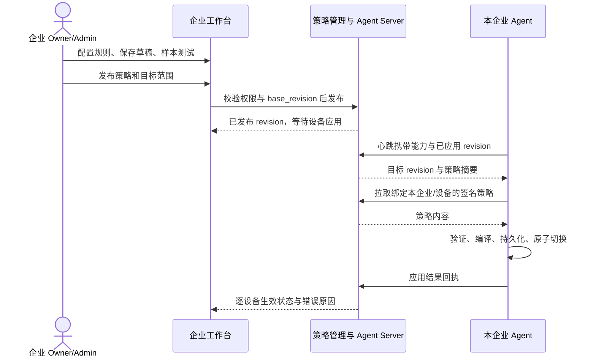
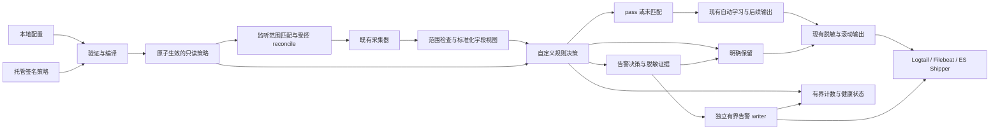
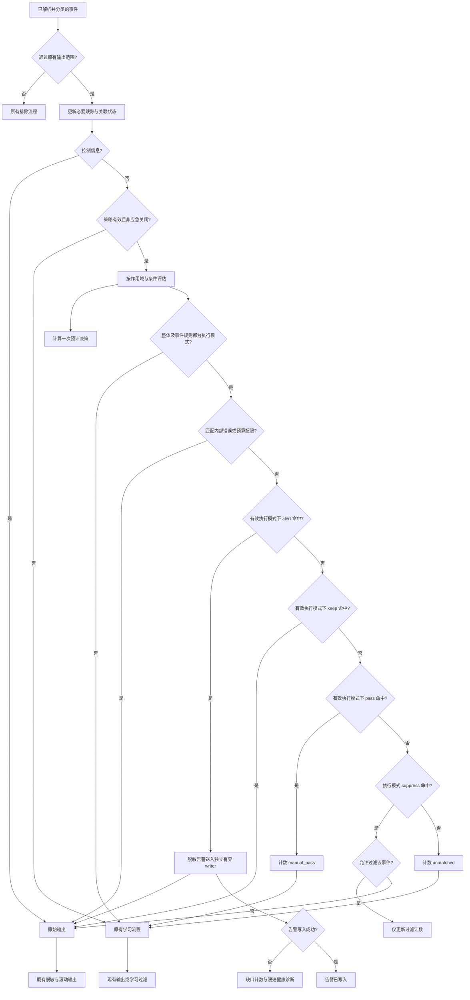

# 企业 Agent 采集自定义白名单设计

**语言：** [English](custom-whitelist-design.md) | 简体中文（本文）

**状态：A 方案已实现 R1（Agent 0.3.97 / Agent Server rc.84 / Server rc.135）。** 本文保留完整设计及后续扩展，当前支持的配置、命令和限制以[R1 实施指南](custom-collection-rules.zh-CN.md)为准。快照过滤、离线托管下发及扩展 explain 命令不属于 R1。

**本次需求修订：** 事件规则支持“告警并记录”“不记录日志”“强制记录日志”“继续后续处理”四种动作。“强制记录”跳过学习过滤，pass 交给后续学习/输出链路。四种动作及优先级已实现于 R1。

## 1. 目标与使用方式

用户知道某类行为属于正常业务，或希望对特定行为告警时，可以直接定义规则，无需等待重复 5 次或重新学习。规则既能精确匹配多个字段，也能表达路径前缀、命令正则、端口范围、IP 网段和保留例外。Linux、Windows 使用相同规则语法，ES 和 SLS 使用相同 Agent 决策引擎。

企业白名单统一管理两类规则：**事件处理**对已采集事件选择告警、不记录、强制记录或继续处理；**监听采集范围**合并原 whitelist_ports，决定哪些本机监听端点不作为 Linux 进程树监控根。两者都不表示允许进程执行、允许访问网络或认定事件安全。自定义事件决策在必要跟踪/关联、源范围检查及风险分类之后、学习过滤之前执行；它不恢复源侧未采集/已排除的事件。未匹配的事件继续走现有学习和输出链路，不等于强制保留。过滤或排除期间缺失的原文不会另外保存，规则撤销只能恢复后续采集/输出，不能恢复历史。

| 界面动作 | action | 原模块 JSONL | 自定义风险告警文件 | 自动学习 |
|---|---|---|---|---|
| 告警并记录 | alert | 保留原事件一次 | 写入一条结构化告警 | 跳过训练和过滤 |
| 不记录日志 | suppress | 不写原事件 | 不生成告警 | 跳过训练和过滤；只更新聚合计数 |
| 强制记录日志 | keep | 保留原事件一次 | 不生成告警 | 跳过训练和过滤 |
| 继续后续处理 | pass | 由后续学习/输出链路决定 | 不生成告警 | 按既有配置参与训练/过滤 |

“原事件”仍须经过既有脱敏和滚动输出；不是明文保存口令/token。“不记录”只省略业务事件，不关闭审计、健康、源故障或聚合统计。pass 不承诺有日志：学习名单生效时仍可能过滤；没有学习机制或学习未启用的事件继续原输出链路。观察模式只计算四种动作的预计结果，不生成真实风险告警、不改变原事件输出。

建议日常操作：选择事件类型和动作 → 组合字段 → 用样本测试 → 在目标设备观察 → 检查预计告警/减量和误命中 → 启用执行。已有学习白名单继续独立运行，用户自定义规则不修改“一小时内 5 次相同事件”的学习算法。

**企业级管理要求：每个企业的 Owner/Admin 必须能在企业工作台配置本企业白名单并发布下发，不需要平台管理员逐条代配，也不要求登录客户主机修改文件。** 托管场景以界面配置和服务端分发为主要入口；本地文件仅用于离线/本地管理场景和诊断。企业之间的规则、样本、统计和设备范围完全隔离。

| 需求编号 | 要求 |
|---|---|
| WL-01 | 单条规则支持多个字段、AND/OR/NOT、正则、数组和网段条件 |
| WL-02 | 支持 alert/suppress/keep/pass；告警和强制记录覆盖学习过滤，pass 交给后续链路 |
| WL-03 | 支持观察与执行两种模式、启停、有效期、版本回退 |
| WL-04 | 事件过滤不改变源范围、跟踪和游标正确性；监听范围规则通过受控 reconcile 调整监控根 |
| WL-05 | 本地配置适配离线 ES；企业工作台管理适配托管环境 |
| WL-06 | 缺失字段、无效策略、断网和资源超限不导致新增静默丢日志 |
| WL-07 | 可以解释为什么命中或未命中，统计减量，审计策略变更 |
| WL-08 | 有界资源、一次编译、并发热切换；旧 Agent 不被强制升级 |
| WL-09 | 企业 Owner/Admin 可在界面配置、测试、发布本企业策略，并查看逐设备下发/生效结果 |
| WL-10 | 将 whitelist_ports 合并为同一企业策略中的监听范围规则，统一管理、下发、审计和回退 |
| WL-11 | 告警同时写入独立 custom-risk-alert.log 并保留原事件，统一脱敏、滚动、权限、上传和失败可观测性 |

## 2. 现有能力与拟新增能力

现有[自动学习](behavior-learning.zh-CN.md)支持 Linux/Windows exec、file_op、Windows active_connect 和普通 PowerShell 脚本事件的精确行为名单。快照使用既有基线/增量机制。whitelist_ports 在新设计中迁移为统一企业白名单的监听范围规则，保留原来的监听排除语义，不能直接等价为事件 listener_port 过滤。模块严重级别筛选及其他既有进程排除保持原有职责。

拟新增的事件处理范围如下，各类已接入事件可使用四种动作。只有已经产生的标准化事件可以被匹配；告警规则不会安装 Sysmon、扩大原有 audit 采集范围、恢复源筛选排除的事件或补齐缺失字段，也不能越过源模块原来的严重级别阈值。监听范围规则单独调整已存在的 Linux 监听监控根及其规则，见第 7.4 节。

| 事件范围 | 对应模块或资产 | 自定义规则用途与前提 |
|---|---|---|
| exec、file_op、active_connect | Linux audit-port-execmon；Windows 证据 reader | 按进程、命令、文件、目标地址组合匹配；Windows 网络/文件须已有对应 Sysmon 事件 |
| Linux 系统与认证风险事件 | syslog-risk-json | 按 program、event_type、user、src_ip、message 等匹配；high/critical 默认保护 |
| Windows 系统与认证风险事件 | windows-eventlog-risk-json | 按 provider、channel、事件编号、user_sid、command 及原生 fields 匹配 |
| persistence_change | host-persistence / host_persistence | 已知持久化路径的精确例外；变化事件默认保护 |
| process_snapshot、process_start、process_exit、process_change | host-process-snapshot / host_process | 排除明确的业务噪声；不能破坏完整快照与变化语义 |
| 端口、身份、服务、任务、内核、容器快照及变化 | host-state-snapshot / host_socket、host_identity、host_service、host_kernel_context | 快照可减量；身份、服务、任务、内核的变化事件默认保护 |
| 常规内部诊断 | 具备结构化字段的诊断输出 | 仅允许已接入的普通诊断事件；不解析 stderr 文本作为规则输入 |

Agent 授权/升级协议、最小运行健康信息、源故障、规则错误、规则生效回执及快照覆盖声明属于控制信息，不进入这四种事件动作，始终走原控制链路。新生成的 custom_risk_alert 也不重新进入规则引擎或学习，避免递归告警和自过滤。当前 `host_behavior_summary` 的上传开关沿用既有策略，本设计不重新开启它。

**Linux 监听范围不变：** 当前 listener_process 缺失/空白或归属为 unknown 的监听证据在学习和输出前已被排除，自定义 `keep` 规则不能恢复它们。Windows listener_process 是否为空必须依据其事件适配器，不能把空值当成任意进程。见[进程归属](process-attribution.zh-CN.md)。

## 3. 用户看到的规则模型

一条规则只包含“在哪类事件或监听候选中、满足哪些条件、采取什么动作”。不引入脚本执行、SQL、模板变量或跨事件关联语言。

| 字段 | 语义与建议默认值 |
|---|---|
| id、name、description | 稳定规则 ID、显示名称和业务理由；修改保留 ID，复制生成新 ID |
| kind | event_filter（默认）：事件处理；保留此标识以沿用草案配置；listener_scope：监听采集范围 |
| enabled | 默认 false；只有启用且在有效期内的规则参与决策 |
| mode | observe 或 enforce；默认 observe |
| action | event_filter 使用 alert/suppress/keep/pass；listener_scope 使用 exclude_listener/keep_listener；必须明确选择，无默认动作 |
| alert | 仅 action=alert 时必填；title 必填（最多 256 字节），severity 可为 low/medium/high/critical（默认 high），description 可选（最多 1024 字节）；静态文本，不支持模板执行 |
| priority | 0–1000，默认 100；事件动作固定 alert > keep > pass > suppress，仅用于同动作归因；监听保留仍优先 |
| scope.platforms | linux / windows，至少选择一个 |
| scope.modules、scope.event_types | modules 必填；event_filter 必填 event_types；listener_scope 不接受 event_types；均不接受 `*` |
| scope.asset_types | 仅事件规则可用；没有该字段的源事件不匹配此限制 |
| when | 一个条件树，见第 4 节 |
| valid_from、expires_at | 可选 RFC3339 时间，区间为 [开始, 结束)；普通规则可长期有效 |
| allow_protected | 仅事件规则可用，默认 false；过滤默认保护事件需要额外显式授权，见第 6 节 |

策略整体的 `mode=observe` 可以限制全部规则只观察。只有整体和规则均为 enforce 才实际执行 alert/suppress/keep/pass；observe 不写风险告警、不强制保留、不覆盖其他执行规则，也不过滤。策略整体默认关闭，启用后默认 observe，不因 Agent 升级自动开启。非 alert 动作携带 alert 配置、缺少 action 或无效告警严重级别时拒绝整份策略。

同一设备只有一个有效自定义策略。多个业务规则放在同一策略中，禁止本地规则、远程规则和旧版本规则隐式叠加。托管策略的设备/设备组选择在服务端分配层完成；本地部署直接应用到当前主机。

两类规则在同一 rules 数组、同一企业界面、同一 revision 内管理。未指定 kind 的现有草案样例按 event_filter 理解；监听规则必须显式指定 kind=listener_scope。不能在监听规则中使用 command_line、event_type 等尚未产生的事件字段，也不能把事件 keep 误认为恢复已排除的监听采集根。

## 4. 条件语法与精确语义

### 4.1 字段组合

`all` 表示 AND，`any` 表示 OR，`not` 表示 NOT。节点只能是这三种之一或一个字段条件，不允许混合形状。all/any 必须有非空子条件。下面的条件表示：java 或 mysqld 的监听树中，执行了指定健康检查，并且采集到的 UID 不为 0。

```json
{
  "all": [
    {"field": "/listener_process", "op": "in", "value": ["java", "mysqld"]},
    {"field": "/exe", "op": "eq", "value": "/usr/bin/curl"},
    {"field": "/command_line", "op": "eq", "value": "curl -fsS http://127.0.0.1:8080/health"},
    {"not": {"field": "/uid", "op": "eq", "value": "0"}}
  ]
}
```

上述样例仅在 `/uid` 实际存在时成立；字段缺失不会被 NOT 变成“UID 不为 0”。可以用 any 组合两个完整的 all 分支，表达 `(A AND B) OR (C AND D)`。不同字段之间不自动相关联，不支持“与前一条事件相同”或跨数组对象的隐式连接。

字段使用 [JSON Pointer](https://www.rfc-editor.org/rfc/rfc6901)：`/exe` 表示顶层 exe，`/fields/Path` 表示 fields 中的 Path；字段名中的 `~` 和 `/` 分别写为 `~0` 和 `~1`。路径大小写敏感，界面用字段选择器生成路径，用户不必手写。第一版仅允许字段目录中的标量和字符串数组路径，不接受根对象、任意数组下标、JSONPath 通配或未知路径。

字段目录按选定模块/事件展示实际可用字段、类型和完整性，而非一个全平台固定表：

| 事件视图 | 代表字段与实际类型 |
|---|---|
| Linux audit/eBPF 证据 | listener_process、pid_name、exe、command_line、uid、uid_name 为字符串；listener_port/connect_port 为数值；file_paths 为字符串数组 |
| Windows host 证据 | exe、command_line、user、windows_event_id、dst_ip、dst_port 为字符串；关联成功后提供 file_paths 数组 |
| Linux 风险事件 | program、user、src_ip、severity、message 为字符串；fields 下只提供已登记的原生字段 |
| Windows 风险事件 | provider、channel、event_id、user_sid、command、script_sha256 为字符串；字段目录明确原生 fields 中可用的键 |
| 持久化事件 | path、category、persistence_type、action 为字符串；size 为数值 |
| host-process | exe、user、command_hash、cgroup 为字符串；thread_count/rss_bytes 为数值 |
| host-state | entity_type、action、entity_key，以及所选实体的实际字段；端口示例为 listen_address/listen_port |

Linux audit 的用户名称是 uid_name/auid_name，不能套用其他模块的 user；其内部 Fields 不序列化，也不作为可配置任意字段开放。跨模块规则要求字段与类型在所有选定视图中一致，否则拆成不同规则。SLS 的 `__source__`、Project/Logstore 和 ES 索引名属于上传/服务端元数据，不能在 Agent 本地字段条件中使用；按主机限定规则使用设备分配范围。

### 4.2 操作符

| 操作符 | 输入 | 语义 |
|---|---|---|
| eq、neq | 字符串、布尔值或数值 | 完整相等/不等；不把数值字符串自动转换成数值 |
| in、not_in | 同类型非空值列表 | 等于/不等于列表中任一项 |
| prefix、suffix、contains | 字符串 | 前缀、后缀、子串；value 不允许为空 |
| regex | 字符串 | 正则搜索匹配；完整匹配需自行写 `^...$` |
| cidr | IP 字符串 | 位于指定 IPv4/IPv6 网段；无效地址为 unknown |
| gt、gte、lt、lte、between | 数值 | 数值比较；between 的 `[min,max]` 包含两端 |
| exists | 布尔值 | 字段是否存在；存在但为空字符串或 null 仍算存在 |
| is_empty | 布尔值 | 已存在的字符串/数组是否为空；null 和缺失返回 unknown |
| array_any、array_all、array_none | 字符串数组 + item 条件 | 至少一项/所有项/没有一项满足 item；数组必须非空 |
| array_eq | 字符串数组 | 整个数组精确匹配，顺序和重复项均参与比较；可显式匹配 `[]` |

array 的 item 只允许不含 field 的字符串操作符，不再嵌套数组。array_any/all/none 对空数组均返回 false；存在 null、非字符串项或超限元素时返回 unknown，不能跳过坏元素后判定“全部正常”。

普通字符串默认区分大小写，不折叠空白，不替换斜杠，不解析命令，不解码 URL 口令。eq/in/prefix/suffix/contains 可显式指定 `case_sensitive=false`，不改变字段名大小写。regex 用表达式中的 `(?i)` 控制大小写，不接受 case_sensitive；数组 item 沿用同一规则。没有通配符操作符：`*` 在 eq 中是普通星号，需要模式匹配时使用 regex。

### 4.3 缺失、类型错误与截断

使用 true、false、unknown 三值逻辑，只有最终结果 true 才命中。NOT unknown 仍是 unknown；AND 中 false 优先，其余有 unknown 则 unknown；OR 中 true 优先，其余有 unknown 则 unknown。未知不会被当成“不等于”“不在列表”或“不是该进程”。

字段未出现、null、类型不符、无效编码或超过检查上限时返回 unknown。配置里未知字段、错误类型和非法操作符在发布/加载时拒绝；事件偶尔缺字段则继续采集，计数 missing_field。允许 `exists=false` 显式匹配缺失，但发布检查必须提示该规则覆盖缺证据事件。

匹配视图应附带字段完整性。源事件明确标记为截断/不完整时，该字段的内容比较返回 unknown，exists 仍可检查存在性；没有完整性标记时只能按实际采集值匹配，不能声称它代表完整原命令。需要完整判断时选择明确暴露的完整性字段；这不改变现有 Linux exec 学习允许截断命令入名单的规则。

不同模块的字段目录声明真实类型与来源。第一版保留现有端口 JSON 字符串为字符串，使用 in 匹配 `"443"`；只对本身为数值的字段提供数值比较。后续数值端口视图必须增加明确的新字段/能力，不能静默改变 `/dst_port` 类型。

### 4.4 正则约定

复用 Go 标准库 regexp 的 RE2 风格语法，不引入 PCRE。支持锚点、分组、选择、字符类、重复和 `(?i)`/`(?m)`/`(?s)`；不支持前后向断言或反向引用。加载时编译，错误返回规则 ID、条件路径和原因。Go regexp 对单个固定表达式的匹配具有随输入长度线性增长的保证，但总成本还受规则数、表达式规模和字段长度影响。[Go regexp](https://pkg.go.dev/regexp)、[RE2 语法](https://github.com/google/re2/wiki/Syntax)。

| 目的 | 表达式文本 | JSON value |
|---|---|---|
| 完整 Linux 临时路径 | `^/var/cache/myapp/[A-Za-z0-9_-]+\.tmp$` | `"^/var/cache/myapp/[A-Za-z0-9_-]+\\.tmp$"` |
| 忽略大小写的 Windows 路径 | `(?i)^C:\\ProgramData\\MyApp\\Cache\\[^\\]+\.tmp$` | `"(?i)^C:\\\\ProgramData\\\\MyApp\\\\Cache\\\\[^\\\\]+\\.tmp$"` |
| 命令中出现健康检查参数 | `--health-check(\s|$)` | `"--health-check(\\s|$)"` |

正则搜索不是完整匹配。例如 `curl` 会命中包含 curl 的更长命令；需要限制整条命令时使用锚点。正则只匹配指定字段，不匹配整条 JSON 或原始 XML。未知/无效 UTF-8 字段不进入正则引擎。

## 5. 策略配置与规则样例

### 5.1 完整策略

拟新增顶层配置 `collection_whitelist`，统一包含事件四动作和监听采集范围，与 behavior_learning 独立：

```json
{
  "collection_whitelist": {
    "enabled": false,
    "source": "local",
    "policy_file": "/opt/secweaver-agent/etc/custom-whitelist.json",
    "apply_to_backfill": false
  }
}
```

策略的 schema_version 固定为 1，policy_id 稳定，revision 为单调递增的正整数；mode 默认 observe，rules 必须为数组，空数组表示没有规则。allow_protected_suppression 默认 false。策略可额外设置 valid_from/expires_at，约束整份策略；规则有效期不能超出策略有效期。重复 JSON 键、未知配置字段和重复规则 ID 均拒绝。

本地策略文件完整示例：

```json
{
  "schema_version": 1,
  "policy_id": "wl-business-noise",
  "revision": 1,
  "mode": "observe",
  "allow_protected_suppression": false,
  "rules": [
    {
      "id": "java-health-check",
      "name": "Java application health check",
      "description": "Confirmed loopback health check from the application service",
      "enabled": true,
      "mode": "enforce",
      "action": "suppress",
      "priority": 100,
      "scope": {
        "platforms": ["linux"],
        "modules": ["audit-port-execmon"],
        "event_types": ["exec"]
      },
      "when": {
        "all": [
          {"field": "/listener_process", "op": "eq", "value": "java"},
          {"field": "/pid_name", "op": "eq", "value": "curl"},
          {"field": "/exe", "op": "eq", "value": "/usr/bin/curl"},
          {"field": "/command_line", "op": "regex", "value": "^curl -fsS http://127\\.0\\.0\\.1:8080/health$"}
        ]
      }
    },
    {
      "id": "keep-sensitive-commands",
      "name": "Keep shell and credential operations",
      "description": "Retain investigation evidence even if a learned entry matches",
      "enabled": true,
      "mode": "enforce",
      "action": "keep",
      "priority": 100,
      "scope": {
        "platforms": ["linux"],
        "modules": ["audit-port-execmon"],
        "event_types": ["exec"]
      },
      "when": {
        "any": [
          {"field": "/exe", "op": "in", "value": ["/bin/bash", "/usr/bin/sshpass"]},
          {"field": "/command_line", "op": "contains", "value": "/etc/shadow"}
        ]
      }
    }
  ]
}
```

整体 observe 时两条规则都只记录预计命中，原来的学习行为不变。整体改为 enforce 后，健康检查可立即过滤，无需等待学习；保留例外命中时直接保留并跳过学习过滤。

### 5.2 Linux/Windows 文件操作

下面是规则片段，放入完整策略的 rules 数组。只过滤目标应用对非空缓存路径列表的访问。array_all 避免“一个正常缓存文件 + 一个敏感文件”被一起过滤。

```json
{
  "id": "linux-application-cache",
  "name": "Application cache files",
  "description": "Only the application cache directory",
  "enabled": true,
  "mode": "observe",
  "action": "suppress",
  "scope": {"platforms": ["linux"], "modules": ["audit-port-execmon"], "event_types": ["file_op"]},
  "when": {
    "all": [
      {"field": "/listener_process", "op": "eq", "value": "java"},
      {"field": "/exe", "op": "eq", "value": "/opt/myapp/bin/cache-worker"},
      {"field": "/file_paths", "op": "array_all", "item": {"op": "prefix", "value": "/var/cache/myapp/"}}
    ]
  }
}
```

Windows 使用对应 reader 和目标程序路径；不要求 Linux 监听根归属：

```json
{
  "id": "windows-application-cache",
  "name": "Windows application cache files",
  "description": "Only known application temporary files",
  "enabled": true,
  "mode": "observe",
  "action": "suppress",
  "scope": {"platforms": ["windows"], "modules": ["windows-eventlog-risk-json"], "event_types": ["file_op"]},
  "when": {
    "all": [
      {"field": "/exe", "op": "eq", "value": "C:\\Program Files\\MyApp\\worker.exe", "case_sensitive": false},
      {"field": "/file_paths", "op": "array_all", "item": {"op": "regex", "value": "(?i)^C:\\\\ProgramData\\\\MyApp\\\\Cache\\\\[^\\\\]+\\.tmp$"}}
    ]
  }
}
```

路径按源事件提供的文本匹配，不能据此证明真实文件没有符号链接、junction 或挂载跳转。本设计不在事件热路径访问文件系统解析真实路径。

### 5.3 Windows 网络事件：字段组合与网段

```json
{
  "id": "windows-business-api",
  "name": "Known internal application API",
  "description": "Application HTTPS traffic to the dedicated API subnet",
  "enabled": true,
  "mode": "observe",
  "action": "suppress",
  "scope": {"platforms": ["windows"], "modules": ["windows-eventlog-risk-json"], "event_types": ["active_connect"]},
  "when": {
    "all": [
      {"field": "/exe", "op": "eq", "value": "C:\\Program Files\\MyApp\\worker.exe", "case_sensitive": false},
      {"field": "/protocol", "op": "eq", "value": "tcp", "case_sensitive": false},
      {"field": "/dst_ip", "op": "cidr", "value": "10.20.30.0/24"},
      {"field": "/dst_port", "op": "in", "value": ["443", "8443"]}
    ]
  }
}
```

IPv4 与 IPv6 按地址族匹配，IPv4-mapped IPv6 先明确 unmap；带 zone 的链路本地地址须由适配器明确暴露规范地址，否则 unknown。不以“所有内网流量”或“所有 dockerd/java”作为预置白名单。

### 5.4 Windows sys-messages：指定脚本命令

```json
{
  "id": "windows-approved-inventory-script",
  "name": "Approved inventory script",
  "description": "Exact known script fragment for inventory collection",
  "enabled": true,
  "mode": "observe",
  "action": "suppress",
  "scope": {"platforms": ["windows"], "modules": ["windows-eventlog-risk-json"], "event_types": ["powershell_script_block"]},
  "when": {
    "all": [
      {"field": "/provider", "op": "eq", "value": "Microsoft-Windows-PowerShell"},
      {"field": "/channel", "op": "eq", "value": "Microsoft-Windows-PowerShell/Operational"},
      {"field": "/event_id", "op": "eq", "value": "4104"},
      {"field": "/user_sid", "op": "eq", "value": "S-1-5-18"},
      {"field": "/command", "op": "eq", "value": "Get-CimInstance -ClassName Win32_OperatingSystem"}
    ]
  }
}
```

当前风险输出的 event_id 是 Windows 编号字符串，证据输出使用 windows_event_id，不能混用。当前 script_sha256 对应输出的脚本片段，不能称为完整多分片脚本哈希。要匹配整段脚本身份，必须后续提供独立的完整脚本视图/能力；第一版不隐式复用学习器内部状态。命中已识别 high/critical 脚本仍受第 6 节保护。

### 5.5 host-process：只过滤普通基线项

```json
{
  "id": "process-baseline-known-worker",
  "name": "Known worker baseline entries",
  "description": "Reduce routine full inventory; retain starts, exits and changes",
  "enabled": true,
  "mode": "observe",
  "action": "suppress",
  "scope": {"platforms": ["linux"], "modules": ["host-process-snapshot"], "event_types": ["process_snapshot"]},
  "when": {
    "all": [
      {"field": "/exe", "op": "eq", "value": "/opt/myapp/bin/worker"},
      {"field": "/user", "op": "eq", "value": "myapp"},
      {"field": "/thread_count", "op": "between", "value": [1, 32]}
    ]
  }
}
```

常规快照未携带 command_line 时不能用 command_line 规则；可使用已提供的 command_hash。过滤基线必须同时提供第 8 节的覆盖声明，下游不能将缺失项判断为进程已退出。

### 5.6 告警规则、文件与记录格式

例如 Java 监听进程树执行读取 `/etc/shadow` 的命令时，保留原 exec，同时产生自定义告警。下面是规则片段，观察模式下只显示预计告警，整体和规则切为 enforce 后才写告警：

```json
{
  "id": "alert-java-shadow-access",
  "name": "Java service reading password hashes",
  "description": "Retain evidence and raise a custom risk alert",
  "enabled": true,
  "mode": "observe",
  "action": "alert",
  "priority": 200,
  "alert": {
    "title": "Java service reading password hashes",
    "severity": "high",
    "description": "Investigate this command in the service process tree"
  },
  "scope": {"platforms": ["linux"], "modules": ["audit-port-execmon"], "event_types": ["exec"]},
  "when": {
    "all": [
      {"field": "/listener_process", "op": "eq", "value": "java"},
      {"field": "/exe", "op": "eq", "value": "/usr/bin/cat"},
      {"field": "/command_line", "op": "contains", "value": "/etc/shadow"}
    ]
  }
}
```

自定义风险文件使用独立 JSONL 输出，不混入 internal-diagnostic_log 或 host_behavior_summary：

| 平台 | 默认文件 |
|---|---|
| Linux | `/opt/secweaver-agent/logs/custom-risk-alert.log` |
| Windows | `C:\ProgramData\SecWeaver\Agent\logs\custom-risk-alert.log` |

路径跟随实际安装根目录的 logs；只有本地主机管理员/安装配置可改变输出目录，企业规则不能指定任意文件路径。文件名由 Agent 固定生成，不使用规则名或事件字段拼接路径。所有规则共享此文件，不为每条规则创建文件。拟新增 `collection_whitelist.alert_output` 本地配置，默认 `max_size_mb=100`、`max_backups=5`、`queue_capacity=1024`、`queue_max_bytes=8388608`；它不属于企业 rules 的可编辑字段。当前文件和滚动备份都受磁盘保护；Linux 权限 0600，Windows 使用管理员/SYSTEM ACL，与既有输出要求一致。

生成的记录样例如下，字段是拟新增契约，不能冒充已有 syslog 风险记录：

```json
{
  "schema_version": 1,
  "event_type": "custom_risk_alert",
  "asset_type": "custom_risk_alert",
  "event_id": "ca_example_0001",
  "timestamp": "2026-10-13T08:30:00Z",
  "generated_at": "2026-10-13T08:30:01Z",
  "enterprise_id": "ABCDEF1234567890",
  "device_id": "swd_EXAMPLE",
  "host_name": "example-host",
  "host_ip": "192.0.2.10",
  "platform": "linux",
  "origin": "custom_rule",
  "severity": "high",
  "title": "Java service reading password hashes",
  "description": "Investigate this command in the service process tree",
  "policy_id": "wl-business-noise",
  "policy_revision": 2,
  "rule_id": "alert-java-shadow-access",
  "rule_name": "Java service reading password hashes",
  "source_module": "audit-port-execmon",
  "source_event_type": "exec",
  "source_event_id": "audit:example:42",
  "backfill": false,
  "source_event_truncated": false,
  "source_event": {
    "event_type": "exec",
    "listener_process": "java",
    "pid_name": "cat",
    "exe": "/usr/bin/cat",
    "command_line": "cat /etc/shadow"
  }
}
```

timestamp 使用源事件时间；不存在或无法解析时用生成时间，并增加 `source_time_unavailable=true`，不能编造源时间。generated_at 是实际生成时间，均为 RFC3339。严重级别默认 high，最终值取配置值与源事件已识别严重级别中的较高者；源未提供严重级别时使用配置值，不降低已有 critical 风险。原模块 JSONL 保持原事件类型和既有数据格式，不改为 custom_risk_alert。

同一源事件只选一条最终告警规则，生成一条告警并保留一条原事件；不同源事件即使字段完全相同，也分别记录，不默认去重或聚合。告警 event_id 由设备身份、稳定源记录标识、策略 revision 和最终 rule_id 确定，重试同一次告警沿用 ID；有原生唯一标识时作为 source_event_id，没有时由适配器提供可用的稳定来源位置，否则生成本次处理 ID 并声明 `idempotency_scope=attempt`，不承诺跨重启去重。仅内容哈希不能替代记录身份。匹配详情供样本解释使用，不为每个事件上传完整条件树。

source_event 保存经统一脱敏的原事件证据副本，整个告警最多 32 KiB；超限时按固定字段优先级保留来源/进程/路径等证据，标记 source_event_truncated=true 和 omitted_fields，不截断 JSON 字节形成坏行。告警标题、说明及规则名称同样脱敏；不得在风险文件、原模块文件或诊断中额外泄露口令、URL 编码口令、sshpass 参数和 token。未截断的原事件仍按原输出约束写入，不受告警副本大小影响。

告警文件由单个有界 worker 独占写入、轮转和关闭，复用现有输出的身份注入、脱敏、磁盘保护和滚动组件；队列同时受条数和总字节限制，不按规则/事件创建线程。告警记录直接写入文件而不等待聚合摘要周期；只有 writer 确认写入成功才计入 alert_written，入队只计 alert_queued。普通写入不承诺每条 fsync，异常断电仍可能损失尾部记录。正常关闭最多用 5 秒排空队列，剩余记录计为未完成，不伪装已落盘。

原事件与告警是两个输出，没有跨文件原子提交或 exactly-once 保证。队列满、磁盘保护、权限错误或写入失败时仍尝试正常记录原事件，跳过学习过滤，记录 alert_write_failed/alert_delivery_gap 的聚合健康状态和限速诊断，Agent 保持运行；原事件本身写入失败也必须单独报告，不能用“告警入队”冒充完整处理成功。无界重试、临时目录无限积压和静默把失败改成 suppress 均禁止。重复告警可由下游按 event_id 去重，实际记录率及失败数独立展示。

**上传契约：** ES/SLS 使用同一告警格式，通过 Filebeat/ES Shipper/Logtail 独立采集 custom-risk-alert.log，并接入专门的索引/Logstore、DataAsset schema/查询和风险分析技能；不能只建文件就宣称已经入云，也不复用已停用的行为摘要。首版新增能力 `custom-event-alert-v1`，其中声明告警格式和本地输出能力，上传路由就绪状态另报。托管策略发布前必须验证目标安装模式具备该动作和所需上传路由；旧 Agent 不收到 alert，不静默降为 keep/suppress、不强制升级。离线 ES/本地模式允许先保存文件，上传须另行接入；Doctor 区分匹配、入队、写入、shipper 路由和云端可验证状态。

### 5.7 继续后续处理：pass

例如希望健康检查仍由学习器判断，而不被更宽的业务 suppress 规则直接丢弃，可增加下面的规则片段：

```json
{
  "id": "pass-health-check-to-learning",
  "name": "Let learning handle this health check",
  "description": "Continue existing learning instead of manual suppression",
  "enabled": true,
  "mode": "enforce",
  "action": "pass",
  "priority": 100,
  "scope": {"platforms": ["linux"], "modules": ["audit-port-execmon"], "event_types": ["exec"]},
  "when": {
    "all": [
      {"field": "/listener_process", "op": "eq", "value": "java"},
      {"field": "/exe", "op": "eq", "value": "/usr/bin/curl"},
      {"field": "/command_line", "op": "eq", "value": "curl -fsS http://127.0.0.1:8080/health"}
    ]
  }
}
```

pass 是自定义阶段的最终动作，不是“跳过本规则再执行下一条自定义规则”，也不重新进入同一规则引擎。无 alert/keep 命中时，pass 覆盖同时命中的 suppress，事件进入现有学习/输出链路；因此不宜配置过宽的 pass。学习器未启用时继续原输出；已启用时，是否训练、是否已入名单以及是否过滤均由其既有状态与保护约束决定，pass 不开启/重置学习、不延长学习期、不撤销现有名单。

未匹配自定义规则也进入同一后续链路，但统计为 unmatched；显式 pass 统计为 manual_pass，并注明命中规则。两者都不等于“已写入日志”，实际学习过滤/原始输出另行统计。运行异常时第 9 节的强制保留降级不是 pass，不能用这个动作让异常事件被学习器再次过滤。

## 6. 事件处理的冲突顺序、保护与学习关系

决策顺序固定，不让用户猜测哪条规则最后生效：

1. 原采集范围检查、内部跟踪/关联、风险分类完成；不属于输出范围的事件按原逻辑处理。
2. 控制信息强制保留，不进入可过滤集合。
3. 有效 enforce 的 alert 规则命中：生成一次自定义告警并保留原事件，跳过自定义 suppress 和学习训练/过滤。告警输出失败仍保留原事件并报告缺口。
4. 没有 alert 时，有效 enforce 的 keep 规则命中：保留原事件，跳过自定义 suppress 和学习训练/过滤。
5. 没有 alert/keep 时，有效 enforce 的 pass 规则命中：计数 manual_pass，结束自定义决策，交给现有学习/输出链路；不生成告警，也不强制保留。
6. 没有 alert/keep/pass 时，对 suppress 规则逐条确认条件与保护授权。high/critical、持久化变化、身份/服务/任务/内核变化默认不能过滤；默认保护命中时保留且跳过学习过滤。
7. 合法 enforce suppress 命中：计数并停止原始输出，不送入学习训练或匹配，不逐事件写“已过滤”日志，也不生成告警。
8. 未匹配事件计数 unmatched，继续现有学习，再输出、脱敏和滚动写入。observe 只计算“预计自定义决策”，不改变这些步骤、不生成风险告警。

事件动作顺序固定为 **alert > keep > pass > suppress**；未匹配默认沿用原链路。priority 不能让 suppress 覆盖前三种动作，也不能让 pass 覆盖 alert/keep。同行为多条规则命中时，priority 高者归因为决策规则；相同优先级按 id 字节序升序取一条。多个规则不会把同一事件计成多条决策或重复告警。observe 统计按全部当前有效规则的完整假设执行计算，一次只归因一个预计动作；混合模式的实际决策只考虑 enforce 规则，观察中的 alert/keep/pass 不能阻挡正在执行的 suppress。

**保护例外：** 用户确实需要过滤默认保护的业务事件时，策略 `allow_protected_suppression=true` 和该条 suppress 的 `allow_protected=true` 必须同时显式启用，填写业务理由及 expires_at，规则有效期最长 7 天。企业 Owner/Admin 单人操作即可，必须记录变更审计，不要求二人审批。控制信息始终不能覆盖。保护仅基于已有分类和明确事件族，不承诺对普通 exec 自动识别所有攻击。

**学习独立性：** 发布、停用和回退自定义策略不改变学习 generation、健康学习时长、候选或已入名单。alert/keep 命中的事件不训练，防止手工撤销后立即被新学出的名单过滤；此前已经存在的学习条目仍保留，规则撤销后可重新生效。已有学习名单不能挡住有效 alert/keep。想恢复所有原文时，需同时关闭自定义过滤与学习过滤，或发布覆盖目标事件的 keep 规则；想重新学习则使用现有学习重置流程。

pass/未匹配事件才交给后续学习链路，且只交给一次；不支持学习的事件族继续既有输出。规则命中统计和学习过滤统计属于不同阶段，manual_pass 后被学习过滤可分别计数，不能当成自定义 suppress；它也不覆盖控制保留、源分类或学习器现有的高风险保护。

所有降级恢复原文都只发生在当前源筛选范围内。没有有效自定义策略时不执行 alert/suppress/keep/pass，但既有学习仍按其原配置运行；有效策略评估时的引擎故障则按第 9 节强制保留本条事件，不能再被学习过滤。doctor 必须清楚显示策略加载与运行故障以及学习的独立状态。

## 7. 本地与企业工作台管理

### 7.1 本地/离线配置

Linux 默认文件：`/opt/secweaver-agent/etc/custom-whitelist.json`；Windows 默认文件：`C:\ProgramData\SecWeaver\Agent\etc\custom-whitelist.json`。Windows 跟随实际 ProgramData 和 Agent 安装根目录，自定义安装根目录使用同一根目录下的 etc。Linux 策略权限 0600，仅 root 写入；Windows 使用管理员/SYSTEM ACL。本地模式由主机管理员维护，不强制云端签名或联网。

拟新增命令如下，**当前版本尚不存在**：

```text
secweaver-agent whitelist validate --file <policy.json>
secweaver-agent whitelist test --file <policy.json> --events <sample.jsonl> --explain
secweaver-agent whitelist test --file <policy.json> --listeners <listener-sample.jsonl> --explain
secweaver-agent whitelist install --file <policy.json>
secweaver-agent whitelist install --file <policy.json> --migrate-legacy-ports
secweaver-agent whitelist disable
secweaver-agent whitelist status --json
```

test 默认离线，不注册设备、不写真实输出、不修改学习状态；结果包含样本总量、匹配规则、保护拦截、字段缺失、预计告警/过滤/强制记录/pass 及未匹配数量。pass 的实际学习结果取决于设备当前学习状态，普通样本测试不修改该状态、不承诺可预测云端最终日志量。告警样例只在测试结果中预览，不写真实 custom-risk-alert.log。explain 展示最终动作、是否进入学习及优先级冲突、条件路径和结果，命令、口令、token 按现有脱敏规则隐藏。disable 是当前主机的持久应急覆盖，停止所有自定义动作；托管下发不能静默重新开启，显式解除覆盖后才恢复托管策略。

监听规则用 --listeners 的候选样本验证，不拿已过滤的 exec 历史推断监听覆盖。--migrate-legacy-ports 在本地显式执行第 7.4 节同样的校验与可恢复迁移，不绕过 observe/签名来源/原配置摘要检查。

本地文件更新通过统一验证器和原子替换完成，禁止每条事件重新读文件。安装命令先保存上一有效版本；回退其内容必须生成更大的 revision。

### 7.2 企业工作台

企业工作台必须提供“Agent 采集策略 → 自定义白名单”功能入口；企业 Owner/Admin 可以独立完成配置和发布，不依赖平台管理员手工下发。本文只定义功能要求，界面布局与视觉方案另行设计。

| 操作 | 要求 |
|---|---|
| 新建/编辑/复制/禁用规则 | 字段、操作符和值可视化组合；高级用户可编辑同一 JSON 条件树 |
| 选择事件动作 | 明确展示“告警并记录”“不记录日志”“强制记录日志”“继续后续处理”；alert 展开标题/严重级别/说明，keep 明示跳过学习，pass 明示仍可能被学习过滤 |
| 保存草稿/发布策略 | 两个明确的操作；保存只更新草稿，发布才生成不可变 revision 并进入下发流程 |
| 选择设备 | 企业全部设备、指定设备或已存在的设备组；设备组能力不存在时不声称已支持 |
| 样本测试 | 使用上传的脱敏样本或获授权的已有日志；提示历史样本不能代表全部真实流量 |
| 观察发布 | 默认 observe；显示每台设备实际接收 revision 和兼容性，不把保存等同于全体生效 |
| 切换执行 | 分别显示预计告警量、过滤量、强制记录量、传递量、保护例外和覆盖范围；传递量不能当成日志写入量；首批可只选择指定设备 |
| 停用/回退 | 新 revision 发布；保留历史，不删除审计记录；断网设备显示等待接收 |
| 命中查看 | 最终动作、最近命中、实际/预计减量、告警写入失败、缺字段、保护拦截、有效期和实际应用版本；支持按规则关联查询风险告警 |

本企业 Owner/Admin 可以变更；其他角色按现有权限只读。创建、编辑、测试、发布、复制、导入/导出、停用、回退和查询统计都必须检查企业归属，不能仅隐藏其他企业的界面数据。每次变更记录企业、操作人、时间、理由、旧/新 revision、内容摘要和目标设备范围，明确观察→执行转换、动作/告警严重级别变更与保护覆盖。服务端必须使用已认证的租户/设备身份分配策略，不能信任请求体的企业 ID 做跨租户授权。

远程模式 source=managed。新增能力 `custom-event-whitelist-v1`，基础动作包括 suppress/keep/pass；按 Agent 上报能力下发可用模块、动作、字段和操作符。不支持某动作的设备显式标记不兼容，不静默转换 pass 为 keep/suppress；不支持的旧 Agent 不收到新配置字段，继续原有行为，不得强制升级。能力支持不等于策略已应用，必须有回执。

包含 alert 的策略还需 custom-event-alert-v1 与安装模式要求的上传路由就绪。只有基础白名单能力的 Agent 不能接收 alert 策略；管理端显式显示不兼容设备，不把 alert 静默改写或删除后下发。发布校验包含动作、告警元数据及字段目录，保留旧客户端的注册、心跳、采集和升级协议。

托管策略复用现有远程配置的签名验证、租户/设备绑定和传输机制，按心跳携带 revision/摘要，内容有变化才下载。签名角色使用配置策略的信任用途，不能直接拿 Agent 更新清单私钥作无限通用授权；若现有机制不能覆盖绑定和防回放，实施前须补齐契约。无需建设新的 KMS/签名服务。

托管签名包必须覆盖 policy_id、revision、内容摘要、启停状态、企业/设备分配范围以及 issued_at/valid_from/expires_at。建议有效期 7 天、到期前续发更大的 revision；续期也必须重新签名，不能只用一个未签名心跳延长过滤。整份策略及规则以最早到期时间为准；无法可信判断时间时暂停自定义决策并报告 clock_untrusted。

网络故障继续使用最后有效且未过期策略；到期后停止自定义决策，继续原学习和采集，报告 expired。省略新字段表示保留原配置，停用必须有明确的新 revision。回退提高 revision，不能接受较旧 revision 重放。一个签名 revision 中多个独立规则的到期分别生效。

### 7.3 企业配置到 Agent 生效的闭环

一个企业可以保存多份草稿/历史版本，但每台设备只分配一个有效策略。默认发布范围为“本企业全部兼容设备”；发布页可以显式改为指定设备，界面显示兼容设备、不兼容设备、离线设备和本地管理设备的数量。“全部设备”是持续的企业范围，新注册的兼容 SaaS Agent 自动继承最新已发布策略，不只是发布当时的设备 ID 快照。

新安装的 SaaS Agent 使用托管策略来源，未发布策略时自定义过滤关闭；不要求用户设置 policy_file。明确选择本地管理的设备显示“本地管理”，不被云端策略静默覆盖。离线 ES 的本地入口保留。企业管理员仅能分配本企业策略，本地持久应急关闭仍按第 7.1 节优先。

发布/下发步骤如下：

1. 管理员在界面保存草稿，可继续编辑和测试；现有 Agent 仍使用旧版本。
2. 管理员点击“发布策略”，明确 observe/enforce、目标范围和变更理由；默认 observe。服务端完整校验规则/字段/能力，提示不兼容和保护例外，不能把部分校验失败的策略发布为成功。
3. 服务端以 base_revision 做并发校验，在持久化事务中保存新不可变 revision、目标分配和变更审计，再交给分发流程。重复提交通过幂等标识返回同一次发布结果；并发修改返回可理解的冲突原因，不覆盖他人的新策略。
4. Agent 在下一次成功的已配置心跳中发现目标 revision/摘要变化，拉取绑定本企业和设备的签名策略。无需重启 Agent；不能因每次心跳重复下载未变化内容。
5. Agent 校验签名、范围、有效期、动作能力和资源限额，预检执行模式所需的告警 writer/安装上传路由，完整编译并持久化后原子切换；随后回传 applied 回执。下载成功或保存成功都不等于已生效，writer 初始化失败保留上一有效策略并报告 apply_failed。
6. 企业工作台展示逐设备结果及“已生效 N / 待接收 M / 失败 K”，同时单列不兼容、本地管理及应急关闭设备。管理员可以查看失败原因、调整策略，再发布新 revision。



回执至少包含 device_id、policy_id、目标 revision、实际应用 revision/digest、结果、错误码、应用时间、本地应急状态及 alert_output_ready/alert_route_ready。路由就绪不代表云端已入库，运行期故障另报健康状态。服务端使用认证设备身份关联回执，不能接受跨企业设备 ID。设备列表分别展示“期望版本”“实际生效版本”“最近回执时间”和在线状态；离线不等于应用失败，陈旧回执也不能被展示成刚刚生效。

离线设备保留最后有效策略，恢复连接后直接同步最新目标 revision，不必顺序应用每个旧版本。下载/传输失败使用既有退避和 jitter 重试；同一 revision 的编译错误合并报告，等待修订，不能每次心跳持续刷错。策略发布后不在界面上自动改成“全体已生效”。

停用、删除规则、缩小目标范围及回退也必须发布更大的 revision。被移出范围的在线设备收到明确的 disabled 策略：签名分发包指示 collection_whitelist.enabled=false，并撤销旧有效分配，而不是引入未定义的 mode 值。不能仅因服务端不再返回策略而继续旧过滤；离线设备在恢复连接或旧策略到期后停止旧过滤。停用关闭自定义事件决策，并撤销已迁移的监听排除、受控恢复原基础监控范围；不自动关闭/重置学习名单。未迁移的旧端口配置继续原有行为，无需恢复。无需二人审批，所有上述变更保留企业审计。

### 7.4 将 whitelist_ports 合并进企业采集白名单

**入口与保存方式：** 企业管理员在同一个“自定义白名单”页面选择“事件处理”或“监听采集范围”，端口直接用整数列表/范围控件配置，也可与监听进程、可执行路径、监听地址组合。保存、发布、设备范围、有效期、观察/执行、审计及回执复用同一套流程，不再要求用户维护一个独立的云端 whitelist_ports 开关。监听候选只支持 exclude_listener/keep_listener，不接受 alert/suppress/keep/pass；需要告警时对实际采集的 host_socket 或其他事件设置 alert，不能对尚未采集的 exec 告警。

**现有语义：** Linux listenerMatchesFilter 在 netstat 与 procfs 发现候选时，按 whitelist_ports 排除本机非 loopback TCP LISTEN 端点；IPv4/IPv6 都适用。它不是远程目标端口、不是允许入站的防火墙规则，也不排除 host-state 的端口快照、syslog 认证、host-persistence 等其他模块。按端口排除会减少对应监控根及其后代的 exec/网络/文件证据，不能只在最终 JSON 中做 listener_port 等值过滤来代替。

**第一版适用范围：** listener_scope 仅支持 Linux audit-port-execmon 的 audit/audit_pid/eBPF 后端，协议为 TCP。Windows reader 没有同等监听根机制，不能把它转换成“排除所有同端口网络事件”；Windows/UDP 标记不支持。新增能力 listener-scope-whitelist-v1，独立于 custom-event-whitelist-v1；发布同时包含两类规则时需两种能力，不静默剥掉不支持的端口规则。

监听候选字段目录为 /listener_port（数值）、/listener_address、/listener_process、/listener_exe（字符串）。后者表示已确认监听根的 exe，不是事件子进程 exe；无法获取时为 unknown，不能猜测或排除。支持已有字段操作符及 AND/OR/NOT，端口用 eq/in/between，名字/路径可以用 regex；不对端口运行正则。求值在监听发现阶段，不进入逐事件热路径。

下面的规则片段等价于对这台主机配置 whitelist_ports=[9092,11211]，处于 observe 时只预览排除结果，整体及规则均 enforce 才执行：

```json
{
  "id": "exclude-known-business-listener-ports",
  "kind": "listener_scope",
  "name": "Exclude selected business listener ports",
  "description": "Explicitly approved reduction of listener-root coverage",
  "enabled": true,
  "mode": "observe",
  "action": "exclude_listener",
  "scope": {
    "platforms": ["linux"],
    "modules": ["audit-port-execmon"]
  },
  "when": {
    "field": "/listener_port",
    "op": "in",
    "value": [9092, 11211]
  }
}
```

例如只排除某个 Java 服务的 9092，而不是所有程序的 9092，可在 when/all 中同时添加 listener_port=9092、listener_process=java 及 listener_exe 的精确路径/正则。新增 keep_listener 例外只保留通过原基础发现范围的端点，不能扩大到 loopback、未知归属或原本未选择的端口；其优先级高于 exclude_listener。事件 keep 只作用于已经采集的事件，不能覆盖此阶段的排除。

**多监听与规则所有权：** 排除对象是监听端点。一个 PID 同时监听 9092 和 8443，只排除 9092 时仍监控由 8443 支撑的进程树，不能承诺这个 PID 的事件全部消失。只有根不再被任何保留端点/其他合法归属需要时，才退休其活跃根、后代扩展和 audit/eBPF 资源。共享 exe/PID 规则按引用关系清理，只删除该模块拥有且已无引用的规则；不使用 auditctl -D，不误删持久化或系统规则。

应用时立即安排一次有界 reconcile，不等待下一次完整 5 分钟扫描；不额外引入全量 /proc 高频扫描。后端需要重建时按既有受控模块生命周期执行，不退出整个 Agent、不重启主机。回执只有在事件策略与监听配置均完成应用后才标为 applied；失败保留上一有效版本并尝试恢复旧监控范围，无法确认恢复时标记 apply_failed/degraded，不伪装原子成功。切换前已受理的在途事件按原 generation 完成，回执注明生效时间；既有本地积压/云日志不反向删除。

当前发现函数对“没有监听根”返回错误，实施时必须区分故意排除与采集源故障：候选全部被策略排除是 scope_empty 的正常等待状态，Agent 和其他模块继续运行，后续定时发现仍工作；不能触发无监听根的退出/重启循环。发现不完整或 PID 身份无法确认时，不能据此认定所有端点均已排除并清理仍需监控的根。

**保护边界：** 根排除发生在事件产生前，事件 severity 保护和学习规则无法挽回未采集的证据。发布界面必须预览将失去哪些根/后代监控，要求管理员填写采集范围变更理由；无需二人审批。源认证/持久化等独立模块照常工作，但不能因此宣称该服务的 exec 覆盖仍完整。观察结果统计候选端点/根数量，不能把它称为已过滤的事件数。

**旧配置迁移：**

迁移观察阶段不清空旧字段、不改变当前监听范围。仅事件策略可先发布并保留旧端口行为；已有旧端口的设备首次执行 listener_scope 必须有明确的“迁移并替换”指令，否则回传 migration_required，保留上一有效策略，不静默执行半份新策略。观察回执注明“规则已加载观察，旧端口仍生效”，不冒充已迁移。新安装旧列表为空的设备也记录空列表摘要，可自动完成无旧值的替换。

1. 升级和首次打开界面都不自动清空本地 whitelist_ports。支持的新 Agent 回传当前旧端口列表及摘要，设备页标为“旧配置，尚未迁移”；不支持的 Agent 仍使用原配置。
2. 企业管理员可导入所选设备的旧列表为 listener_scope 规则，查看实际设备差异后发布“迁移并替换”。不同设备的端口列表不能自动求并集，避免扩大其他主机的排除范围；必要时分批指定设备迁移。
3. R1 采用签名的设备级覆盖，校验旧配置摘要后仅在 enforce 下接管监听决策；本地文件保留用于回退，不执行清空。完整列表超过规则限额时拒绝导入，不合并不同主机端口。
4. 签名错误或本地摘要变化时保留原有效策略和本地行为，并回传错误；不执行破坏性的跨文件迁移。
5. 停用、到期或降级后恢复保留的本地端口配置；导入端口明确记录设备范围和企业发布版本。

## 8. 接入架构与数据正确性

### 8.1 模块职责



| 拟新增职责 | 归属及约束 |
|---|---|
| 类型、字段目录、表达式校验与编译 | Agent 独立 pkg/eventwhitelist；不混入 audit 规则管理或 behaviorlearning 状态机 |
| 模块适配器 | 各采集模块暴露结构化只读视图；不在通用 Writer 中反解析 JSON |
| 风险告警输出 | 独立告警 worker 复用 pkg/output，不建立第二套脱敏/轮转；持有源身份与策略快照，单独上报写入/队列故障 |
| 告警消费 | shipper、DataAsset 和分析技能接入 custom_risk_alert；与原事件关联，不能统计成额外一次主机执行 |
| 监听范围匹配与迁移 | 独立字段视图复用匹配器；audit-port-execmon 继续拥有发现、根生命周期、规则清理和后端切换 |
| 策略加载与应用 | Agent 顶层管理；复用配置写锁，避免与远程配置/升级恢复互相覆盖 |
| 托管策略版本、分配与回执 | 独立 Agent Server；复用其配置分发、存储及审计约定 |
| 规则编辑、测试和状态 | 独立 Server 企业工作台；不存储 Agent 更新私钥 |

### 8.2 事件流程



“更新必要状态”遵循采集器原来的事务/写入顺序，不能把尚未可靠处理的整批事件提前提交游标。自定义过滤成功可视为该单条事件已处理；Windows EventRecordID 仍须越过该记录，不能因少写一行而永久重读。alert/keep 的原事件按既有写入/游标契约处理，告警 worker 不拥有源游标；告警失败按第 5.6 节报告缺口，不能阻塞 reader 或永久重读整批。过滤 Sysmon 1 的原始输出也必须先更新 ProcessGuid 命令缓存，否则后续网络/文件证据会失去关联。对保留的监听根，exec/clone 仍驱动进程树跟踪。事件 suppress 仅减少输出/上传；alert 会额外产生告警，不能把告警量算成原始执行次数。监听排除可减少不再需要的监控规则，但不停止 auditd、不阻断执行，也不承诺减少其他系统规则生成的 audit 输入。

host-process/host-state 的比较状态保存完整采集结果，不保存“过滤后的清单”，避免下一轮反复产生假新增/假删除。每个有过滤的快照批次必须输出不可过滤的 `snapshot_coverage` 控制记录：snapshot_id、asset_type、采集总数、原始输出数、自定义过滤数、其他既有省略数、policy_revision 和 `coverage=filtered`。采集总数=原始输出数+自定义过滤数+其他既有省略数，alert/keep 已计入原始输出，pass 按后续实际输出/省略结果归类；告警数量单列，不再次加入此等式。不能修改旧 snapshot_process_count/snapshot_entity_count 把采集总数伪装成上传总数。

下游 DataAsset/技能对 filtered 批次不得把缺项推断为退出或删除。**快照过滤只有在覆盖记录、shipper 路由、资产 schema/查询与 completeness/调查技能均接入后才能开启；缺任一环节则拒绝该快照 suppress 规则并说明原因。** 没有新增通用对象数组匹配或跨事件状态关联。

过滤发生在脱敏输出之前；匹配视图中的原始敏感值只驻留采集流程内存，不记录到诊断日志。托管样本和历史查询通常已经脱敏，测试结果需要标明视图差异；需要精确匹配口令/token 时不建议把秘密写进白名单，使用稳定的程序、路径和非敏感参数组合。

历史回填与实时流共用输出决策，但**默认不对历史回填应用 alert/suppress**，避免首次回填触发半年历史告警或省略调查证据。回填需要显式设置 apply_to_backfill=true，预览预计告警量及过滤量并保留覆盖计数；告警 backfill=true，源时间和生成时间分别保留，不能冒充实时攻击。keep/pass 和保护仍有效；pass 不改变回填链路原有的学习参与方式。不反向删除磁盘已有日志或云端数据。

## 9. 稳定性与性能约束

| 限制 | 第一版建议值/行为 |
|---|---|
| 单策略体积 | 最多 1 MiB，超限整份拒绝 |
| 规则数量 | 最多 256 条，包括两类规则、保留例外和 observe；不得按事件动态新增规则 |
| 条件树 | 深度最多 6；每规则最多 16 个叶子；全策略最多 4096 个叶子 |
| 列表/数组 | 配置 in 列表最多 128 项；事件数组最多 256 项，超限为 unknown |
| 正则 | 每条最多 512 字节，全策略最多 64 个；编译后指令总量上限 32768 |
| 普通匹配值 | 每个值最多 4096 字节；字段路径最多 256 字节 |
| 单事件检查 | 每字段最多 32 KiB，整次评估最多检查 256 KiB 的累计谓词输入；超限执行下述降级 |
| 告警输出 | 单条完整 JSON 最多 32 KiB；队列最多 1024 条且总字节最多 8 MiB；文件 100 MiB、备份 5 个，受统一磁盘保护 |
| 统计维度 | 固定规则 ID/版本，禁止以 PID、命令、源 IP 或正则捕获值创建无界 label |
| 持久版本 | 当前有效版本 + 上一有效版本；托管历史由服务端保存 |

索引先按 platform/module/event_type/asset_type 缩小候选。一次加载完成字段路径解析、正则编译、列表索引和 CIDR 解析；事件路径直接读字段，不做 JSON 序列化再解析、不启动子进程、不访问网络、不写逐事件状态文件。可安全调整 pure AND 条件求值顺序，先判断等值/前缀，再执行正则。

整个事件的 alert、keep 和 pass 评估必须先完成，之后才能决定 suppress；不能命中 pass 就跳过尚未评估的 alert/keep。资源预算超限、匹配内部错误或不确定是否存在更高优先级动作时，**该事件降级为强制记录并跳过学习过滤**，不生成未经完整确认的告警，不返回 pass；不能用已经匹配的 suppress 提前丢弃事件。缺失字段的 unknown 则按第 4 节逻辑正常求值，不等同于引擎故障。不能靠每事件创建 goroutine + 超时来限制正则，否则超时后任务继续运行会耗尽资源。

新策略在旁路完整验证/编译，成功后原子替换只读快照。每条事件固定使用同一个 revision，不混合新旧条件；运行中持有旧快照的事件允许完成，无每事件全局互斥锁。切换失败保留上一有效策略，首次加载失败则禁用自定义决策，不退出 Agent。移除/过期策略明确记录状态，不沿用过期内容。

告警入队时固化最终规则元数据、源身份和 revision，不在 worker 中重新读取“当前策略”判断；切换/停用阻止新事件按旧策略决策，已受理的旧 revision 告警可有界排空并保留旧版本标签。源对象在入队后不可再被采集器修改。队列只保存脱敏后的有界副本，不保留大批原 XML/命令对象；写入错误不反馈为采集模块退出。

签名错误、磁盘写入失败、重复 id、未知字段、错误正则、超过限制均拒绝整份新策略，返回结构化错误，如 `rule=windows-application-cache path=/when/all/1/item/value code=InvalidRegex`。日志只显示脱敏摘要，同一故障合并计数并限速输出，不能因一条错误规则产生海量 internal-diagnostic_log。

## 10. 运维状态与数据量

doctor、健康日志和企业设备页分别展示：enabled、source、mode、policy_id/revision/digest、规则数、应用时间、到期时间、应急关闭、最后错误、预计告警/过滤/强制记录/pass 数、实际最终动作数、unmatched、保护拦截数、缺字段和资源超限数。manual_pass 与后续 learned_suppressed/原始输出分别展示，不把传递数伪装成已写日志数。自定义 filtering_active 与学习 filtering_active 分开命名；alerting_active 单列，不能把只有告警的策略显示成“过滤未生效”。有效 enforce suppress 规则存在表示已具备过滤能力，最近命中为 0 不等于配置失效。监听规则另报 listener_scope_active、排除端点/退休根数量、scope_empty 和 legacy_ports_migration 状态；不与事件过滤数相加。

告警另外报告 alert_queued、alert_written、alert_write_failed（包括入队失败）、alert_queue_depth/bytes、alert_output_ready、alert_route_ready、最近成功写入时间及云端 delivery=verified/unverified/failed。匹配一次 alert 算一次最终动作，保留的原事件不另计 keep，告警写入重试不另算新命中。实际未写入数必须能解释队列中/失败的差额；断电或重启后的计数连续性按窗口规则声明，不能伪装精确。

每个设备每 5 分钟最多一条**聚合** `custom_whitelist_summary`，无计数/状态变化时不写，展示总量及最多 10 条贡献最大的规则计数，其余合并为 other；固定字节上限 16 KiB。单条事件最多归因一次；实际过滤数与自动学习过滤数分别计数。规则完整计数供本地 status/doctor 按需读取，不每规则每事件上传，也不把完整命令样本放进摘要。

摘要写入 Agent 运维健康输出，通过已配置的健康上传通道查询；不复用被关闭的 host_behavior_summary 路由。DataAsset/shipper 增加新控制类型的 schema 和白名单路由后方可声明云端可见。摘要频率和内容不能重新制造减量问题；摘要队列/写入失败不阻塞采集，不改变事件决策，健康状态注明统计窗口不完整。

例如每天 8 万条 exec，suppress 条件覆盖 7 万条，其中 200 条被 keep 保留，40 条被 alert 保留并告警，1,000 条被 pass 交给学习，三者互不重叠。则实际自定义过滤 68,760 条；240 条强制保留，1,000 条 pass 与 10,000 条 unmatched 共 11,000 条继续原学习/输出，另外生成 40 条告警。聚合摘要每天至多 288 条，再加少量状态/覆盖记录；实际上传字节仍须按原始事件和告警大小、剩余学习过滤和 shipper 压缩统计。告警动作会增加数据量，观察页必须提前展示，不能承诺所有规则都能减量。命中率只是规则覆盖指标，不是攻击检测效果。

计数窗口与 revision 绑定，策略切换关闭旧窗口；不把重启前后未持久化计数冒充连续精确总量。禁止用“少了多少云日志”直接等同于白名单过滤，云端延迟和 shipper 故障要单独检查。

## 11. 验证与实施顺序

| 验证组 | 必须覆盖 |
|---|---|
| 匹配 | AND/OR/NOT、嵌套、大小写、空值、missing+NOT、数值类型、IPv4/IPv6、数组含敏感路径、Unicode 与无效编码 |
| 正则 | JSON 转义、搜索/完整匹配区别、Windows 反斜杠、不支持的断言/反向引用、编译限额与长字段 |
| 冲突 | alert > keep > pass > suppress、alert/keep 覆盖学习、pass 覆盖自定义 suppress、观察无真实动作、混合模式独立、优先级并列、保护默认/授权/到期、同事件只计一次 |
| 传递 | pass 与 unmatched 区分、只进入一次后续链路、不继续下一条自定义规则、学习关闭/学习中/名单生效/降级状态、不支持学习的事件族、后续过滤不计作自定义 suppress、不改变学习状态、引擎错误强制保留而不是 pass |
| 告警 | 原事件和独立风险文件均有记录、默认 high 不降低 critical、单事件多规则仅一告警、脱敏/32 KiB/有效 JSON、源身份与重试 ID、文件权限/轮转/磁盘保护、队列满及写入失败保留原文、源游标与 worker 所有权、关闭排空、历史回填开关与时间 |
| 生命周期 | 缺文件、错误签名、损坏策略、原子切换、重启、断网、过期、防回放、应急关闭、回退新 revision |
| Linux | 事件过滤不改变归属/跟踪；监听排除按规则调整根，未知 listener 范围不扩大 |
| Windows | 单 reader 所有权、4688 与 Sysmon、ProcessGuid 缓存、分片脚本、中文事件、过滤后游标继续前进 |
| 快照 | 内部完整比较、覆盖计数闭合、下游不把省略项当退出；缺配套能力拒绝 suppress |
| 运行成本 | 空策略、256 条等值、64 个正则、最大数组/长字段、并发热切换与 24 小时持续输入 |
| 接入/权限 | ES/SLS 同一决策和告警格式、告警 shipper/资产/技能路由、原始执行不重复计数、脱敏差异、旧 Agent、alert 能力不足拒绝、不兼容字段、跨租户拒绝、审计/回执和有界摘要 |
| 企业发布闭环 | Owner/Admin 独立配置/发布、保存不下发、并发与幂等、逐设备 applied 回执、新注册继承、离线恢复、缩小范围明确停用 |
| 监听范围/旧端口迁移 | TCP IPv4/IPv6、netstat/procfs 一致、全部排除正常等待、同 PID 多端口、共享 exe/规则引用、keep_listener、切换失败恢复、移除/到期补齐、旧列表差异与并发摘要、旧 Agent 回退 |

性能验收先记录无白名单基线，再比较 CPU、分配次数、P95/P99 决策耗时、峰值内存和原采集吞吐。要求默认关闭路径无新增表达式执行，评估热路径不读磁盘/编译正则/开启线程，超过预算后原文链路仍能持续工作；具体吞吐门槛以 Linux x86_64/ARM64 与 Windows x64 实机测量确定，不预先宣称减量百分比或零性能开销。

建议实施顺序：

1. 实现独立匹配引擎、字段目录、本地配置、样本测试、observe/enforce 与 alert/suppress/keep/pass、独立告警 writer、doctor 与有界统计；先接入 Linux/Windows host-exec、file_op、active_connect 和风险日志。
2. 接入托管策略、企业工作台动作/字段编辑与样本测试、权限审计、回执、设备分配及应急关闭；同时完成告警的 ES/SLS shipper、DataAsset 和风险技能接入，以及 listener_scope 的后端接入与 whitelist_ports 迁移。先指定设备观察，确认结果后启用；未完成企业管理员“配置→发布→逐设备生效→告警/记录可验证”闭环前，不能宣布托管白名单功能完成。
3. 在 shipper、DataAsset 和技能覆盖声明全部贯通后启用 host-process/host-state 快照过滤，再接入已结构化的常规诊断。

上述能力是拟定需求，不代表当前版本已提供。正式实施须同步各仓库契约、注释、中英文运维文档和回归测试。首次包含该功能的新 Agent 包必须使用新的 canonical VERSION，不得覆盖既有版本；Operator 嵌入新 Agent 时也必须生成新 Bundle 版本。实施前不修改现有学习文档的算法，不自动向存量设备下发过滤策略。
