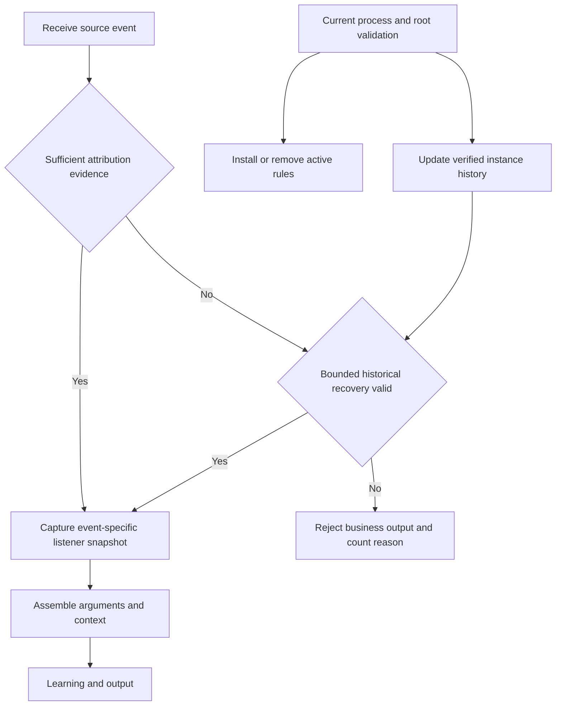

# Linux Process Attribution and Short-Lived Evidence

**Languages:** English (this page) | [简体中文](process-attribution.zh-CN.md)

Agent 0.3.96 separates historical event attribution from current process liveness, retaining the Linux output gate and instance isolation introduced through 0.3.95. A reliably admitted event no longer loses `listener_process` merely because processes exit during assembly. Unproven events still drop before original output, learning and upload. This applies to `audit`, `audit_pid`, eBPF exec and auxiliary audit output, including learning-disabled, raw-detail and final-flush paths. Windows collection is unchanged.

The gate applies to the Agent's listener-event log/stdout and its downstream upload. It does not change the operating system's `/var/log/audit/audit.log`, process/host-state/persistence collectors, or other upload sources. Dropped details are not copied to another diagnostic log, and do not enter learning counters or summaries. Previously written local backlog can still upload after an upgrade; verify events generated after the new collector starts. No automatic historical deletion is performed.

## Meaning of service attribution

`listener_process` / `listener_pid` describe verified listener context, not necessarily the event process's direct parent. `ppid` still describes that parent. Automatic Web backend association requires verified descent. Process names, backend keywords in arguments, executable equality and a shared host do not establish ownership.

For example:

```text
containerd-shim
├── mysqld
└── runc
```

MySQL ownership flows only to confirmed descendants. It cannot promote its parent shim into its own process tree. Here runc is a sibling; targeting the MySQL container does not prove mysqld initiated the call. The process name runc does not establish trust or normal activity. This fix adds neither container-task identification nor runc aggregation/filtering.

## Exec-time parent evidence (0.3.101)

On Linux amd64/arm64, both complete Audit mode with eBPF tracking and eBPF-only
capture the real parent at successful exec. `ppid` no longer comes from the
fork-time owner map, and `ppid_name` is no longer queried through a reusable
`/proc` PID. For `sshd -> bash -> curl`, bash is the direct parent and sshd is
the independently verified listener root. A later exec after reparenting reports
the new real parent without changing the proven service origin. Parent evidence
does not independently authorize listener ownership.

| JSON field | Meaning |
| --- | --- |
| `ppid` | Exec-time parent TGID in the host PID namespace; omitted if unreadable |
| `ppid_name` | Captured parent leader comm (up to 15 bytes), without later `/proc` lookup |
| `ppid_exe` | Complete absolute path relative to the parent's filesystem root; incomplete paths omitted |
| `ppid_start_boot_ns` | Parent boot-time start token in nanoseconds; not event `CLOCK_MONOTONIC` or `/proc` clock ticks; omitted if unavailable |
| `parent_identity_status` | `complete`, `partial` or `unavailable`; complete requires name, nonzero start token and complete path |
| `ppid_exe_status` | `captured`, `truncated` or `unavailable` |

These fields are additive. Audit/Windows events do not claim these eBPF
guarantees. The server protocol, listener gate and four-field exec learning key
stay unchanged; upgrades retain learning state. A parent instance key requires
host identity, the same boot, PID and start token. Bare PIDs and tokens across
boots are insufficient.

Path resolution follows mount transitions with a maximum of 16 steps and a
256-byte buffer (255 data bytes). Existing CO-RE kernel reads avoid requiring
newer `bpf_d_path` helpers. Missing vendor fields, kernel threads with no image,
unreadable paths, concurrent relationship/image changes and exhausted path
budgets remain partial/unavailable; they do not disable exec. This is best-effort
event-time evidence, not an atomic snapshot of all concurrent filesystem
renames. Container/chroot paths are in the parent's own root, not necessarily
accessible directly from the Agent's root.

Older kernels expose the boot-time start token as `real_start_time`; CO-RE
accepts that name as well as `start_boottime`. The differently clocked
`start_time` field is never substituted. Parent name/path bytes retain spaces.

Thread exit is not process exit. `sched_process_exit` checks the thread group's
remaining live count before removing ownership or staged argv. This preserves
nonleader exec while the kernel retires the old leader, and also cleans up when
the last exiting thread is not the leader. Existing task/signal live-count BTF
fields must resolve when loading the object; failure remains an explicit load
error. The kernel test forces nonleader exec to make this regression deterministic.

The snapshot travels inside the event, so parent exit, buffer delay and later
PID reuse cannot replace it with another process's name. Existing CWD/TTY
enrichment remains best-effort `/proc`. The event grows by 288 bytes; a separate
256-byte per-CPU scratch guard helps older verifiers prove helper bounds without
entering the wire record or pending map. Map and queue capacities are unchanged.
The embedded object and Go layout must be regenerated together. Upgrade and
restart the collector; internal maps are not reused across releases.

`go test ./pkg/auditportexecmon ./pkg/processtracker/ebpf` verifies historical
output and object contracts; Linux also runs wire decoding/layout checks.
For actual verifier, parent exit and reparenting validation on an isolated Linux
test host with existing eBPF prerequisites:

```bash
sudo env SECWEAVER_EBPF_PARENT_INTEGRATION=1 go test \
  ./pkg/processtracker/ebpf -run TestParentSnapshotKernel -v
```

The opt-in test attaches temporary programs, creates disposable children and
restores the test process's subreaper setting. It does not change auditd, Agent
configuration, host services or learning state. Without opt-in it skips; after
opt-in actual loading failures must fail the test.

0.3.101 passed 30 native rounds on Kylin V10 x86_64 with kernel
`4.19.90-89.27.v2401.ky10.x86_64`. Each round covers parent exit, reparenting
and over-budget paths while forcing nonleader exec. An isolated eBPF-only
collector also confirmed parent fields in local JSONL. This does not replace
ARM64 native attachment or ES/SLS delivery validation; ARM64 was cross-built only.

## Listener discovery and instance isolation

Discovery first uses `netstat -tlnp`. Command failure, missing PIDs or incomplete parsing trigger `/proc/net/tcp{,6}` plus `/proc/<pid>/fd` socket-inode lookup. The inode is the tenth whitespace-separated TCP field, not a column counted backwards from the end. An unresolved socket is not guessed to belong to sshd merely because its port is 22 or its reported name is systemd/init.

- Each listener PID has an independent root identity. Shared Java/Nginx executables or bind addresses do not merge distinct PIDs. Bootstrap starts at the actual socket owner and expands downward, without seeding all processes running the same executable into one service.
- Executable rules remain a collection optimization, but their hits are only candidates. Both `audit_pid` and auxiliary eBPF audit records require real ancestry and root lifetime validation, rather than an executable's old label.
- Independent PHP-FPM, Gunicorn, Puma and other backends are no longer assigned to the first Nginx/Apache gateway. Only verified descendants inherit it; independent backends need their own discoverable listener root. Independent Unix-socket-only or loopback-only backends are not automatically included. This release adds no explicit proxy-mapping configuration.
- Discovery remains limited to filtered, non-loopback TCP LISTEN sockets in the Agent's network namespace. It does not enumerate every container namespace or equate host NAT/proxies with application roots. The default listener rescan is five minutes.
- When multiple processes share a socket FD, a discovery source may expose only one owner. Other owners are not merged merely by executable equality. Verify the actual master/worker topology; arbitrary shared-FD topologies are not guaranteed complete coverage.

## Event snapshots, active tracking and historical evidence



- **Audit snapshots:** both real readers capture the listener instance and full source transaction at SYSCALL admission, binding PID, PPID, exe, key and syscall. EXECVE/PATH/PROCTITLE add context without resolving today's PID again. Exit, restart or PID reuse during assembly cannot transfer that event to a replacement. Snapshots are trusted in-memory objects; an `attribution_accepted` string in log text is not a snapshot. A conflicting primary rejects the transaction; tails with another timestamp cannot mix into the same serial.
- **Active tracking:** PID, root start time and real ancestry remain validated using uncached `/proc` reads, including before/after rule installation. Historical owners are output-only: they cannot seed descendants or install old rules for a current PID. No uploaded fields or server protocols change.
- **Reparenting:** when the child's PID and start time still identify the same process, a PPID change updates topology without discarding its service origin. A changed or unverifiable child instance is not inferred from the parent change.
- **Transient reads:** fresh proof of the original child/root lifetimes, or captured eBPF root-generation evidence, can recover subsequent events. An already rejected audit transaction is not relabeled by a later recovery; its initial proof was insufficient.

## Bounded history and limits

| Evidence | Recovery conditions | Capacity and expiry |
| --- | --- | --- |
| eBPF root history | Exact captured root PID/start token previously verified by this collector; source time inside that root's collection interval | At most 4,096 root instances; retired history remains eligible for 30s, and event age on the monotonic clock must also be at most 30s |
| Audit process history | Matching parent and source time inside a positively verified interval for the same process; a currently readable PID must retain its start time | At most 16,384 records; expire 30s after the last positive observation; PID/parent/root changes replace or invalidate records |
| Existing short fork proof | Successful clone/fork, matching parent, valid root and original source/receipt checks | Existing 5s window and 16,384-proof limit remain; replayed clones and ordinary exec cannot renew unknown instances |

History is memory-only and local to this collector lifetime, with no database or reuse across restarts. Capacity evicts the oldest record; unavailable evidence causes rejection instead of an unbounded cache or guessed name. Expired records are removed on lookup or periodic cleanup. Snapshots are released with existing assembly transactions (the current expiry window is 10s), without a separate long-lived global event map; cache eviction does not revoke an already captured snapshot.

eBPF compares `CLOCK_MONOTONIC` with kernel event timestamps, never with the opaque `RootStartTime` token. An observed root exit tightens the upper bound to its source time; otherwise, the first observed unreadability or removal from the listener inventory supplies the bound. A readable zombie cannot reactivate an explicitly exited root. Fresh discovery of a process that stops and later resumes listening starts a new interval; recovery never bridges the unmonitored gap, and older events without snapshots may be rejected.

**Audit has no eBPF-style captured process-generation token.** Delayed events inside a positively verified lifetime can survive a process living longer than five seconds. If an event occurs after the last positive observation and both process and parent have exited, a remembered PID alone cannot extend proof. Without a snapshot, valid interval or original short fork proof, it still drops. This avoids reintroducing runc/PID-reuse misattribution and cannot reconstruct all lost kernel events.

History does not automatically expand collection to new events after root retirement. Proven historical events are retained while active rules are cleaned up independently. Shared containers, executable equality, audit keys and sensitive-path watch hits do not prove inheritance. Non-bounded ancestry walks still cap each starting chain at 64 nodes and detect cycles.

## Diagnostic counters

Module stderr emits a changed `listener attribution stats:` aggregate at most once per 30s, plus a final shutdown aggregate. Use the existing module-stderr collection path; this adds no uploadable business log or management-page field.

- `snapshot_saved` / `snapshot_used`: verified snapshots at admission and output.
- `root_history_used` / `process_history_used`: source-time historical recovery.
- `reparented` / `identity_recovered`: same-instance reparenting and recovery.
- `identity_conflict`, `root_unavailable`: instance conflict or unverifiable current root.
- `history_missing`, `history_expired`, `history_evicted`, `history_time_rejected`: missing, expired, capacity-evicted or temporally invalid history.
- `transaction_conflict`, `audit_rejected`, `ebpf_rejected`, `outside_scope`: conflicting transactions, admission/output rejection or out-of-scope candidates.

These count decisions, not deduplicated events; do not sum them into a loss rate. They contain no commands, credentials or rejected event details. Compare learning suppression, kernel lost samples, audit backlog and output volume; zero empty labels does not prove zero missed events.

## Upgrade and canary verification

Upgrade with a new versioned package; never republish changed bytes under an earlier version. A normal upgrade rebuilds in-memory ownership and rules without automatically clearing learning baselines or rewriting previously uploaded logs. 0.3.96 retains more verified historical events without resetting learning state. Missing or incorrect labels in historical events are not rewritten. Check whether previous misattribution affected learning baselines; normal upgrades do not clear them automatically.

Canary on one Linux container host and record the actual backend, version, process start times and before/after windows. Existing `/proc` visibility and audit/eBPF privileges are required. The fix does not require additional Docker management API access.

Verify:

1. Compare simultaneous service-root, runtime-parent and sibling process identities; siblings must no longer inherit Java/MySQL labels.
2. Use an isolated test service to check real children and later generations, including short-lived processes, service restarts and PID reuse.
3. Confirm events without a confirmed listener are absent from original output and the upload stream, while unrelated host traffic remains filtered.
4. Check two independent services sharing one executable, IPv4/IPv6 discovery without netstat, and root PID reuse with delayed events. Commands such as pgrep queries must not become associated backends.
5. Exercise exit during assembly, reparenting, root exit arriving before a delayed exec, same-instance read recovery, capacity/expiry, and rejection outside proven source-time intervals.
6. Compare CPU, memory, output volume, latency and lost/backlog. Output reduction now includes rejected unknown attribution as well as learning suppression; learning counters only cover events admitted to that engine.

Run `make check` from the Agent directory, or `go test -race ./pkg/auditportexecmon` for attribution and `go test ./pkg/processtracker/ebpf` for the embedded-object contract. Linux additionally checks generated Go layouts and event decoding; other developer platforms only parse the object and cannot validate kernel attachment or verifier acceptance. These tests combine synthetic process lifetimes with real event assembly/output; they do not replace audit/eBPF attachment and canary verification on the target Linux host.

If rollback is required, use the existing upgrade recovery workflow to restore the previous complete release and rebuild tracking. Versions 0.3.92/0.3.93 can emit unknown events again; rollback does not retain this output gate. The gate deliberately omits even real service events when their listener identity cannot be established. Rolling back to 0.3.95 restores assembly/historical attribution loss; 0.3.94 also restores listener-identification defects. Upgrade the complete Agent package and restart the collector. 0.3.96 retains the 0.3.95 eBPF object and event layout without regeneration. Internal maps and history are not reused across restarts.
