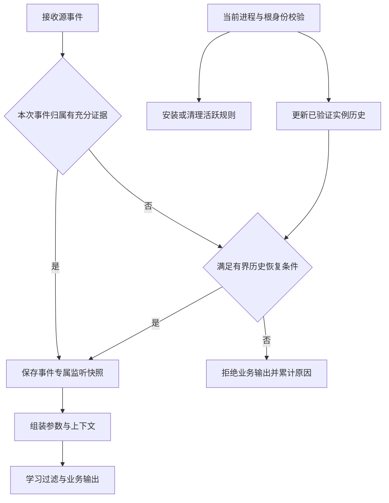

# Linux 进程归属与短命进程证据

**语言：** [English](process-attribution.md) | 简体中文（本文）

Agent 0.3.96 在 Linux 监听事件输出门禁和 0.3.95 实例隔离基础上，分离已发生事件的历史归属与当前活跃进程状态。已经可靠确认的事件，不再仅因组装期间进程退出而丢失 `listener_process`；无法证明归属的事件仍在原始输出、学习和上传前丢弃。适用于 `audit`、`audit_pid`、eBPF 执行及其辅助 audit 输出，包括学习关闭、原始明细和退出刷新。Windows 采集行为不变。

该规则作用于 Agent 的监听事件日志/标准输出及其后续上传，不修改操作系统的 `/var/log/audit/audit.log`、进程/主机状态/持久化采集器及其他上传来源。被丢弃的明细不会转存诊断日志，也不进入学习计数或摘要。升级前已写入的本地积压仍可能在升级后上传，验收应检查新采集器启动后产生的事件；不会自动删除历史数据。

## 服务归属的含义

`listener_process` / `listener_pid` 表示采集器确认的监听服务上下文，不等同于事件进程的直接父进程；直接父进程仍由 `ppid` 表达。自动关联 Web 后端只接受已验证的后代关系；进程名、命令参数包含后端关键词、相同 exe 或共用宿主机都不足以证明归属。

例如：

```text
containerd-shim
├── mysqld
└── runc
```

MySQL 服务根只能向已确认的后代传播归属，不能把父 shim 纳入自己的进程树。这里的 runc 是兄弟进程；它的目标容器可能是 MySQL 容器，但这不足以证明 mysqld 发起了调用。Agent 不因进程名是 runc 而将其列为可信或正常任务；本次没有新增容器任务识别或 runc 汇总过滤。

## 监听发现与实例隔离

监听发现首先使用 `netstat -tlnp`，在命令失败、缺少 PID 或解析不完整时使用 `/proc/net/tcp{,6}` 和 `/proc/<pid>/fd` 的 socket inode 关联。TCP 表的 inode 固定取第 10 个空白分隔字段，不从末尾倒数；无法确认 socket 持有 PID 时不会因为端口为 22、名称为 systemd/init 就猜成 sshd。

- 每个监听 PID 独立建立根身份，相同 Java/Nginx 可执行文件或相同监听地址不会把独立 PID 合并。初始化从实际 socket 持有 PID 开始，再向后代扩展；不会把所有同 exe 进程播种为一个服务。
- exe 规则仍可降低采集规则成本，但命中只代表候选事件。`audit_pid` 及 eBPF 辅助 audit 同样必须验证真实祖先和根生命周期，不能直接返回 exe 对应的旧标签。
- 不再将独立 PHP-FPM、Gunicorn、Puma 等进程自动挂到第一个 Nginx/Apache。只有可验证的后代能继承该网关；独立后端应按自己的可发现监听根采集。仅使用 Unix socket 或 loopback 的独立后端不会因此自动纳入，此版本没有新增显式代理映射配置。
- 当前自动发现范围仍是 Agent 所在网络命名空间内、经过端口过滤的非 loopback TCP LISTEN；不遍历所有容器网络命名空间，也不将宿主机 NAT/proxy 等同于容器应用根。默认监听重扫为 5 分钟。
- 多个进程共享同一个 socket FD 时，发现源可能只提供一个持有者；其他持有者不会仅因 exe 相同就自动合并。需要验证具体 master/worker 拓扑，不能宣称任意共享 FD 拓扑都覆盖完整。

## 事件快照、活跃跟踪与历史证据



- **audit 事件快照：** 两个实际 reader 在 SYSCALL 主记录接收时保存监听实例和完整源事务标识，并绑定 PID、PPID、exe、key 和 syscall。后续 EXECVE/PATH/PROCTITLE 只补充上下文，不重新用当前 PID 查找服务。组装期间父子退出、根重启或 PID 复用，不会把该事件转给新实例。快照仅在内存中生成；日志文本里的 `attribution_accepted` 不能充当快照。冲突主记录会撤销该事件，其他时间戳的同序号尾记录不会混入。
- **当前跟踪：** PID、根启动时间和真实祖先仍需校验；身份检查直接读取 `/proc`，不复用富化缓存。安装规则前后检查身份。历史恢复结果只用于输出，不能据此扩展后代或给当前 PID 安装旧规则。没有增加业务输出字段或服务端协议。
- **重新托管：** 已确认子进程 PID 与启动时间一致时，PPID 改变只更新父子关系，不自动删除历史服务来源。子进程实例已变或不可验证时，不凭父 PID 变化猜测归属。
- **暂时读取失败：** 后续同时确认原子进程及原根实例，或取得 eBPF 的原根代际证据后，可以恢复后续事件。已经被拒绝的 audit 事务不会因后来的状态恢复而补名；它没有充分的初始证明。

## 有界历史恢复的条件与限制

| 证据 | 恢复条件 | 资源与失效边界 |
| --- | --- | --- |
| eBPF 根历史 | 源事件携带精确的根 PID/启动时间 token，且本采集器曾验证对应根；事件时间位于该根采集区间内 | 最多 4,096 个根实例；退休历史有效期 30 秒，事件源时间距当前单调时钟也不得超过 30 秒 |
| audit 进程历史 | 父 PID 一致，源时间位于同一进程实例已被正向验证的时间区间内；当前若存在同 PID，则启动时间必须一致 | 最多 16,384 条；距末次正向验证超过 30 秒失效；PID/父关系/根实例变化会替换或撤销旧记录 |
| 原有短时 fork 证明 | 成功 clone/fork、父 PID 与根校验通过，源时间和接收时间满足原有条件 | 原有 5 秒窗口和 16,384 条上限保留；重复 clone 和普通 exec 不能为未知实例续期 |

历史缓存只驻留在本次采集器内存中，不写数据库或跨重启复用。容量满时淘汰最旧记录；无法还原的事件仍拒绝，不扩大缓存或使用猜测名称。过期记录在查询时或周期清理时回收。事件快照随既有组装事务释放（现有过期清理窗口为 10 秒），不会另建按事件长期保存的全局映射；历史缓存淘汰不会撤销已经保存的快照。

eBPF 使用 `CLOCK_MONOTONIC` 与内核事件时间比较，不能把 `RootStartTime` token 当成纳秒时间。已观察到根 exit 时，以源 exit 时间收紧上界；仅观察到根不可读或从监听清单移除时，以首次观察时间作为上界。已知退出不会因 zombie 的 `/proc` 仍可读取而重新变成活跃根。相同进程停止监听后又被新一次发现确认监听，会开始新采集区间，旧区间不跨越未监控间隙恢复；未保存快照的旧区间事件可能因此被拒绝。

**audit 不具备 eBPF 的源进程代际 token。** 运行超过 5 秒的进程，其已验证存活区间中的延迟事件可由历史恢复；如果事件发生在末次正向验证之后，进程和父进程又都退出，不能仅凭旧 PID 延长证明。缺少快照、有效区间或原短时 fork 证据时仍丢弃。此限制避免重新引入 runc/PID 复用误归属，不能承诺完全恢复丢失的内核事件。

根退出后的新事件不因历史缓存而自动扩大采集范围。已经有充分证明的历史事件保留；活跃规则仍按当前身份和监听发现独立清理。相同容器、相同 exe、audit key 或敏感路径 watch 命中均不能代替继承证据。非有界后端祖先查询仍限制为每条起始链最多 64 个节点并检查循环。

## 诊断计数

模块 stderr 每 30 秒至多输出一条有变化的 `listener attribution stats:`，退出时补充最终汇总。沿用已有模块 stderr 的收集方式查看，未新增上传业务日志或管理页面字段。

- `snapshot_saved` / `snapshot_used`：接收和输出阶段使用的已确认快照。
- `root_history_used` / `process_history_used`：按源时间恢复的历史归属。
- `reparented` / `identity_recovered`：同实例重新托管及身份恢复。
- `identity_conflict`、`root_unavailable`：实例冲突或当前根不可验证。
- `history_missing`、`history_expired`、`history_evicted`、`history_time_rejected`：历史缺失、过期、容量淘汰或源时间不符。
- `transaction_conflict`、`audit_rejected`、`ebpf_rejected`、`outside_scope`：事务冲突、输出/接收拒绝或范围外候选。

这些是判定次数，不是去重后的事件总数，不能相加计算丢失率。计数不包含命令、凭证或被拒绝的明细。应同时对照学习抑制、内核 lost、audit backlog 和输出数量，不能把“空字段为零”理解为没有漏采。

## 升级与灰度验证

使用新版本包升级，不要复用旧版本号发布修改后的二进制。正常升级重建内存中的进程归属及规则，不自动清空现有学习基线，也不修改已经上传的历史日志。0.3.96 改善已验证历史事件保留，不清理学习状态；历史事件中缺失或错误的标签不会被重写。需要检查当前内存/学习基线是否曾受误归属污染；正常升级不会自动清空已有基线。

建议先选择一个 Linux 容器主机灰度，并记录实际后端、版本、进程启动时间和升级前后窗口。需要相应 `/proc` 读取能力，以及既有 audit/eBPF 运行权限；无需为本修复额外开放 Docker 管理 API。

验收包括：

1. 用同一时刻的进程树核实服务根、运行时父进程和兄弟进程，确认兄弟进程不再误标成 Java/MySQL。
2. 在隔离测试服务中验证真实的子进程及多代后代仍能采集，检查短命进程、服务重启和 PID 复用。
3. 检查缺少已确认监听服务的事件不会出现在原始输出或上传流中，同时确认无关主机事件仍被过滤。
4. 验证同一 exe 的两个独立服务、缺 netstat 时的 IPv4/IPv6 监听发现，以及旧事件延迟到达后的根 PID 复用；确认 `pgrep` 查询等命令不会被当作关联后端。
5. 验证组装期间退出、PPID 重新托管、根 exit 先于延迟 exec 到达、同实例读取恢复、历史容量/过期，以及源时间超出证明范围的拒绝。
6. 对比 CPU、内存、输出量、采集延迟及 lost/backlog。日志减量现在同时包含未知归属丢弃和学习过滤；学习计数只覆盖进入该引擎的事件。

源码回归可在 Agent 目录执行 `make check`；针对归属运行 `go test -race ./pkg/auditportexecmon`，针对内嵌对象布局运行 `go test ./pkg/processtracker/ebpf`。Linux 上还会执行生成的 Go 结构与事件解码一致性测试，其他开发平台仅解析对象布局，不能代替内核 verifier/挂载验证。测试包含合成进程生命周期及真实事件组装/输出链路，不替代目标 Linux 主机上的 audit/eBPF 挂载和灰度验收。

若需要回退，按既有升级恢复流程回到上一完整版本并重建进程跟踪。0.3.92/0.3.93 可能重新输出 unknown 事件，回退不会保留本次输出限制。该规则的明确取舍是：即使事件真实来自服务，只要无法确认监听身份，也会丢弃。回退到 0.3.95 会恢复组装期与历史归属丢失问题，回退到 0.3.94 还会恢复监听识别缺口。升级须使用完整 Agent 包并重启采集器；0.3.96 沿用 0.3.95 的 eBPF 对象与内部事件布局，不需要重新生成对象。内部 map 和历史缓存不跨重启复用。
